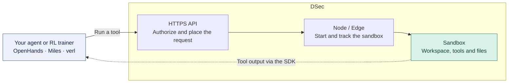

# DSec Reproduce

**A sandbox runtime for teams building tool-using agents and training them with reinforcement learning.**

When a coding agent says “run the tests,” something has to give it a machine, execute its command, and return the output. DSec does that part. It keeps the workspace alive for the next tool call, lets the caller look up an operation after a lost reply, and releases the sandbox when the episode ends. Your agent chooses the actions, your task defines the reward, and your trainer updates the model.



An independent implementation inspired by the DSec paper. **v0.1 is a development preview** for trusted users on Linux KVM hosts. [Paper](https://arxiv.org/abs/2609.22978) · [Validated capabilities](docs/PROJECT_STATUS.md) · [Roadmap](ROADMAP.md)

## Run your first episode

Write `3` to a file inside a MicroVM and have the verifier read it back. Two fixed agent replies drive this example, so you can try the sandbox before choosing a model, GPU or benchmark.

**1. Install the client.** From a terminal with Git and Python 3.11 or newer.

```sh
git clone https://github.com/QingdiMeng/dsec-reproduce.git
cd dsec-reproduce
python3 -m venv .venv
.venv/bin/python -m pip install .
```

**2. Choose your starting point.**

| What you have | What to do |
| --- | --- |
| **Access to a DSec deployment** | Ask the operator for a `client.json` with working credential and CA file references, plus access to a rollout worker serving the `default` environment. Go to step 3. |
| **A Linux x86_64 machine to set up** | Follow the host guide to check KVM, prepare Firecracker and a guest, then start the services and activate the Node. Use the generated `client.json` in step 3. [Single-host setup](docs/guides/QUICKSTART.md#1-install-and-select-external-artifacts) |
| **Only a laptop, no deployment** | Try the local recovery walkthrough below. It uses an in-memory test fixture and runs without a hypervisor or credentials. |

<details>
<summary>Setting up an empty Linux host? Check these three milestones.</summary>

1. **Can your account use KVM?** On the Linux host, run `test -r /dev/kvm && test -w /dev/kvm && echo "KVM accessible"`. If you don't see the message, check virtualization support and your account's KVM permissions before preparing images.
2. **Can one guest run?** Select the Firecracker binary and guest kernel, build the small ext4 guest, and configure the isolated Node instance. Run the guide's `dsec-host smoke` command to verify local execution and cleanup. [Guest build](docs/guides/QUICKSTART.md#2-build-a-fresh-non-tb-smoke-guest) · [Node setup](docs/guides/QUICKSTART.md#3-configure-an-independent-instance)
3. **Can the API place work on that Node?** Start the control plane, join and activate the Node with its Edge and worker sockets, and locate the generated `client.json`. You can now run step 3 below. [Connect the Node to the API](docs/guides/QUICKSTART.md#4-finish-api-deployment-and-run-the-first-workload)

</details>

<details>
<summary>Try request recovery on your laptop</summary>

From the cloned repository, run the following command.

```sh
.venv/bin/python -m unittest -v \
  tests.unit.test_cluster_control.ClusterTests.test_lost_reply_recovers_on_other_controller_without_create_replay
```

Look for `Ran 1 test` and `OK`. The test drops the reply to a create request. A second controller finds the original sandbox by request ID, verifies it is running and stops it. The simulated Edge counts exactly one creation. Step 3 exercises a real MicroVM.

</details>

**3. Run the task.** Replace `/path/to/client.json` with the file from step 2. Use a new output directory each time.

```sh
.venv/bin/python -I tools/verify_rollout_api.py \
  --api-config /path/to/client.json --out ./first-episode
```

**Expected terminal output** `{"status": "passed", "checks": 1}`. Open `first-episode/report.json` and look for `miles_loop_through_api` with `score: 1`. The first reply ran `printf 3 > /rl-counter` in the guest. The second ended the task. If you get `NoPlacement`, check that the Node is active and its rollout worker advertises the required environment. [First-workload checklist](docs/guides/QUICKSTART.md#4-finish-api-deployment-and-run-the-first-workload)

## Choose a workload

| What you want to do | Working example |
| --- | --- |
| Give a coding agent a shell and editor, then score its patch in a fresh workspace | [OpenHands + SWE-Gym](apps/swegym/README.md) |
| Score terminal tasks with their supplied verifiers, or connect Miles | [Terminal-Bench 2.1](apps/tb21/README.md) |
| Train a small model with sandboxed Python rewards and compare held-out results | [MBPP + verl GRPO](apps/mbpp/README.md) |
| Let a desktop agent see the screen and send keyboard or mouse input | [OSWorld on an Ubuntu FullVM](apps/osworld/README.md) |
| Bring your own task, tools and verifier | [Task contract](docs/architecture/AGENT_ENVIRONMENT_CONTRACT.md) |

Workloads install separately from the core. Operators choose among short function calls (FnCall), containers inside QEMU, Firecracker MicroVMs with snapshot and fork support, and QEMU FullVMs for desktops. [Execution modes](docs/architecture/EXECUTION_ISOLATION.md) · [Versioned environments and storage](docs/guides/ARTIFACT_PUBLICATION.md)

## Deployment and evidence

- **Operating a cluster?** Deploy API replicas and Linux Nodes, then inspect sandboxes and requests through the console. [Cluster guide](docs/guides/CLUSTER_DEPLOYMENT.md) · [Management console](docs/guides/CLUSTER_CONSOLE.md)
- **Evaluating recovery?** The kind demo stops two of three worker domains and checks that the original VM and its data survive. These domains share one physical host. [Demo and measured recovery times](deploy/cluster/demos/kind-ha/README.md)
- **Evaluating RL or runtime cost?** The MBPP case records 187 GRPO updates and evaluates 500 held-out tasks before and after training. Runtime comparisons have their own protocol and measurements. [Training results](docs/reports/MBPP_VERL_FIRST_USE.md) · [Docker comparison](docs/reports/DSEC_VERITY_PILOT_REPORT.md)

[Documentation](docs/README.md) · [Contributing](CONTRIBUTING.md) · [Development release](https://github.com/QingdiMeng/dsec-reproduce/releases/tag/v0.1.0-dev.0) · [MIT license](LICENSE) · [Third-party notices](THIRD_PARTY_NOTICES.md)
