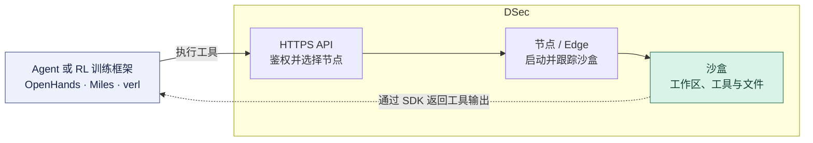

# DSec Reproduce

[English](README.md) · **简体中文**

**DSec 是供 Agent 调用工具和开展强化学习训练的沙盒运行时。**

当编程 Agent 决定“运行测试”时，DSec 为它提供机器，执行命令，并把输出送回 Agent。下一次工具调用可以继续使用同一工作区。如果调用方没收到回复，可以凭请求 ID 找回已经执行的操作。一个 episode 结束时，调用方可以释放沙盒。Agent 决定下一步做什么，任务定义奖励，训练框架负责更新模型。



本项目是对 DSec 论文的独立实现。**v0.1 是面向 Linux KVM 宿主机上受信用户的开发预览版。** [论文](https://arxiv.org/abs/2609.22978) · [已验证的能力](docs/PROJECT_STATUS.md) · [路线图](ROADMAP.zh-CN.md)

## 跑通第一个 episode

这个示例用两条固定回复驱动 Agent，在 MicroVM 内向文件写入 `3`，再由验证器读回并评分。你可以先体验沙盒，全程无需选择模型、GPU 或基准测试集。

**1. 安装客户端。** 在装有 Git 和 Python 3.11 或更高版本的终端中运行以下命令。

```sh
git clone https://github.com/QingdiMeng/dsec-reproduce.git
cd dsec-reproduce
python3 -m venv .venv
.venv/bin/python -m pip install .
```

**2. 根据手头的环境选择入口。**

| 你有什么环境 | 从哪里开始 |
| --- | --- |
| 已有 DSec 部署的访问权限 | 请运维人员提供 `client.json`，确认其中引用的凭据和 CA 文件可用，且部署中有服务于 `default` 环境的 rollout worker。然后执行第 3 步。 |
| 一台待配置的 Linux x86_64 机器 | 按单机指南检查 KVM，准备 Firecracker 和 guest，启动服务并激活节点。在第 3 步使用部署生成的 `client.json`。[单机部署](docs/guides/QUICKSTART.zh-CN.md#install) |
| 只有笔记本 | 展开下方的请求恢复示例。它在内存中模拟服务，无需虚拟机监控器或访问凭据。 |

<details>
<summary>从空白 Linux 宿主机开始，怎样确认每一步成功？</summary>

1. **账号能访问 KVM 吗？** 在宿主机运行 `test -r /dev/kvm && test -w /dev/kvm && echo "KVM accessible"`。如果没有看到提示，先检查机器的虚拟化支持和账号的 KVM 权限。
2. **能运行一台 guest 吗？** 选择 Firecracker 二进制和 guest 内核，构建小型 ext4 guest，配置独立节点实例，再用指南中的 `dsec-host smoke` 验证执行和回收。[构建 guest](docs/guides/QUICKSTART.zh-CN.md#guest) · [配置节点](docs/guides/QUICKSTART.zh-CN.md#node)
3. **API 能把任务放到这个节点吗？** 启动控制面，用节点的 Edge 和 worker 套接字加入并激活节点，找到生成的 `client.json`，即可执行第 3 步。[将节点接入 API](docs/guides/QUICKSTART.zh-CN.md#workload)

</details>

<details>
<summary>在笔记本上体验请求恢复</summary>

在克隆好的仓库中运行以下命令。

```sh
.venv/bin/python -m unittest -v \
  tests.unit.test_cluster_control.ClusterTests.test_lost_reply_recovers_on_other_controller_without_create_replay
```

看到 `Ran 1 test` 和 `OK` 即表示通过。测试会丢弃创建请求的回复。第二个控制器根据请求 ID 找回原沙盒，确认它仍在运行，再将其停止。模拟 Edge 只记录到一次创建。下面第 3 步使用真实 MicroVM。

</details>

**3. 运行任务。** 将 `/path/to/client.json` 替换为第 2 步得到的文件路径。每次运行请使用新的输出目录。

```sh
.venv/bin/python -I tools/verify_rollout_api.py \
  --api-config /path/to/client.json --out ./first-episode
```

终端应输出 `{"status": "passed", "checks": 1}`。打开 `first-episode/report.json`，找到 `miles_loop_through_api`，检查是否为 `score: 1`。第一条回复让 guest 执行了 `printf 3 > /rl-counter`，第二条结束了任务。如果返回 `NoPlacement`，请检查节点是否已激活，以及 rollout worker 是否声明支持所需环境。[首次运行检查项](docs/guides/QUICKSTART.zh-CN.md#workload)

## 选择工作负载

| 想做什么 | 可运行的案例 |
| --- | --- |
| 给编程 Agent 提供 shell 和编辑器，在新的工作区评测补丁 | [OpenHands + SWE-Gym](apps/swegym/README.zh-CN.md) |
| 用任务自带的验证器评测终端任务，或接入 Miles | [Terminal-Bench 2.1](apps/tb21/README.zh-CN.md) |
| 用沙盒执行 Python、计算奖励，比较小模型训练前后在留出集上的表现 | [MBPP + verl GRPO](apps/mbpp/README.zh-CN.md) |
| 让桌面 Agent 查看屏幕并发送键鼠输入 | [Ubuntu FullVM 上的 OSWorld](apps/osworld/README.zh-CN.md) |
| 接入自己的任务、工具和验证器 | [任务契约](docs/architecture/AGENT_ENVIRONMENT_CONTRACT.zh-CN.md) |

各工作负载可独立于核心包安装。运维人员可按需选择短函数调用（FnCall）、QEMU 内的容器、支持快照和分叉的 Firecracker MicroVM，或用于桌面的 QEMU FullVM。[执行模式](docs/architecture/EXECUTION_ISOLATION.zh-CN.md) · [环境版本与存储](docs/guides/ARTIFACT_PUBLICATION.md)

## 部署与实验结果

- **部署集群**。部署 API 副本和 Linux 节点后，可以通过控制台查看沙盒及请求。[集群指南](docs/guides/CLUSTER_DEPLOYMENT.zh-CN.md) · [管理控制台](docs/guides/CLUSTER_CONSOLE.zh-CN.md)
- **评估故障恢复**。kind 演示停止三个 worker 故障域中的两个，检查原虚拟机及其数据是否保留。三个故障域在同一物理宿主机上。[演示和实测恢复时间](deploy/cluster/demos/kind-ha/README.md)
- **评估训练效果和运行成本**。MBPP 案例完成 187 次 GRPO 更新，训练前后分别评测同一组 500 个留出任务。沙盒运行成本另有对照协议和实测数据。[训练结果](docs/reports/MBPP_VERL_FIRST_USE.zh-CN.md) · [Docker 对照](docs/reports/DSEC_VERITY_PILOT_REPORT.md)

[文档目录](docs/README.zh-CN.md) · [贡献指南](CONTRIBUTING.zh-CN.md) · [开发预览版](https://github.com/QingdiMeng/dsec-reproduce/releases/tag/v0.1.0-dev.0) · [MIT 许可证](LICENSE) · [第三方声明](THIRD_PARTY_NOTICES.zh-CN.md)
