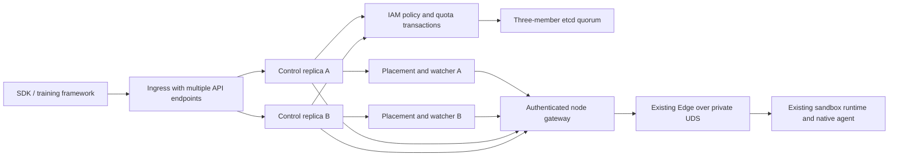

# HA cluster control plane

Status: development preview with bounded acceptance on 2026-10-11. High availability
is required in the first cluster release. Development runs on macOS; the Linux
experiment machine is a real Edge node. This is not a production release or a
claim of independent-host availability.

The accepted [control-plane and Host CLI refactoring decisions](MODULAR_REFACTOR_DESIGN.md#control-host-decisions)
(CPH-001 through CPH-008) govern the next structural changes. They preserve
ownership, durable admission/failure semantics and HA requirements; acceptance
of the decisions does not mean that their implementation is complete.

The current [module ownership map](MODULAR_REFACTOR_DESIGN.md#控制面决策与传输边界)
separates Node admission/recovery decisions (`control.node_gateway` and
`control.rollout_gateway`) from Node RPC adapters (`host.node_transport`) and
HTTP/TLS (`host.cluster_http`). `host.cluster` composes these with etcd and private
UDS clients. The old Host gateway constructor is a compatibility facade only;
its decision methods are inherited from the canonical control implementation.
This separation adds no service or protocol and does not expand HA acceptance.

## Ownership and deployment

The design follows [DSec §3.2 and §8](https://arxiv.org/html/2609.22978): IAM
owns project policies and quotas; the apiserver is a stateless ingress; placement
filters and samples healthy nodes; watchers reconstruct their views by polling
Edges. An Edge owns sandbox execution, admission, process identities, storage,
snapshots and native sessions. Model/GPU management remains external.

The formal user path is SDK → API Server → owning Edge. All remote sandbox
operations, including shell commands, files and streaming I/O, traverse that
ingress. The Node gateway below is our authenticated bridge to the Edge's private
UDS, not a second placement authority. The local direct UDS SDK is retained for
compatibility and development. New QEMU/FullVM and outer-VM Container/FnCall
backends must extend this existing cluster path; passing a private VMM test does
not expose a backend through the cluster API.

IAM, API, placement and watcher are distinct modules. The first deployment can
co-locate one instance of each in a controller process, with at least two such
processes. No singleton process is responsible for routing or reconciliation.
The module interfaces allow separate deployment later. Controller availability
requires an available ingress and etcd quorum, not just a second Python process.
Three etcd processes on one Mac test member/process failure; they do not tolerate
loss of that physical Mac. Production puts quorum members in independent failure
domains. This iteration does not install BGP or claim the paper's BGP/ECMP path.

## Service responsibilities

| Component | Owns | Does not own |
| --- | --- | --- |
| IAM | Principal authentication, nested projects, bounded permission delegation, resource/concurrency quota admission, audit records | Shell execution or sandbox lifecycle truth |
| API Server | Versioned request validation, IAM checks, creation ingress, owner routing, command/file/stream-event forwarding | A per-sandbox registry or local durable routing database |
| Placement Engine | Backend/environment/capability filtering, power-of-k sampling, load ranking, recent local placement overlay | Hard physical reservations or execution state |
| Watcher | Authenticated Edge probes, expiring health/load/capability views, reconnect/rebuild | Declaring an unreachable sandbox stopped or recycling its quota |
| Node gateway | Controller authentication, validated tenant/owner envelope, translation to the existing Edge protocol | Choosing a new node or changing guest/storage mechanisms |
| Edge | Final node resource admission and existing durable request/VM journals | IAM project policy or training algorithms |

Use etcd v3 linearizable reads and conditional transactions for IAM state. This
is our coordination choice, not a storage backend specified by the DSec paper.
See [etcd transaction semantics](https://etcd.io/docs/v3.6/learning/api/) and
[its JSON gateway](https://etcd.io/docs/v3.6/dev-guide/api_grpc_gateway/).
Loss of quorum rejects new protected mutations; a local file or stale cache
must never substitute for successful authorization/quota admission.

## Request, quota and recovery contract

1. Authenticate every user management request and authorize its project scope.
   Principals can delegate only permissions they possess. Child quotas are
   portions of the parent's budget; concurrent delegation cannot overcommit it.
2. Placement selects a candidate from fresh authenticated watcher observations.
   Maintain only a local recent-placement overlay; Edge node admission remains
   final. In this preview a definitive Edge non-admission closes that request;
   a caller can submit a new request ID after checking capacity. Reassignment
   of the same admission requires durable generation fencing and remains open.
3. Before dispatch, IAM durably admits the request ID, canonical digest, project,
   resource demand and selected node. This is a quota/dispatch receipt, not a
   sandbox execution result or a second API registry. Multiple API replicas
   observing the same request cannot assign independent targets. Before the Node
   sends, a CAS records `DISPATCHED`; `NOT_FOUND` after this boundary is unknown,
   because a request may still be queued. It cannot authorize another send.
4. Once dispatch may have reached an Edge, retain that target. Lost responses,
   controller crashes and timeouts require querying its existing request journal.
   They never permit placement on a different node. Same-admission reassignment
   is not implemented; UNKNOWN never permits execution replay.
5. Public sandbox IDs encode version, project, node, backend and local Edge ID.
   Integrity protection prevents caller alteration. Any API instance resolves
   them without owning a local sandbox map. Local IDs and legacy UDS SDK remain
   unchanged; remote handles translate only at the boundary.
6. Command, native file chunks, stream start/events/cancel and result queries
   preserve public request IDs and the existing journal semantics. A deterministic
   project namespace translates IDs at the Node boundary, so tenants using the
   same public ID cannot share an Edge journal entry or a native job. API failover changes
   the endpoint, not the execution identity. Reads can fail over; mutations are
   reconciled before a caller retries. No hidden shell-command replay.
7. Quota remains held when a node disappears, a health lease expires or an API
   instance dies. Release requires an authoritative Edge stopped/non-admitted
   result bound to that admission. Reconciliation is idempotent and uses CAS;
   watchers may overlap or restart without releasing twice.
8. Ready VMs and host physical resources remain charged by the existing Edge
   ledger. IAM project usage is a different scope; placement must not create a
   second physical resource ledger. New workloads still face Edge pressure floors.

## Transport and trust

Remote endpoints use TLS with explicit CA validation; node gateways accept only
controller identities and never expose an unauthenticated Docker/KVM proxy.
IAM credentials are high-entropy opaque tokens; stored/audited values are token
hashes or identities, never raw secrets. Revocation is checked against quorum
state. Node endpoints are administrator provisioned, not arbitrary user URLs.
Local loopback test transports must be explicit and cannot enable insecure
remote bindings. Certificates, tokens and deployment runtime state stay outside
source exports. Existing private UDS interfaces remain available.

## Acceptance gates

| Gate | Required evidence |
| --- | --- |
| IAM | Wrong/revoked credential; project isolation; nested delegation; forbidden permission elevation; concurrent child quota allocation and sandbox admission; policy change versus authorization |
| Placement | Filter wrong backend/environment/capability; reject expired/failed samples; sample k and rank; local overlay; final Edge pressure rejection |
| API and SDK | Same IDs across API failover; command/file/stream semantics through a real Node; cross-project route tampering denied; bounded requests and connections |
| Watcher | Multiple watcher instances; cold rebuild; node loss/rejoin; stale probe completion cannot renew an old snapshot; missing health cannot release a running admission |
| HA storage | Real three-member etcd; stop one member and retain service; lose quorum and reject protected mutations; restore quorum and reconcile identities |
| HA ingress | At least two controller processes; kill the accepting API during create/command; use another API to query the same Edge; no duplicate writable sandbox |
| Formal concurrency | Model quota admission, dispatch uncertainty and release; required unsafe counterexamples and code-guard mutations. Exact trace replay and generation-fenced reassignment remain open |
| Real Linux | Dedicated gateway and Edge root; create/native commands/files/stream/stop; lost controller response; preserved existing host services; all owned resources reclaimed |

One Linux Node proves routing and recovery against a real runtime, not placement
across multiple physical hosts. Deterministic additional node endpoints can test
placement logic; production multi-host and whole-Mac failure remain explicitly
unvalidated until additional hardware is available. No completed gate is inferred
from a diagram, an in-memory coordination fixture or a controller restart alone.

## Recorded acceptance (2026-10-11)

| Evidence | Result and boundary |
| --- | --- |
| Canonical control regressions | 23 passed: concurrent admission/delegation, policy-versus-CAS, tenant isolation (including identical IDs), lost reply, unknown dispatch, terminal release and stale probe ordering |
| Bounded TLC checks | All 21 system cases passed, including one safe cluster model (1,092 distinct states) and four required cluster counterexamples. Cluster bounds: two requests, two Nodes, concurrency quota one |
| Reviewed code mutation gates | Four required behavioral failures when quota admission, immutable owner, proof-only release or released-request dispatch guards are removed. Release has three defenses; the negative control removes all three |
| Real etcd quorum | 7 gates passed: two IAM instances, 12 concurrent requests with quota four, owner binding, one member loss, quorum loss, quorum recovery and idempotent release. Own test containers/network removed |
| Real Linux Node / two local controllers | 15 gates passed with verified API TLS and controller-to-Node mTLS: lost create/command/stream replies, same VM recovery, persistent native session, binary files, Node loss/rejoin, quorum fault and proof-based cleanup |
| Portable Node acceptance tool | `tools/verify_cluster_node.py` passed 10 gates against the same isolated Linux Node; it owns two test controllers and at most one sandbox, and reclaims its sandbox |
| Final proof identity gate | Validated against two persisted real Edge creation journals; unrelated completed operations cannot be bound as creates |
| Broader regressions | macOS: 308 unit tests, five platform skips. Linux: 308 unit tests, one existing skip. Module boundaries: 13 tests on macOS, one Linux-only skip. Source packaging and documentation links passed |

The live Node gates used source archive SHA-256
`7f3394ed6b4a46f37c847820fe27c0b1a77243bebebfc57ec308440a3674871d`
and wheel SHA-256
`0d7ae2c13edd40db53673c7311f539ddd4221a6a287050516ef5dd1b53646848`.
Final proof-identity, cancellation-ID and container-demand validation tightening
was checked with the final source regressions and persisted real creation
journals; it was not another live fault run. Repeat the portable live gate on
the exact release artifact before promoting this preview to production.

Raw local evidence is intentionally not exported with credentials or runtime
artifacts. The acceptance tools record source hashes, reports and private logs
in their caller-selected evidence directories. Source exports include the tools,
models and regressions; they contain no deployment certificates or secrets.

The model abstracts both `ADMITTED` and `DISPATCHED` as its admission phase;
only the latter permits a send to have happened. Its `owner` is the committed
Node, `effects` represents writable sandboxes and `proof` represents authoritative
non-admission or completed cleanup. IAM maps admission/accounting transitions,
the Node gate maps execution/release, and watcher freshness maps node visibility.
`tools/check_cluster_refinement.py` pins source identities and requires exact
reviewed guard text plus behavioral failures when guards are removed. This is
code-guard correspondence, not replay of arbitrary implementation traces or a
proof of general distributed linearizability. Changed guards must be reviewed
against the model and regression schedule.

Before a production release: validate independent failure domains and additional
physical Nodes; provide operator recovery for indefinitely unknown dispatches;
finish IAM quota changes, route-key rotation
and exact cluster trace replay. Existing guest, storage, snapshot and local SDK
mechanisms are preserved.

## Deployment follow-up: readiness and service credentials

`RolloutDispatch` models worker health at the first-send boundary and includes
`DispatchRequiresAcceptedHealth`. Explicit `recover_create` uses the same
ADMITTED-to-DISPATCHED CAS; later states inspect the original worker only.
The worker-health regression is paired with a required guard-removal mutation.
The follow-up finite-model campaign has 35 cases; implementation refinement has
seven required unsafe mutations. These checks are bounded safety evidence.

The Node membership extension adds `NodeLifecycle` and three required unsafe
variants: stale ACTIVE admission, retirement without checking held admissions,
and delayed transitions reviving a retired identity. The current campaign has
39 model cases and ten implementation guard-removal controls at that boundary. Its code mapping
is `node_lifecycle.admit` plus `IAM.admit/release` for the shared CAS,
`NodeLifecycle._transition` for expected-version/state fences and held counts,
and `NodeGateway.lifecycle_proof`/`EpisodeService.drain_status` for owning-service
quiescence. Controlled regressions in `test_node_lifecycle.py` order competing
admission and drain commits in both directions. These are targeted safety checks,
not whole-program equivalence, liveness, or independent physical HA. See
[fleet deployment and recovery](../guides/CLUSTER_DEPLOYMENT.md#dynamic-membership-maintenance-and-retirement).

`NodeUpgrade` adds two invariants and required counterexamples: completion must
have the requested loaded-release proof, and a pending plan must prevent ACTIVE
admission. They map to the `observed != expected` and pending-plan guards in
`NodeLifecycle._transition`; `test_node_upgrade.py` also orders commit versus
rollback with a controlled CAS barrier. The full campaign now has 42 model cases
and twelve implementation mutations. Artifact byte hashing/installation and
process startup are outside this small model and have separate controlled
regressions and Linux acceptance. The compatibility contract declares reviewed
format support; matching labels alone do not prove arbitrary code compatibility.

The security extension adds `CredentialRotation` (completion needs the new
credential; cancellation cannot resurrect a completed credential) and
`TransportRotation` (trust at request acceptance; no late publication regression).
The full finite campaign has 48 cases. The existing twelve cluster mutation
controls are joined by five security guard removals in
`tools/check_security_refinement.py`. Controlled tests order completion/cancel,
concurrent publication and a TLS handshake preceding trust retirement. Code
boundaries map to IAM CAS, `VersionedFile.read`, publication CAS and
`TLSFiles.fence`; cryptography, distributed dissemination and unbounded liveness
remain outside these finite models. See [rotation operations](../guides/CLUSTER_DEPLOYMENT.md#certificate-and-credential-rotation).

`EtcdCredential` serializes service login and renewal within each process. JWT
expiry is only a scheduling hint; verified HTTPS and etcd enforce authenticity
and permissions. Only an explicit 401/code-16 rejection or the exact 400/code-3 stale-auth-store
revision rejection can refresh and resend once. Permission denial and unknown replies preserve the original coordination
semantics. Expired tokens never provide an availability fallback.

Cross-host exports retain TLS and peer identity checks behind Docker NAT,
separate administrator credentials from service replicas, and preserve local
private data directories. Two physical fault domains do not prove arbitrary
single-host HA for a three-member quorum.

The real two-host follow-up passed seven controlled service-fault gates:
worker readiness UNKNOWN, original-episode recovery, same-VM API failover,
operation after token expiry, minority-member loss, majority-member loss with
rejection, and rejoin/clean release. Token renewal used an acceptance-only
12-second TTL, with proactive renewal, one refresh after an explicit server
expiry rejection and denied prefix escape. Three-member authenticated health
and peer identity positive/negative gates passed. Eight application harness
checks passed through the installed Linux API/Node/worker. Physical hosts and
host Docker daemons were not stopped; this does not close the independent-host
availability gate.

Live-episode service restart acceptance on 2026-10-12 passed nine checks on the
two-host deployment. Restart combinations covered both API replicas,
gateway/worker, and API/gateway/worker/Edge together. Physical VMM PID,
`/proc` start ticks and boot ID matched before/after, while the persisted
history/dialogue and held quota remained unchanged. Repeated committed action
submission returned its journal result without another effect. Continued work
and counter verification succeeded; authoritative stop released all resources.
The portable tool records operator stop/start plans and separate Node physical
inspection. Quorum and hosts survived throughout; in-flight crash boundaries
and host-loss availability are separate gates.
