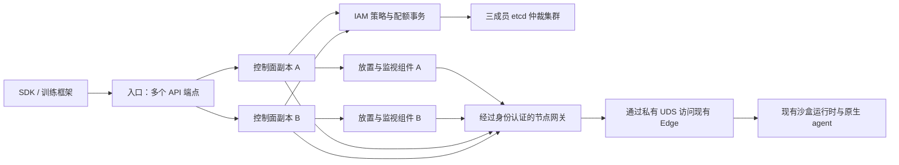

# 高可用集群控制面

[English](CLUSTER_CONTROL_DESIGN.md) · **简体中文**

首版集群要求控制面高可用。2026-10-11 的有限范围验收通过，交付状态为开发预览。开发环境为 macOS，Linux 实验机作为真实 Edge 节点。生产发布和独立物理宿主机故障下的可用性仍待验收。

后续结构调整遵循已批准的[控制面与 Host CLI 重构决策](MODULAR_REFACTOR_DESIGN.md#control-host-decisions)（CPH-001 至 CPH-008）。这些决策保留模块归属、持久化准入及失败语义和高可用要求。设计获批后仍需逐项实现。

当前[模块职责图](MODULAR_REFACTOR_DESIGN.md#控制面决策与传输边界)将节点准入与恢复决策（`control.node_gateway` 和 `control.rollout_gateway`）、节点 RPC 适配器（`host.node_transport`）以及 HTTP/TLS（`host.cluster_http`）分开。`host.cluster` 负责将它们与 etcd 和私有 UDS 客户端组装起来。旧宿主网关构造器仅供兼容，其决策方法继承自唯一的控制面实现。此次拆分没有增设服务或协议，高可用验收范围也未改变。

## 职责与部署

设计遵循 [DSec 第 3.2 节与第 8 节](https://arxiv.org/html/2609.22978)。IAM 管理项目策略与配额；API Server 提供无状态入口；调度器筛选健康节点并采样；Watcher 轮询 Edge 以重建视图。Edge 管理沙盒执行、准入、进程身份、存储、快照和原生会话。模型及 GPU 由外部系统管理。

正式用户路径是 SDK → API Server → 所属 Edge。所有远程沙盒操作均经此入口，包括 shell 命令、文件和流式 I/O。节点网关经认证后桥接到 Edge 的私有 UDS，不参与节点选择。直连本地 UDS 的 SDK 供兼容和开发使用。QEMU/FullVM 以及外层虚拟机中的 Container/FnCall 后端均须接入既有集群路径。私有 VMM 测试通过不代表后端已经能通过集群 API 使用。

IAM、API、调度器和 Watcher 是四个独立模块。首版允许每个控制器进程各内置一份，至少部署两个控制器进程。路由和状态核对不依赖单一进程，模块接口也允许后续拆分部署。控制器可用性同时要求入口可达且 etcd 有法定多数。在同一台 Mac 上运行三个 etcd 进程只能验证成员或进程故障。生产部署应把成员置于独立故障域。本轮未部署 BGP，未验收论文中的 BGP/ECMP 路径。

## 服务职责

| 组件 | 负责 | 职责之外 |
| --- | --- | --- |
| IAM | 主体认证、嵌套项目、受限权限委派、资源与并发配额准入、审计记录 | shell 执行、沙盒生命周期的权威状态 |
| API Server | 版本化请求校验、IAM 检查、创建入口、按归属路由、命令/文件/流事件转发 | 逐沙盒登记表、本地持久化路由数据库 |
| Placement Engine | 按后端/环境/能力过滤，power-of-k 采样，按负载排序，在本地计入最近的调度结果 | 硬性预留物理资源、管理执行状态 |
| Watcher | 经认证的 Edge 探测，有效期内的健康/负载/能力视图，重连与重建 | 把不可达沙盒判为已停止、释放其配额 |
| 节点网关 | 认证控制器，校验租户与归属信息，翻译为现有 Edge 协议 | 改选节点、更改 guest 或存储机制 |
| Edge | 节点资源最终准入、既有的请求与 VM 持久日志 | IAM 项目策略、训练算法 |

IAM 状态使用 etcd v3 的线性一致读与条件事务。etcd 是本项目选用的协调组件，论文并未指定这一存储后端。详见 [etcd 事务语义](https://etcd.io/docs/v3.6/learning/api/)及其 [JSON 网关](https://etcd.io/docs/v3.6/dev-guide/api_grpc_gateway/)。失去多数派后拒绝新的受保护变更，本地文件或陈旧缓存不能作为授权或配额准入依据。

## 请求、配额与恢复契约

1. 每个用户管理请求都须经过认证，并按项目范围授权。主体只能委派自己拥有的权限。子项目配额从父项目预算中划拨，并发委派也不能超额。
2. 调度器依据经过认证且未过期的 Watcher 观测选择候选节点，本地仅叠加最近调度产生的负载。最终是否接纳由 Edge 决定。本预览版中，Edge 明确拒绝准入便结束该请求；调用者可核实容量，再以新请求 ID 提交。同一准入记录改派节点需要持久的代际隔离，尚待实现。
3. 分派前，IAM 将请求 ID、规范化摘要、项目、资源需求及所选节点持久化为准入记录。该记录证明配额与分派归属，不能充当沙盒执行结果。并发处理同一请求的多个 API 副本不能各自选定目标。节点发送前先用 CAS 记录 `DISPATCHED`；越过此界限后若得到 `NOT_FOUND`，操作可能仍在排队，应记为未知，不可再次发送。
4. 请求可能到达 Edge 后，目标节点必须保持不变。若回复丢失、控制器崩溃或请求超时，应查询该 Edge 的已有请求日志。当前不支持同一准入改派其他节点。UNKNOWN 状态不允许重放执行。
5. 公共沙盒 ID 编码版本、项目、节点、后端和 Edge 本地 ID。完整性保护能防止调用方篡改。任一 API 实例均能解析 ID，无需维护本地沙盒映射。原本地 ID 和旧 UDS SDK 保持不变，远程句柄仅在边界处转换。
6. 命令、原生文件分块、流启动/事件/取消及结果查询都保留公共请求 ID 和已有日志语义。节点边界按确定性的项目命名空间转换 ID，不同租户即使使用相同公共 ID，也不会共用 Edge 日志项或原生任务。API 故障切换只改变端点，执行身份保持不变。读请求可切换副本；变更请求重试前须先核实结果，不会暗中重放 shell 命令。
7. 节点消失、健康租约到期或 API 实例停止时，配额继续保留。只有所属 Edge 提供与该准入记录绑定的已停止或未接纳证明，才能释放配额。核对操作使用 CAS 且具备幂等性，允许多个 Watcher 重叠运行或重启。
8. ready VM 和物理宿主资源继续由既有 Edge 台账计费。IAM 统计项目用量，调度器不能另建一份物理资源台账。接受新任务时，仍须满足 Edge 的宿主资源余量要求。

## 传输与信任

远程端点使用 TLS 并显式验证 CA。节点网关只接受控制器身份，不对外提供未经认证的 Docker/KVM 代理。IAM 使用高熵不透明 token，只存储或审计 token 哈希或主体身份。撤销状态以多数派数据为准。节点地址由管理员配置，不能由用户任意指定 URL。本地回环测试传输须显式启用，不能由此开放不安全的远程监听。证书、token 和部署运行状态不进入源码发行包。私有 UDS 接口继续供内部使用。

## 验收条件

| 项目 | 要求的证据 |
| --- | --- |
| IAM | 无效或撤销的凭据、项目隔离、嵌套委派、禁止权限提升，并发子配额划拨与沙盒准入，以及策略变更与授权竞争 |
| 调度 | 过滤不匹配的后端/环境/能力，排除过期或失败的观测，采样 k 个节点并排序，计入本地最近调度，以及 Edge 最终因资源压力拒绝准入 |
| API 与 SDK | API 切换后 ID 不变，通过真实节点验证命令/文件/流语义，拒绝跨项目路由篡改，限制请求及连接 |
| Watcher | 多 Watcher、冷启动重建、节点失联与重入。旧探测晚到不能延长旧视图，缺少健康信息不能释放运行中的准入 |
| 高可用存储 | 真实三成员 etcd；停一成员仍服务，失去多数派时拒绝受保护变更，恢复多数派后核实身份 |
| 高可用入口 | 至少两个控制器进程；创建或执行命令时停止接收请求的 API，由另一 API 查询同一 Edge，不产生第二个可写沙盒 |
| 并发形式化验证 | 对配额准入、分派不确定性和释放建模，给出所需的不安全反例及代码守卫变异。精确轨迹重放和基于代际隔离的重新分派尚待验证 |
| 真实 Linux 节点 | 独立网关及 Edge 根目录，验证创建、原生命令、文件、流和停止，注入回复丢失，保留宿主已有服务，回收全部自有资源 |

一台 Linux 节点能验证真实运行时上的路由与恢复。额外的确定性节点端点可验证调度决策。多物理主机生产部署和整台 Mac 失效仍待额外硬件验收。架构图、内存协调测试或一次控制器重启不能单独作为通过某项验收的依据。

## 已记录的验收（2026-10-11）

| 证据 | 结果与范围 |
| --- | --- |
| 控制面回归 | 23 项通过，涵盖并发准入和委派、策略变更与 CAS 的竞争、租户隔离（含相同 ID）、回复丢失、分派未知、终态释放、旧探测顺序 |
| 有界 TLC 检查 | 全部 21 项系统用例通过，含一个安全集群模型（1,092 个不同状态）和四个规定的集群反例。集群模型上限为两个请求、两个节点、并发配额一 |
| 经审阅的代码变异检查 | 分别移除配额准入、归属不可变、仅凭证明释放及已释放请求禁止分派的守卫，四项均按预期失败。释放有三道防护，负对照一并移除三者 |
| 真实 etcd 多数派 | 7 项通过：双 IAM 实例、配额四下的 12 个并发请求、归属绑定、单成员故障、失去多数派、多数派恢复、幂等释放。测试容器和网络已清理 |
| 真实 Linux 节点与两个本地控制器 | 验证 API TLS 和控制器到节点的 mTLS，15 项通过，覆盖创建/命令/流回复丢失、同一 VM 恢复、持久原生会话、二进制文件、节点失联重入、多数派故障和依据证明清理 |
| 可移植节点验收工具 | `tools/verify_cluster_node.py` 在同一独立 Linux 节点上通过 10 项检查。工具管理两个测试控制器，最多创建一台沙盒，结束后回收 |
| 最终证明身份检查 | 使用两份持久化的真实 Edge 创建日志验证，其他已完成操作不能冒充创建结果 |
| 更广回归 | macOS 单元测试 308 项，5 项因平台跳过。Linux 单元测试 308 项，1 项沿用既有跳过。macOS 模块边界 13 项，1 项仅限 Linux。源码打包和文档链接通过 |

实机节点验收使用源码归档 SHA-256 `7f3394ed6b4a46f37c847820fe27c0b1a77243bebebfc57ec308440a3674871d` 和 wheel SHA-256 `0d7ae2c13edd40db53673c7311f539ddd4221a6a287050516ef5dd1b53646848`。随后收紧了证明身份、取消 ID 和容器需求校验，使用最终源码回归及已有真实创建日志核对，未重复实机故障注入。进入生产前，须用拟发布的精确制品再次运行可移植实机验收。

原始本地证据、凭据及运行制品不随源码导出。验收工具在调用者选定的证据目录中写入源码哈希、报告和私有日志。源码导出包含工具、模型和回归用例，不包含部署证书或秘密。

模型将 `ADMITTED` 和 `DISPATCHED` 合并为准入阶段，只有后者表示请求可能已经发出。`owner` 表示已提交的节点，`effects` 表示可写沙盒，`proof` 表示权威的未接纳或已清理结果。IAM 对应准入和记账转换，节点守卫对应执行与释放，Watcher 新鲜度对应节点可见性。`tools/check_cluster_refinement.py` 固定源码身份，要求守卫文本与已审阅版本完全匹配，并要求移除守卫后出现预期的行为失败。这是模型到代码守卫的对应检查。任意实现轨迹的重放和一般分布式线性一致性证明仍超出范围。守卫改动后须对照模型和受控回归时序重新审查。

进入生产前，还需验证独立故障域和更多物理节点，为长期分派未知的情况提供运维恢复流程，完成 IAM 配额变更、路由密钥轮换与精确集群轨迹重放。既有 guest、存储、快照和本地 SDK 机制保持兼容。

## 后续部署验收：就绪性与服务凭据

`RolloutDispatch` 对首次发送边界上的 worker 健康状态建模，包含 `DispatchRequiresAcceptedHealth`。显式 `recover_create` 同样使用从 ADMITTED 到 DISPATCHED 的 CAS；越过这一状态后只查询原 worker。worker 健康回归配有必需的守卫移除负对照。后续有限模型验证有 35 项用例，实现细化检查包含七项必须暴露不安全行为的变异。结论仅适用于所测安全边界。

节点成员扩展新增 `NodeLifecycle` 和三个必需的不安全变体：按过期的 ACTIVE 状态准入、退役时遗漏仍占用的准入记录、延迟状态转换使退役身份复活。此边界包含 39 项模型用例及十项实现守卫移除对照。`node_lifecycle.admit` 与 `IAM.admit/release` 对应共享 CAS，`NodeLifecycle._transition` 对应预期版本/状态检查及占用计数，`NodeGateway.lifecycle_proof` 和 `EpisodeService.drain_status` 对应所属服务静止状态。`test_node_lifecycle.py` 中的受控回归分别让准入和排空先提交，验证两种顺序。这些检查覆盖特定安全属性，全程序等价性、活性和独立物理主机高可用不在范围内。参见[集群部署与恢复](../guides/CLUSTER_DEPLOYMENT.zh-CN.md#dynamic-membership-maintenance-and-retirement)。

`NodeUpgrade` 增加两个不变量及必需的反例：完成升级须有已加载指定发行版本的证明，有待执行计划时禁止 ACTIVE 准入。这些规则对应 `NodeLifecycle._transition` 中的 `observed != expected` 和待执行计划守卫；`test_node_upgrade.py` 还通过可控 CAS 屏障验证提交与回滚的顺序。全套现有 42 项模型用例和十二项实现变异。制品字节校验、安装及进程启动另有受控回归与 Linux 验收。兼容性契约声明经审阅的格式支持范围，仅有相同标签不能证明任意代码兼容。

安全扩展新增 `CredentialRotation`（完成需要新凭据，取消不能使已完成轮换的旧凭据复活）和 `TransportRotation`（以请求接收时的信任为准，晚到的发布不得倒退版本）。有限模型共 48 项。在原有十二个集群变异对照之外，`tools/check_security_refinement.py` 增加五个安全守卫移除测试。受控测试固定完成与取消、并发发布，以及信任退役前已发生 TLS 握手的顺序。代码边界对应 IAM CAS、`VersionedFile.read`、发布 CAS 及 `TLSFiles.fence`。密码学、分布式传播与无界活性超出有限模型范围。参见[轮换操作](../guides/CLUSTER_DEPLOYMENT.zh-CN.md#certificate-and-credential-rotation)。

`EtcdCredential` 在各个进程内串行化服务登录与续期。JWT 过期时间仅用于安排续期，真实性和权限由验证过证书的 HTTPS 连接与 etcd 强制执行。只有明确收到 401/code-16 拒绝，或精确匹配 400/code-3 的过期认证存储版本拒绝，才能刷新凭据并重发一次。权限拒绝和回复未知沿用原有协调语义。过期 token 不能作为恢复可用性的后备。

跨主机导出在 Docker NAT 后仍执行 TLS 与对端身份检查，管理员凭据与服务副本分开，并保留本地私有数据目录。仅有两个物理故障域的三成员多数派，不能证明任一主机失效时均可用。

两台真实主机的后续验收通过七项受控服务故障检查：worker 就绪状态 UNKNOWN、找回原 episode、API 切换后仍为同一 VM、token 到期后继续操作、少数成员失联、多数成员失联且拒绝请求，以及重入后完整释放。验收专用 token TTL 为 12 秒，验证了主动续期、服务端明确拒绝过期凭据后刷新一次，以及越权访问前缀被拒绝。三成员认证健康及对端身份正负对照通过。已安装的 Linux API、节点和 worker 还通过八项应用 harness 检查。验收未停止物理宿主机或宿主 Docker 守护进程，独立主机可用性仍待验证。

2026-10-12 在双主机上运行中 episode 的服务重启验收通过九项。组合包括两个 API 副本、网关和 worker，以及 API/网关/worker/Edge 一起重启。前后 VMM 的 PID、`/proc` 启动 tick 和 boot ID 均相同，持久化历史、对话和已占配额保持一致。重复提交已执行动作只返回日志结果，不再产生副作用。随后继续运行及计数器验证均通过，权威停止证明触发全部资源释放。可移植工具保存运维停止/启动方案及独立的节点物理状态检查结果。全程保有多数派且宿主机在线；执行中崩溃窗口和宿主机失效可用性另行验收。
