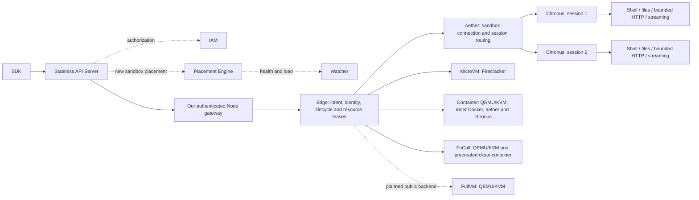

# Native execution and production isolation

Updated: 2026-10-25. Execution is a Linux development preview. Production
containment is a separate, unfinished gate; splitting the agent does not
establish a security boundary or a complete reproduction of aether/chronus.

## Runtime boundaries

The backend mapping follows [DSec §3.1–3.3](https://arxiv.org/html/2609.22978#S3.SS1):

| Public backend | Target execution path | Current boundary |
| --- | --- | --- |
| FnCall | A precreated container inside QEMU/KVM, then task cleanup | Networkless Edge/SDK path. Read-only root and per-invocation tmpfs/process reset; failed cleanup retires the VM. No aether/chronus on the task path. |
| Container | Docker inside an outer QEMU/KVM VM; per-sandbox aether/chronus | Networkless QEMU guest with inner Docker and native agent. Legacy host Docker remains a distinct development configuration. |
| MicroVM | Firecracker; per-sandbox aether/chronus | Existing real runtime; new guest execution gates have passed. |
| FullVM | Full QEMU/KVM VM; per-sandbox aether/chronus | Private QEMU primitive passed real Linux execution/fault gates; no public FullVM/Edge integration yet. Do not substitute Firecracker. |

These paths share SDK contracts and Edge ownership; their boot, containment and
recovery capabilities stay backend-specific. A production Container request
must not silently fall back to host Docker. FullVM and FnCall must not return a
success response from a driver that has not been implemented.

The formal cluster path is SDK → API Server → Edge → aether → chronus for
Container, MicroVM and FullVM operations. Creation also passes IAM authorization
and placement using watcher observations before the owning Edge checks capacity.
All remote sandbox calls, including files and streaming I/O, enter through the
API Server. The API Server remains stateless with respect to sandbox execution;
Edge owns the journals, identities and physical leases. Our authenticated Node
gateway bridges the API Server to the Edge's private UDS; it is an implementation
boundary, not another placement or lifecycle authority. The existing local UDS
SDK remains a compatibility/development interface, not the production cluster
ingress. See [cluster ownership and routing](CLUSTER_CONTROL_DESIGN.md).

`sdk/cluster.py` and `control/cluster_api.py` already implement this remote path
for the supported backends. Adding public FullVM requires extending the same
SDK/API/IAM/placement/Node/Edge chain, with capability checks and owner-bound
request IDs throughout. QEMU artifact paths and CID allocation remain node-local
administrator configuration; callers select environments and resource demands.
The private QEMU primitive and CID acceptance do not yet establish that full path.

### QEMU execution primitive

`runtime/backends/qemu.py` is a networkless Linux development primitive. It
requires pinned binary/kernel/template hashes, a mode-0700 instance directory,
KVM and vhost-vsock access, and an administrator-reserved host-wide guest CID.
It boots q35 with KVM only, a private raw disk, QEMU seccomp, disabled default
devices/network/user config, and a private QMP socket. The guest starts paused;
`query-kvm` must confirm KVM before `cont`. This is a trusted-artifact development
path, not a claim of complete host or tenant confinement. `production=True`
rejects before effects until Edge leases, confinement and network policy exist.

`runtime/backends/qmp.py` bounds frames, asynchronous events and one absolute
deadline. It negotiates QMP and matches response IDs; allowed operations are
status/KVM queries, stop/cont and quit. It never forwards arbitrary monitor
commands, migration paths or drive additions. Lost mutation replies are not
retried. Legacy port 5000 and native port 5001 keep their existing guest frames;
QEMU connects via Linux AF_VSOCK rather than Firecracker's CONNECT/UDS bridge.

The driver writes boot/control intent before effects and adopts only exact
UID/executable/argv/boot-ID/start-time identities using the existing pidfd
verifier. Interrupted intents retire attested processes rather than replay.
The fork-to-PID-record gap is recovered using the prior exact argv, unique UUID
and private paths. A different configuration or process identity rejects
adoption. Pause/resume keep the QEMU process alive; checkpoint/restore explicitly
rejects the Firecracker snapshot format. The standalone primitive has no guest
request journal, physical resource ledger or public SDK route; the composed
Container/FnCall backend now owns these at Edge, not in application callers.

Lifecycle operations share one owner lock and lifecycle mutex: a stop waiting
behind boot takes effect after boot returns, then stopped completion is final.
`QemuLifecycle.tla` bounds this primitive, interrupted control and boot count;
the checker requires late-ready and replay counterexamples. The controlled
regression holds guest readiness at a barrier, submits stop, releases readiness
and requires the final stopped record. This model and test are separate evidence,
not an automatic implementation-refinement proof or a cluster availability proof.

`runtime/isolation/vsock.py` provides internal `QemuCIDPool` reservations.
Cooperating Edges must share one private pool directory and an administrator
range disjoint from other host VMMs. `reserve(instance_directory)` durably commits
a CID and unique token before boot; repeated reservation returns that token.
Lost replies, restart, missing processes and elapsed time never release it.
Pool corruption or a missing established ledger fails closed. Kernel CID
collisions reject boot; the allocator does not replace an existing VMM.

`retire(lease, vm)` checks the CID, instance directory and token before effects,
holds the QEMU lifecycle mutex, stops the attested process, and only then commits
release. Adoption is required before retiring an existing boot intent. A delayed
old token cannot stop or release a replacement. Allocation uses a short flock
transaction; no VMM I/O runs under the shared pool lock. Stopping an unstarted
VM also persists a terminal record, fencing a later controller from booting that
directory after CID return. Callers must use the reservation to configure the
QEMU primitive; the composed Container/FnCall backend wires it into Node/Edge admission.

`QemuCID.tla` bounds three lease tokens and two CIDs. `Reserve` maps to the locked
load/commit, `ProveDeath` to `QemuVM.stop` and its pidfd wait, and `Retire` to the
second token check and durable release. Controlled regressions force concurrent
reservation and blocked retirement, retain failed/uncertain commits, and require
stale cleanup to fail before VMM effects. Unsafe variants must expose unlocked
allocation, premature release and stale-token cleanup. These bounded checks do
not prove arbitrary filesystem recovery, runtime refinement or vsock security.



### Networkless Container and FnCall integration

`runtime/backends/qemu_container.py` composes the existing QEMU driver and shared
CID allocator with Edge admission, lifecycle and action journals. The trusted
`qemu_execution_catalog` fixes each environment's mode, binary/kernel/template
hashes, image configuration digest and inner/outer resource limits. It never
calls host Docker. The preparer exports stopped pinned host images; Docker starts
only after the guest boots. A configured QEMU catalog rejects absent environments
rather than selecting a host-Docker backend. No network device is attached.

The SDK exposes `run_container` and `run_fncall`. A FnCall handle owns a charged
warm slot; `invoke` performs an independent bounded shell invocation. Calls on a
slot serialize; callers create more slots for parallelism. The API deliberately
keeps the existing authenticated `container` route/admission category and encodes
`execution_mode=fncall` in the immutable specification and journal digest. This
adds an execution policy without creating a second IAM/resource authority or
changing existing signed route bytes. Status exposes the actual execution path.
Placement requires observed `fncall-execution-v1`; protocol support alone does
not advertise a prepared function environment. Older Container requests and their
lifecycle digests remain unchanged. New function environments require upgraded
API, Node and Edge; an old Edge cannot execute them by falling back to Docker.

The release's Edge persistence contract is **2**. Existing request bytes remain
compatible, but an older Edge cannot interpret QEMU/FnCall records and failure
proofs. Automatic upgrade/rollback across Edge contracts 1 and 2 rejects; use a
fresh drained instance and a separately reviewed migration. Never bypass that
check, restore a live ledger backup, or mix old/new service roles on one Node.

The guest-only supervisor uses bounded frames on vsock 5002, accepts the host
CID only, and authenticates a per-VM key before parsing an operation. It exposes
fixed status/execute/query operations, not Docker arguments.
Containers run without capabilities, privileges, network, host devices or a
Docker socket; native Container traffic on 5001 reaches the inner Unix agent.
The FnCall slot has a read-only root plus writable `/work` and `/tmp` tmpfs. Before
reporting DONE it restarts that same precreated container, replacing processes
and tmpfs. If execution/cleanup becomes uncertain, Edge retires the entire VM.
FnCall has no persistent sessions or snapshot API. Container keeps its writable
workspace and native sessions until stopped; snapshots/offload remain unsupported.

### Authenticated QEMU guest channels

`runtime/isolation/guest_auth.py` supplies the host and standalone trusted guest
with `dsec-vsock-auth-v1`. Both port 5002 control and port 5001 native/streaming
traffic require a fresh 256-bit challenge and direction/port-bound HMAC-SHA256
proofs before JSON parsing or a connection to the inner agent. One absolute two-second
handshake deadline bounds partial reads as well as writes. No legacy fallback
exists on this composed path. A proof from another VM, port or past challenge
does not authorize work. The existing native binary protocol stays unchanged
behind this gate; Firecracker and the standalone development primitive retain
their existing transports. The handshake authenticates; it is not encryption.

Each new instance gets a random mode-0600 single-link key under its mode-0700
directory before CID reservation. A dedicated private Unix chardev/virtio-serial
port injects the key once during the already-journaled QEMU boot. The guest reads
it into the trusted supervisor's memory before starting the task container; it
does not write the key to guest disk or pass the bootstrap device to the task.
No key value appears in QEMU argv, kernel cmdline, task configuration, API,
etcd or logs. The descriptor and QEMU record bind its SHA-256. Edge restart reads
the same private key and adopts the attested VM without injecting or executing
again. Missing, changed, linked, foreign or broadly-readable key files reject.
A new VM uses a new key; live key rotation is not supported. Retired records
retain their private key until the instance directory is explicitly removed.

This is catalog/descriptor schema 2. Old schema-1 guests must be drained with
their original release and rebuilt; editing the schema is not migration. Edge
contract 2 remains required. Root and the Edge service UID are trusted: this gate
closes the other-host-user vsock bypass, not a compromise of those principals.
Untrusted connection flooding, host LSM/cgroup containment, networking and shared
storage remain separate production gates; `production=True` still rejects.

`GuestChannelAuth.tla` exhaustively checks effect admission for two keys, two
ports and two fresh challenges, treating HMAC as an unforgeable bound proof.
It is not a cryptographic, randomness or whole-runtime proof. Required bypass,
port-binding and replay counterexamples are paired with controlled socket tests
and source guard mutations in `check_security_refinement.py`. Existing QEMU
lifecycle/CID models continue to own boot interruption and retirement ordering.

An Edge action journal is committed before invoking guest work. A lost reply is
UNKNOWN, never permission to invoke the function again. Results and failure
evidence remain queryable after slot retirement. A failed create returns quota
only after private writable disk retirement as well as VMM/CID cleanup. Journals,
bounded diagnostic records and console logs remain; task data is not retained as
an uncharged disk allocation. Uncertain action proofs include the accepted command
arguments and bounded failure cause, even when there is no result response.
A durable failure reply carries the cleanup proof; controller-loss reconciliation
uses that same proof. Health expiry never frees a lease. Already
stopped predecessor records cannot retire a reused CID's new owner token.

IAM checks the observed outer VM minimum against the requested quota. Edge also
reserves outer RAM, vCPU and the entire private writable disk before boot. It
does not charge only the inner container's memory. Catalog edits require an
explicit Edge restart and withdraw health while existing artifacts disagree.

`FnCallSlot.tla` bounds two invocation IDs and READY/RUNNING/CLEANING/RETIRING/
STOPPED phases. `Clean` corresponds to supervisor restart/identity verification
before DONE; `Lose` to failed execution/cleanup and host UNKNOWN/retirement;
`Release` uses the existing pidfd/CID retirement proof. Controlled tests hold
cleanup at an event barrier and prove another invocation cannot start. Required
source mutations remove cleanup, permit UNKNOWN replay and bypass failed-slot
fencing. CI checks these boundaries and records source/model hashes; it does not
claim automatic implementation refinement or an unbounded liveness proof.

This completes a networkless execution path, not production confinement. QEMU
still reports `production=False`: host cgroup/LSM enforcement, connection-flood
resilience, mediated outbound networking, Container memory offload,
and shared read-only image storage remain separate gates. The current preparation
uses a private ext4 guest and inner VFS Docker; it is not an EROFS/OverlayBD
performance result. Existing MicroVM EROFS, DAX, OverlayBD/ublk and 3FS mechanisms
are unchanged. There is no 60 ms cold-start or large-scale density claim.

## Canonical execution implementation

`guest_native.c` is the compatibility build entry point. It includes the
canonical `native/protocol.h`, `native/aether.c`, `native/chronus.c`,
`native/files.c` and `native/http.c`. One executable forks distinct Linux
processes: an aether per sandbox, persistent chronus executors per shell session,
and bounded connection relays. No extra executable needs to be found after
chroot. The legacy guest port 5000 and native port 5001 are preserved.

Aether owns connection admission, session creation/routing and dead-worker
cleanup. Incomplete headers have independent five-second deadlines and share
one bounded poll loop; they cannot block a complete request's header admission.
Connection/worker counts remain bounded. Chronus owns shell state and session
operations; close and cancellation are monotone. Closed IDs are tombstoned;
reattach does not create a replacement shell. Edge remains the durable intent
and result owner, including UNKNOWN/no replay after an uncertain operation.

Linux subreapers clean adopted command descendants on session close. Aether
cleans untracked descendants adopted after a chronus dies. This is lifecycle
cleanup, not protection against a malicious guest-root process. Process roles
are diagnostics, not authorization evidence.

Sandbox-wide file APIs remain compatible. `session.read_file`, `write_file`
and `abort_file_write` route through that session's chronus. Upload metadata
records the owning session; another session cannot commit/abort it. Session
close or worker death removes incomplete owned uploads. Filesystem contents
remain sandbox-wide: sessions are not independent filesystem security tenants.

`session.request(method, url, headers=..., body=...)` performs bounded HTTP
inside chronus. It execs the guest's `/usr/bin/curl` or `/bin/curl` directly,
without shell evaluation; `-q` disables task-controlled curlrc. It supports
HTTP/HTTPS and explicit methods, does not follow redirects or automatically
retry, caps request headers at 8 KiB/32 entries, request body at 64 KiB, and
response body below 1 MiB. HTTPS retains curl's normal certificate verification.
Timeout and close bound execution; resource/file-size limits bound response
spools. Curl transport failures are explicit failures. Output truncation is
reported. This is a bounded request API, not HTTP response streaming or a
cross-platform chronus implementation.

Edge advertises new protocol extensions, and the guest independently advertises
its actual capabilities. HTTP needs curl in the prepared guest; a base guest
without it rejects the operation. New SDKs reject old Edges before sending
session-file/HTTP requests; upgraded cluster replicas/gateways also check their
owning Node/Edge. Never silently ignore a supplied session ID or emulate HTTP
with a shell command. Core SDK imports do not require curl, QEMU or OpenEnv.

## Production containment completion gates

### Opt-in QEMU host confinement

Catalog schema 2 optionally carries `host_isolation`. An absent policy retains
the explicitly development-only path; a configured policy never falls back.
`runtime/isolation/qemu_host.py` composes dedicated per-VM cgroup v2 limits with
the instance-scoped administrator AppArmor broker. `qemu_launch.py` is an
unprivileged stdlib-only gated exec child, not a root launcher. Its parent must
journal the waiting child's identity and obtain the broker's durable claim
before sending exec permission. Parent pipe loss before that permission exits
the child. No Python `preexec_fn` executes inside a threaded Edge.

The child enters its cgroup, requests AppArmor on-exec, sets NoNewPrivs and
disables core dumps, then execs QEMU. After QMP/KVM readiness, before guest
continuation and on adoption,
Edge checks the actual cgroup inode/limits, process membership, exact enforcing
profile, NoNewPrivs, zero effective/permitted capabilities and seccomp mode.
The broker grants only that VM's writable disk, logs and two listener paths,
trusted kernel/binary/libraries and required devices; it grants no task secrets,
peer VM directories, cgroup writes or further exec. It permits stream socket
creation and anonymous internal IPC between processes under the same profile;
pathname sockets require the exact file permissions. Abstract binds and
connections remain ungranted, without an address-qualified deny that would
also suppress address-independent creation. Fine-grained Unix socket mediation
is mandatory. Broader network policy remains a separate gate.

The broker serializes prepare/claim/retire. A claim binds the exact cooperative
launcher PID, UID, executable/argv, boot ID and start time. Retirement requires
that claimed process to be dead, persists an irreversible RETIRED fence, then
unloads the profile. A live pidfd or unreadable process details is not death.
Edge additionally requires an empty, identity-matching cgroup before removing
it and returning its CID/physical lease. Death is journaled before potentially
failing cleanup, so restart can continue retirement without reopening a reused
PID or replaying a launch. Missing prerequisites and policy/limit drift reject.

Memory admission includes configured VMM overhead in addition to guest RAM.
CPU, memory, swap and pids controllers are enforced; host I/O throttling is not
claimed. The service requires explicit systemd cgroup delegation/subgroup;
the backend does not appropriate another service's tree. See the
[host guide](../guides/DSEC_HOST_CONFIGURATION.md#qemu-host-confinement).

`QemuHostGate.tla` bounds commit/claim/exec/death/retirement interleavings;
unsafe early-unload, delayed-claim, uncommitted-exec and outside-group cases
must produce counterexamples. Controlled regressions and three required source
mutations check corresponding guards. This is not whole-runtime refinement.
Real controller acceptance passed CPU throttling, child OOM and pids refusal
inside one dedicated delegated user service. After correcting the Unix socket
creation rule, installed-wheel Linux acceptance passed all seven public
FnCall/Container/MicroVM checks and 24 orchestration checks, including actual
kernel confinement, denied host-file reads, authenticated channels, Edge
adoption and complete resource retirement. See the
[acceptance report](../reports/DSEC_V01_INSTALL_ACCEPTANCE.md).
This validates the bounded networkless host path; it does not close broader
tenant/adversarial, networking or flood-resilience production gates.

An additional opt-in network path has bounded installed-wheel Linux acceptance.
A fixed-instance root broker owns separate netns/TAP/veth resources,
attaches a pinned TC eBPF IPv4 policy before activating interfaces and hands one
already-open TAP FD to the ordinary Edge user. The existing gated child claims
the network after journaling its PID and before AppArmor claim/exec permission.
The VMM stays in the host network namespace with no network-administration
capability; its only network device FD refers to its isolated TAP. AppArmor
permits that instance's inherited private root-owned device node and does not
grant `/dev/net/tun`. The task's Docker host network is the outer guest only.

`QemuNetworkLease.tla` bounds policy-before-activation, one-shot FD delivery,
live-process retention and irreversible retirement. Controlled mutations cover
the corresponding launch/lending/death/fence checks. A real-process regression
also kills a broker wrapper while a descendant holds its inherited lock;
teardown cannot acquire the lock until that command finishes. This establishes
the command-serialization assumption for the tested tools, not an unlimited
distributed proof. Native C packet tests exercise the same predicate compiled
for TC; successful compilation alone is not evidence that the kernel loaded it.
The real run passed seven SDK and 29 orchestration checks, including eight
fixed packet cases through the attached kernel program, Container public HTTPS,
FnCall DNS, host/metadata/private denial, restart/adoption and complete cleanup.
This is one prepared Node with no proxy, not multi-tenant adversarial/flood or
scale acceptance. Production remains disabled.
See [network setup and limits](../guides/DSEC_HOST_CONFIGURATION.md#isolated-qemu-ipv4-egress-bounded-linux-acceptance).

Complete these gates before calling the system a production sandbox service:

1. QEMU/KVM driver and artifacts: explicit QEMU binary/kernel/guest identities,
   private per-instance disk and control sockets; no TCG fallback, unrestricted
   QMP endpoint or caller-supplied launch arguments. Preserve Edge journals and
   resource leases across controller and VMM failures.
2. Container containment: Docker and its privileges stay inside the outer VM;
   no host Docker socket, host directory or host device reaches a task. Charge
   outer-VM and shared-service overhead explicitly, including pool inventory.
3. Host process containment: constrained unprivileged VMM identity, AppArmor
   confinement, seccomp and enforced cgroup limits. Verify applied kernel state;
   missing prerequisites must reject creation rather than report enforcement.
4. Per-instance eBPF network policy: preserve netns isolation and limited
   administrator authority; deny cross-tenant/host/metadata access while allowing
   configured DNS, public egress and explicitly authorized proxy exceptions.
   Existing netns/iptables helpers are not evidence for this new eBPF gate.
5. FnCall and FullVM: use the backend mapping above, with separate explicit
   capability/cleanup gates. Function cleanup failure retires the container;
   full-VM pause/checkpoint capabilities cannot be copied from Firecracker.
6. Real fault acceptance: two independent tenants, denied host/peer access,
   resource exhaustion, guest-root misbehavior, abrupt VMM/agent death and
   complete identity-proven cleanup. Preserve host Docker/Grafana and routing.

QEMU dependencies can be installed without libvirt daemons or default networks.
A package installation alone does not pass these gates. See
[QEMU's isolation requirements](https://www.qemu.org/docs/master/system/security.html).

## Validation boundary

Real Linux acceptance on 2026-10-12 used QEMU 8.2.2, KVM, one vCPU and 512 MiB per
VM, with pinned binary/kernel/guest hashes recorded in each report.
`tools/verify_qemu_backend.py --fault-gates` passed 14 gates: guest execution,
persistent sessions, binary files, stdout/stderr streams, pause/resume, process
adoption, abrupt VMM death, lost QMP reply and a real controller SIGKILL between
spawn and PID record. `--cid-gates` passed 15 gates in a separate run, including
two concurrent VMs, CID exhaustion across pool restart, reuse with a stale-token
fence, peer continuity and a real controller crash retaining its reservation.
Both reports had no cleanup errors; all owned VMMs stopped and the CID pool was
empty. Existing host Docker/Grafana, interfaces and routes were preserved.

These are networkless raw-disk development tests. They do not establish public
FullVM SDK support, QEMU on-demand storage, outer-VM Docker, AppArmor/cgroup/eBPF
enforcement, VM HTTP support or a create-latency target. VM HTTP was not tested;
the prepared guest lacks curl. Production requests still reject before effects.
Reserve the requested CID(s) administratively before running acceptance:

```sh
PYTHONPATH=src:. python tools/verify_qemu_backend.py \
  --root /srv/dsec/qemu-accept-unique --manifest /srv/dsec/qemu-artifacts.json \
  --guest-cid 20000 --fault-gates --cid-gates
```

The root must be new and short enough for a private QMP socket. `--cid-gates`
requires both the specified CID and its immediate successor. No dependencies
or policies are installed by this tool; its report records source identity,
configuration, individual results and cleanup failures.

`tools/verify_native_sdk.py --executor-gates` checks real aether/chronus process
roles, scoped binary files and closed-session rejection, together with existing
session/stream/pause-restore gates. `tests/unit/test_native_guest.py` includes
controlled incomplete headers, session death and HTTP on a local test server;
SDK tests check journaled POST deduplication and reject old-Edge semantics.

`verification/AetherRouting.tla` bounds two requests and one session. It checks
ready-request eligibility and closed-session finality, and requires the unsafe
blocking-header and implicit-restart counterexamples. This is a finite routing
model, not a proof of socket fairness, arbitrary implementation refinement,
process-tree isolation or malicious-guest containment. Existing controlled C
shutdown traces and native lifecycle code mutations remain separate required
gates; source evidence now includes all native modules after the split.
