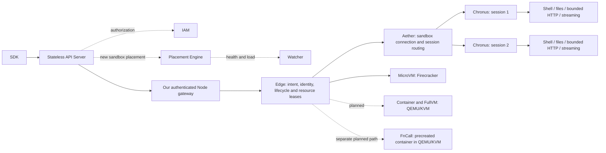

# Native execution and production isolation

Updated: 2026-10-12. Execution is a Linux development preview. Production
containment is a separate, unfinished gate; splitting the agent does not
establish a security boundary or a complete reproduction of aether/chronus.

## Runtime boundaries

The backend mapping follows [DSec §3.1–3.3](https://arxiv.org/html/2609.22978#S3.SS1):

| Public backend | Target execution path | Current boundary |
| --- | --- | --- |
| FnCall | A precreated container inside QEMU/KVM, then best-effort task cleanup | Not implemented. No aether/chronus on the task path. |
| Container | Docker inside an outer QEMU/KVM VM; per-sandbox aether/chronus | Existing Docker backend runs on the host and is trusted-development only. The outer VM path is unfinished. |
| MicroVM | Firecracker; per-sandbox aether/chronus | Existing real runtime; new guest execution gates have passed. |
| FullVM | Full QEMU/KVM VM; per-sandbox aether/chronus | Private QEMU primitive passed real Linux execution/fault gates; no public FullVM/Edge integration yet. Do not substitute Firecracker. |

These paths share SDK contracts and Edge ownership; their boot, containment and
recovery capabilities stay backend-specific. A production Container request
must not silently fall back to host Docker. FullVM and FnCall must not return a
success response from a driver that has not been implemented.

The formal cluster path is SDK → API Server → Edge → aether → chronus for
Container, MicroVM and FullVM operations. Creation also passes IAM authorization
and placement using watcher observations before the owning Edge checks capacity.
All remote sandbox calls, including files and streaming I/O, enter through the
API Server. The API Server remains stateless with respect to sandbox execution;
Edge owns the journals, identities and physical leases. Our authenticated Node
gateway bridges the API Server to the Edge's private UDS; it is an implementation
boundary, not another placement or lifecycle authority. The existing local UDS
SDK remains a compatibility/development interface, not the production cluster
ingress. See [cluster ownership and routing](CLUSTER_CONTROL_DESIGN.md).

`sdk/cluster.py` and `control/cluster_api.py` already implement this remote path
for the supported backends. Adding public FullVM requires extending the same
SDK/API/IAM/placement/Node/Edge chain, with capability checks and owner-bound
request IDs throughout. QEMU artifact paths and CID allocation remain node-local
administrator configuration; callers select environments and resource demands.
The private QEMU primitive and CID acceptance do not yet establish that full path.

### QEMU execution primitive

`runtime/backends/qemu.py` is a networkless Linux development primitive. It
requires pinned binary/kernel/template hashes, a mode-0700 instance directory,
KVM and vhost-vsock access, and an administrator-reserved host-wide guest CID.
It boots q35 with KVM only, a private raw disk, QEMU seccomp, disabled default
devices/network/user config, and a private QMP socket. The guest starts paused;
`query-kvm` must confirm KVM before `cont`. This is a trusted-artifact development
path, not a claim of complete host or tenant confinement. `production=True`
rejects before effects until Edge leases, confinement and network policy exist.

`runtime/backends/qmp.py` bounds frames, asynchronous events and one absolute
deadline. It negotiates QMP and matches response IDs; allowed operations are
status/KVM queries, stop/cont and quit. It never forwards arbitrary monitor
commands, migration paths or drive additions. Lost mutation replies are not
retried. Legacy port 5000 and native port 5001 keep their existing guest frames;
QEMU connects via Linux AF_VSOCK rather than Firecracker's CONNECT/UDS bridge.

The driver writes boot/control intent before effects and adopts only exact
UID/executable/argv/boot-ID/start-time identities using the existing pidfd
verifier. Interrupted intents retire attested processes rather than replay.
The fork-to-PID-record gap is recovered using the prior exact argv, unique UUID
and private paths. A different configuration or process identity rejects
adoption. Pause/resume keep the QEMU process alive; checkpoint/restore explicitly
rejects the Firecracker snapshot format. The standalone primitive has no guest
request journal, physical resource ledger or public SDK route; those belong
to subsequent Edge integration, not application callers.

Lifecycle operations share one owner lock and lifecycle mutex: a stop waiting
behind boot takes effect after boot returns, then stopped completion is final.
`QemuLifecycle.tla` bounds this primitive, interrupted control and boot count;
the checker requires late-ready and replay counterexamples. The controlled
regression holds guest readiness at a barrier, submits stop, releases readiness
and requires the final stopped record. This model and test are separate evidence,
not an automatic implementation-refinement proof or a cluster availability proof.

`runtime/isolation/vsock.py` provides internal `QemuCIDPool` reservations.
Cooperating Edges must share one private pool directory and an administrator
range disjoint from other host VMMs. `reserve(instance_directory)` durably commits
a CID and unique token before boot; repeated reservation returns that token.
Lost replies, restart, missing processes and elapsed time never release it.
Pool corruption or a missing established ledger fails closed. Kernel CID
collisions reject boot; the allocator does not replace an existing VMM.

`retire(lease, vm)` checks the CID, instance directory and token before effects,
holds the QEMU lifecycle mutex, stops the attested process, and only then commits
release. Adoption is required before retiring an existing boot intent. A delayed
old token cannot stop or release a replacement. Allocation uses a short flock
transaction; no VMM I/O runs under the shared pool lock. Stopping an unstarted
VM also persists a terminal record, fencing a later controller from booting that
directory after CID return. Callers must use the reservation to configure the
QEMU primitive; this helper is not yet wired into public Node/Edge admission.

`QemuCID.tla` bounds three lease tokens and two CIDs. `Reserve` maps to the locked
load/commit, `ProveDeath` to `QemuVM.stop` and its pidfd wait, and `Retire` to the
second token check and durable release. Controlled regressions force concurrent
reservation and blocked retirement, retain failed/uncertain commits, and require
stale cleanup to fail before VMM effects. Unsafe variants must expose unlocked
allocation, premature release and stale-token cleanup. These bounded checks do
not prove arbitrary filesystem recovery, runtime refinement or vsock security.



## Canonical execution implementation

`guest_native.c` is the compatibility build entry point. It includes the
canonical `native/protocol.h`, `native/aether.c`, `native/chronus.c`,
`native/files.c` and `native/http.c`. One executable forks distinct Linux
processes: an aether per sandbox, persistent chronus executors per shell session,
and bounded connection relays. No extra executable needs to be found after
chroot. The legacy guest port 5000 and native port 5001 are preserved.

Aether owns connection admission, session creation/routing and dead-worker
cleanup. Incomplete headers have independent five-second deadlines and share
one bounded poll loop; they cannot block a complete request's header admission.
Connection/worker counts remain bounded. Chronus owns shell state and session
operations; close and cancellation are monotone. Closed IDs are tombstoned;
reattach does not create a replacement shell. Edge remains the durable intent
and result owner, including UNKNOWN/no replay after an uncertain operation.

Linux subreapers clean adopted command descendants on session close. Aether
cleans untracked descendants adopted after a chronus dies. This is lifecycle
cleanup, not protection against a malicious guest-root process. Process roles
are diagnostics, not authorization evidence.

Sandbox-wide file APIs remain compatible. `session.read_file`, `write_file`
and `abort_file_write` route through that session's chronus. Upload metadata
records the owning session; another session cannot commit/abort it. Session
close or worker death removes incomplete owned uploads. Filesystem contents
remain sandbox-wide: sessions are not independent filesystem security tenants.

`session.request(method, url, headers=..., body=...)` performs bounded HTTP
inside chronus. It execs the guest's `/usr/bin/curl` or `/bin/curl` directly,
without shell evaluation; `-q` disables task-controlled curlrc. It supports
HTTP/HTTPS and explicit methods, does not follow redirects or automatically
retry, caps request headers at 8 KiB/32 entries, request body at 64 KiB, and
response body below 1 MiB. HTTPS retains curl's normal certificate verification.
Timeout and close bound execution; resource/file-size limits bound response
spools. Curl transport failures are explicit failures. Output truncation is
reported. This is a bounded request API, not HTTP response streaming or a
cross-platform chronus implementation.

Edge advertises new protocol extensions, and the guest independently advertises
its actual capabilities. HTTP needs curl in the prepared guest; a base guest
without it rejects the operation. New SDKs reject old Edges before sending
session-file/HTTP requests; upgraded cluster replicas/gateways also check their
owning Node/Edge. Never silently ignore a supplied session ID or emulate HTTP
with a shell command. Core SDK imports do not require curl, QEMU or OpenEnv.

## Production containment completion gates

Complete these gates before calling the system a production sandbox service:

1. QEMU/KVM driver and artifacts: explicit QEMU binary/kernel/guest identities,
   private per-instance disk and control sockets; no TCG fallback, unrestricted
   QMP endpoint or caller-supplied launch arguments. Preserve Edge journals and
   resource leases across controller and VMM failures.
2. Container containment: Docker and its privileges stay inside the outer VM;
   no host Docker socket, host directory or host device reaches a task. Charge
   outer-VM and shared-service overhead explicitly, including pool inventory.
3. Host process containment: constrained unprivileged VMM identity, AppArmor
   confinement, seccomp and enforced cgroup limits. Verify applied kernel state;
   missing prerequisites must reject creation rather than report enforcement.
4. Per-instance eBPF network policy: preserve netns isolation and limited
   administrator authority; deny cross-tenant/host/metadata access while allowing
   configured DNS, public egress and explicitly authorized proxy exceptions.
   Existing netns/iptables helpers are not evidence for this new eBPF gate.
5. FnCall and FullVM: use the backend mapping above, with separate explicit
   capability/cleanup gates. Function cleanup failure retires the container;
   full-VM pause/checkpoint capabilities cannot be copied from Firecracker.
6. Real fault acceptance: two independent tenants, denied host/peer access,
   resource exhaustion, guest-root misbehavior, abrupt VMM/agent death and
   complete identity-proven cleanup. Preserve host Docker/Grafana and routing.

QEMU dependencies can be installed without libvirt daemons or default networks.
A package installation alone does not pass these gates. See
[QEMU's isolation requirements](https://www.qemu.org/docs/master/system/security.html).

## Validation boundary

Real Linux acceptance on 2026-10-12 used QEMU 8.2.2, KVM, one vCPU and 512 MiB per
VM, with pinned binary/kernel/guest hashes recorded in each report.
`tools/verify_qemu_backend.py --fault-gates` passed 14 gates: guest execution,
persistent sessions, binary files, stdout/stderr streams, pause/resume, process
adoption, abrupt VMM death, lost QMP reply and a real controller SIGKILL between
spawn and PID record. `--cid-gates` passed 15 gates in a separate run, including
two concurrent VMs, CID exhaustion across pool restart, reuse with a stale-token
fence, peer continuity and a real controller crash retaining its reservation.
Both reports had no cleanup errors; all owned VMMs stopped and the CID pool was
empty. Existing host Docker/Grafana, interfaces and routes were preserved.

These are networkless raw-disk development tests. They do not establish public
FullVM SDK support, QEMU on-demand storage, outer-VM Docker, AppArmor/cgroup/eBPF
enforcement, VM HTTP support or a create-latency target. VM HTTP was not tested;
the prepared guest lacks curl. Production requests still reject before effects.
Reserve the requested CID(s) administratively before running acceptance:

```sh
PYTHONPATH=src:. python tools/verify_qemu_backend.py \
  --root /srv/dsec/qemu-accept-unique --manifest /srv/dsec/qemu-artifacts.json \
  --guest-cid 20000 --fault-gates --cid-gates
```

The root must be new and short enough for a private QMP socket. `--cid-gates`
requires both the specified CID and its immediate successor. No dependencies
or policies are installed by this tool; its report records source identity,
configuration, individual results and cleanup failures.

`tools/verify_native_sdk.py --executor-gates` checks real aether/chronus process
roles, scoped binary files and closed-session rejection, together with existing
session/stream/pause-restore gates. `tests/unit/test_native_guest.py` includes
controlled incomplete headers, session death and HTTP on a local test server;
SDK tests check journaled POST deduplication and reject old-Edge semantics.

`verification/AetherRouting.tla` bounds two requests and one session. It checks
ready-request eligibility and closed-session finality, and requires the unsafe
blocking-header and implicit-restart counterexamples. This is a finite routing
model, not a proof of socket fairness, arbitrary implementation refinement,
process-tree isolation or malicious-guest containment. Existing controlled C
shutdown traces and native lifecycle code mutations remain separate required
gates; source evidence now includes all native modules after the split.
