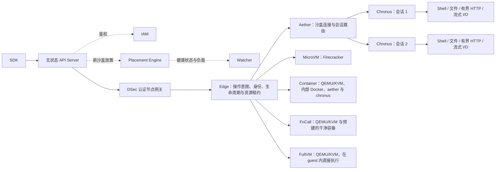

<a id="native-execution-and-production-isolation"></a>

# 原生执行与生产隔离

[English](EXECUTION_ISOLATION.md) · **简体中文**

更新于 2026-10-25。Linux 执行路径处于开发预览阶段。生产隔离另有尚未完成的验收。将 agent 拆分为不同进程本身不能建立安全边界，也不能证明完整复现了 aether/chronus。

<a id="runtime-boundaries"></a>

## 运行时边界

后端映射遵循 [DSec 第 3.1 至 3.3 节](https://arxiv.org/html/2609.22978#S3.SS1)。

| 公共后端 | 目标执行路径 | 当前边界 |
| --- | --- | --- |
| FnCall | 在 QEMU/KVM 内预建容器，每次调用后清理任务状态 | 无网络 Edge/SDK 路径。根文件系统只读，每次调用后重置 tmpfs 与进程；清理失败则回收整台 VM。任务执行路径不经过 aether/chronus。 |
| Container | Docker 运行在外层 QEMU/KVM VM 中，每个沙盒有独立的 aether/chronus | 无网络 QEMU guest 内运行 Docker 和原生 agent。旧宿主 Docker 仍是独立的开发配置。 |
| MicroVM | Firecracker，每个沙盒有独立的 aether/chronus | 已有真实运行时，新 guest 执行路径已通过验收。 |
| FullVM | QEMU/KVM 直接运行 guest OS，每个沙盒有独立的 aether/chronus | 固定版本的无网络 Linux guest 通过公共 SDK/Edge 使用私有磁盘。可选 virtio-gpu 2D 桌面；3D、其他操作系统启动及快照需单独验证。 |

各后端共用 SDK 契约且均由 Edge 管理，其启动、隔离和恢复能力各有边界。生产 Container 请求不能静默回退到宿主 Docker。FullVM 或 FnCall 驱动尚未实现时，必须拒绝请求。

Container、MicroVM 和 FullVM 的正式集群路径为 SDK → API Server → Edge → aether → chronus。创建时须先经 IAM 授权，再依据 Watcher 观测选定节点，最后由所属 Edge 检查容量。所有远程沙盒调用均经 API Server，包括文件及流式 I/O。API Server 不保存沙盒执行状态，日志、身份和物理租约由 Edge 管理。经认证的节点网关桥接 API Server 与 Edge 私有 UDS，不承担调度或生命周期决策。本地 UDS SDK 继续用于兼容和开发。详见[集群归属与路由](CLUSTER_CONTROL_DESIGN.zh-CN.md)。

FullVM 有独立的签名路由、IAM 准入及物理租约后端。各 QEMU 生命周期共用 Container RPC 传输，不可变的 `execution_mode=fullvm` 和环境修订共同指定直接在 guest 中执行。只有已观测到 FullVM 环境的节点可参与调度，创建前节点与 Edge 均复核绑定版本。QEMU 制品路径与 CID 分配留在节点本地；调用方选择环境并声明需求。可选桌面配置连接 virtio-gpu 2D、键盘和绝对坐标指针。只有所属 Edge 能通过私有 QMP 套接字请求 PNG 截图和有界输入。发送输入前先写动作日志，丢失回复不允许重放。此显示配置是主动启用的无网络预览路径，最初未启用宿主隔离配置。

<a id="qemu-execution-primitive"></a>

### QEMU 执行原语

`runtime/backends/qemu.py` 是 Linux 下的无网络开发执行原语，要求固定二进制、内核和模板哈希，实例目录权限为 0700，具备 KVM 与 vhost-vsock 访问权限，并由管理员在整台宿主机范围预留 guest CID。它只用 KVM 引导 q35，配置私有 raw 磁盘、QEMU seccomp、私有 QMP 套接字，禁用默认设备、网络和用户配置。guest 启动后先暂停，须由 `query-kvm` 确认 KVM 后才能 `cont`。此路径依赖可信制品。在具备 Edge 租约、隔离及网络策略之前，`production=True` 会在产生副作用前拒绝。

`runtime/backends/qmp.py` 对帧、异步事件和单次操作的绝对截止时间设限。它协商 QMP 并匹配响应 ID，仅允许状态/KVM 查询、stop/cont 和 quit。不会转发任意监视器命令、迁移路径或新增磁盘请求。变更响应丢失不重试。旧端口 5000 与原生端口 5001 沿用原有 guest 帧协议。QEMU 通过 Linux AF_VSOCK 连接，Firecracker 则使用 CONNECT/UDS 桥接。

驱动在产生副作用前记录启动或控制意图，使用现有 pidfd 验证器，仅接管 UID、可执行文件、argv、boot ID 和进程启动时间全部匹配的进程。意图被中断时回收已核实的进程，不重复执行。若中断发生在 fork 后、记录 PID 前，可以先前记录的精确 argv、唯一 UUID 和私有路径恢复。配置或身份不符时拒绝接管。暂停/恢复保留 QEMU 进程，checkpoint/restore 显式拒绝 Firecracker 快照格式。独立执行原语没有 guest 请求日志、物理资源台账或公共 SDK 路由；组合后的 Container/FnCall 后端在 Edge 中管理这些功能。

生命周期操作共用一把归属锁和一把生命周期互斥锁。在启动后方等待的 stop 会于启动返回后生效，随后已停止状态不可撤销。`QemuLifecycle.tla` 为该原语、中断控制和启动次数建模，检查要求出现迟到的就绪信号及重放反例。受控回归在屏障处挂起 guest 就绪，提交停止，再释放屏障，要求最终记录为已停止。模型和测试分别提供证据，不能据此证明自动实现细化或集群可用性。

`runtime/isolation/vsock.py` 提供内部 `QemuCIDPool` 预留。协同运行的多个 Edge 必须共用私有资源池目录，管理员划定的 CID 区间不得与其他 VMM 重叠。`reserve(instance_directory)` 在启动前持久提交 CID 和唯一 token，重复预留返回同一 token。丢回复、重启、进程暂时找不到和时间流逝均不释放它。资源池损坏或已建立的台账丢失时拒绝继续。内核发现 CID 冲突时拒绝启动，分配器不会替换已有 VMM。

`retire(lease, vm)` 在操作前检查 CID、实例目录和 token，持有 QEMU 生命周期互斥锁，先停止经核实的进程，再提交释放。存在启动意图时须先接管才能回收。迟到的旧 token 无法停止或释放替代实例。分配使用短 flock 事务，共享池锁内不执行 VMM I/O。停止从未启动的 VM 也会持久化终态，防止归还 CID 后另一控制器再从旧目录启动。调用方须用预留结果配置 QEMU；组合后端已将其纳入节点和 Edge 准入流程。

`QemuCID.tla` 的模型边界为三个租约 token 和两个 CID。`Reserve` 对应加锁加载/提交，`ProveDeath` 对应 `QemuVM.stop` 及 pidfd 等待，`Retire` 对应第二次 token 校验和持久释放。受控回归触发并发预留与回收阻塞，保留失败或结果不确定的提交，并验证陈旧清理请求在影响 VMM 前失败。不安全变体须暴露无锁分配、过早释放和旧 token 清理。检查范围未覆盖任意文件系统故障恢复、整个运行时的细化关系或 vsock 安全性。



<a id="networkless-container-and-fncall-integration"></a>

### 无网络 Container 和 FnCall 集成

`runtime/backends/qemu_container.py` 将现有 QEMU 驱动、共用 CID 分配器与 Edge 的准入、生命周期及动作日志组合起来。可信的 `qemu_execution_catalog` 固定各环境的模式、二进制/内核/模板哈希、镜像配置摘要和内外层资源限制。运行时不调用宿主 Docker。准备工具从已停止的固定版本宿主镜像容器导出，只在 guest 启动后运行内层 Docker。QEMU 目录未注册的环境会被拒绝，不会回退到宿主 Docker。该路径不连接网卡。

SDK 提供 `run_container` 和 `run_fncall`。每个 FnCall 句柄持有计入资源预算的预热槽，`invoke` 执行一次独立的有界 shell 调用。同槽调用串行，并行时创建更多槽。API 沿用经认证的 `container` 路由和准入类别，在不可变规格及日志摘要中编码 `execution_mode=fncall`。由此新增执行策略，同时沿用原有 IAM/资源权威和签名路由字节。状态接口公开实际执行路径。调度要求节点已上报 `fncall-execution-v1`，协议支持本身不能证明函数环境已准备好。旧 Container 请求和生命周期摘要保持兼容。新函数环境要求 API、节点与 Edge 同时升级，旧 Edge 不得回退到 Docker 执行函数。

本发行版的 Edge 持久化契约版本为 **2**。现有请求字节兼容，但旧 Edge 无法解读 QEMU/FnCall 记录及失败证明。契约 1 与 2 之间不允许自动升级或回滚；应使用完成排空的新实例，并单独审查迁移。不要绕过检查、恢复仍在运行的台账备份或在单个节点混用新旧服务角色。

仅运行于 guest 内的 supervisor 在 vsock 5002 上使用有界帧，仅接受宿主 CID，解析操作前先认证每台 VM 的独立密钥。它只提供固定的状态、执行和查询操作，不接受任意 Docker 参数。容器不带 capabilities、特权、网络、宿主设备或 Docker 套接字；5001 上的原生 Container 流量连接内部 Unix agent。FnCall 槽使用只读根盘以及可写的 `/work` 和 `/tmp` tmpfs。返回 DONE 前重启同一预建容器，以替换进程并重置 tmpfs。执行或清理结果不确定时，Edge 回收整台 VM。FnCall 不提供持久会话或快照 API。Container 在停止前保留可写工作区和原生会话，快照和内存卸载尚未支持。

离线 FullVM 预览可选择 UEFI 和固定版本的 QCOW2 启动盘。Edge 将 QEMU 镜像工具、固件和基盘绑定到环境修订，以只读方式连接基盘链，按虚拟磁盘容量预留空间。每台 VM 独占写入层和固件变量。guest 内的 systemd 服务启动同一经认证的 DSec guest 协议。

<a id="authenticated-qemu-guest-channels"></a>

### QEMU guest 通道认证

`runtime/isolation/guest_auth.py` 为宿主与独立可信 guest 提供 `dsec-vsock-auth-v1`。5002 控制通道及 5001 原生/流式通道在解析 JSON 或连接内部 agent 之前均要求新生成的 256 位 challenge 和绑定方向与端口的 HMAC-SHA256 证明。绝对握手时限两秒，覆盖分段读写。组合路径不回退到旧协议；其他 VM、其他端口或旧 challenge 的证明均不能授权操作。此边界之后的原生二进制协议不变；Firecracker 和独立开发原语保留各自原有传输。此握手提供认证，不加密载荷。

每个新实例在预留 CID 前，先在 0700 实例目录创建随机、0600、单硬链接密钥文件。QEMU 启动意图记入日志后，通过专用私有 Unix chardev/virtio-serial 端口一次性注入密钥。guest 启动任务容器前，由可信 supervisor 将密钥读入内存，不写入 guest 磁盘，也不向任务暴露引导设备。QEMU argv、内核命令行、任务配置、API、etcd 与日志均不得包含密钥值。描述符与 QEMU 记录绑定其 SHA-256。Edge 重启后读取同一私有密钥，接管经核实的 VM，无需再次注入或执行。文件丢失、变更、有额外链接、属主不符或可被其他用户读取均拒绝。新 VM 使用新密钥，不支持在线轮换。退役记录保留私有密钥，直到显式删除实例目录。

此处使用 catalog/descriptor schema 2。schema 1 的旧 guest 须通过原发行版排空，再重新构建；修改 schema 字段不能完成迁移。仍需 Edge 持久化契约 2。信任边界包含 root 与 Edge 服务 UID；该门槛防止其他宿主用户绕过 vsock 认证，无法覆盖可信主体已失陷的情况。恶意连接洪泛、宿主 LSM/cgroup 隔离、网络和共享存储另有生产门槛；`production=True` 仍会拒绝。

`GuestChannelAuth.tla` 在两个密钥、两个端口、两个新 challenge 的边界内穷举副作用准入，把 HMAC 抽象为不可伪造的绑定证明。它没有证明密码算法、随机性或整个运行时安全。所需的绕过、端口绑定和重放反例，在 `check_security_refinement.py` 中分别对应可控套接字测试和源码守卫变异。QEMU 生命周期/CID 模型继续覆盖启动中断与退役顺序。

调用 guest 执行前先提交 Edge 动作日志。回复丢失时结果为 UNKNOWN，不能再次调用函数。槽退役后仍可查询结果和失败证据。创建失败时，须回收私有可写盘并完成 VMM/CID 清理后才能归还配额。保留日志、有界诊断记录和控制台日志，不留下未计费的任务磁盘。即使没有结果回复，不确定操作的证明也包含已接受的命令参数及受长度限制的失败原因。持久失败回复带有清理证明，控制器失联后的核对也使用同一证明。健康状态过期不会释放租约，已停止的旧记录不能回收复用 CID 的新 token。

IAM 将节点上报的外层 VM 最低需求与请求配额对照。Edge 启动前还须预留外层内存、vCPU 及整个私有可写盘，而非仅计算内层容器内存。修改执行目录后须显式重启 Edge，现有制品不匹配期间撤回健康声明。

`FnCallSlot.tla` 模型包含两个调用 ID 以及 READY、RUNNING、CLEANING、RETIRING、STOPPED 阶段。`Clean` 对应 DONE 前的 supervisor 重启和身份校验，`Lose` 对应执行/清理失败及宿主 UNKNOWN/退役，`Release` 使用现有 pidfd/CID 退役证明。受控测试在事件屏障处阻塞清理，验证另一调用不能启动。必需的变异包括移除清理、允许重放 UNKNOWN，以及绕过失败槽隔离。CI 检查这些边界并记录源码/模型哈希。自动实现细化及无界活性仍未证明。

上述验收打通了离线执行路径。QEMU 仍上报 `production=False`。宿主 cgroup/LSM、抗连接洪泛、受控出站网络、Container 内存卸载及共享只读镜像存储需分别验收。本次准备使用私有 ext4 guest 和内层 VFS Docker，不能作为 EROFS/OverlayBD 性能结果。2026-10-26 新增可选的 QEMU EROFS/pmem-DAX 目录挂载配置，并在限定 Container/FnCall 场景通过共享与写隔离验收，见宿主指南和安装报告。原有 MicroVM 的 EROFS、DAX、OverlayBD/ublk 和 3FS 机制不变。本轮未证明 60 ms 冷启动或大规模部署密度。

<a id="canonical-execution-implementation"></a>

## 原生执行的标准实现

`guest_native.c` 是兼容构建入口，引入标准的 `native/protocol.h`、`native/aether.c`、`native/chronus.c`、`native/files.c` 和 `native/http.c`。一个二进制文件 fork 出不同的 Linux 进程：每个沙盒一个 aether，每个 shell 会话一个常驻 chronus 执行器，以及数量受限的连接中继。chroot 后无需再查找其他可执行文件。保留旧 guest 端口 5000 和原生端口 5001。

aether 负责连接准入、创建和路由会话，清理已退出的 worker。尚未收全的请求头各有独立五秒时限，共用有界 poll 循环，不会阻塞已收全请求头的准入。连接和 worker 数量均受限。chronus 管理 shell 状态和会话操作，关闭及取消状态只能向前推进。关闭 ID 保留墓碑，重新连接不会创建替代 shell。Edge 持久记录意图及结果，操作结果不确定时沿用 UNKNOWN 且不重放。

会话关闭时，Linux subreaper 清理接管的命令后代进程。chronus 退出后，aether 清理接管的未登记后代进程。这用于生命周期清理，不能防御恶意 guest root。进程角色仅供诊断，不作为授权证明。

原有沙盒级文件 API 继续兼容。`session.read_file`、`write_file` 和 `abort_file_write` 经所属会话的 chronus 执行。上传元数据记录会话身份，其他会话无权提交或中止。会话关闭或 worker 退出时清理该会话未完成的上传。文件系统内容仍由整个沙盒共享，单个会话并非独立的文件访问安全域。

`session.request(method, url, headers=..., body=...)` 在 chronus 内执行有界 HTTP 请求，直接 exec guest 的 `/usr/bin/curl` 或 `/bin/curl`，无需 shell 求值；`-q` 禁用任务可控制的 curlrc。支持 HTTP/HTTPS 及显式指定的方法，不跟随重定向或自动重试。请求头最多 8 KiB 或 32 项，请求正文最多 64 KiB，响应正文须小于 1 MiB。HTTPS 沿用 curl 的正常证书验证。超时和关闭限制执行时长，资源与文件大小限制约束临时响应文件。curl 传输失败显式报错，截断输出会标记。此接口尚不提供 HTTP 响应流或跨平台 chronus。

Edge 声明新协议扩展，guest 独立上报实际能力。HTTP 需要准备好的 guest 中装有 curl，基础 guest 缺失时拒绝操作。新 SDK 在发送会话文件/HTTP 请求前会拒绝旧 Edge，升级后的集群副本和网关也会检查所属节点与 Edge。不能忽略传入的会话 ID 或用 shell 命令模拟 HTTP。导入核心 SDK 无需 curl、QEMU 或 OpenEnv。

<a id="production-containment-completion-gates"></a>

## 生产隔离的验收条件

<a id="opt-in-qemu-host-confinement"></a>

### 可选的 QEMU 宿主隔离

schema 2 执行目录可含 `host_isolation`。未配置策略时沿用明确标为仅供开发的路径；已配置策略时不能回退。`runtime/isolation/qemu_host.py` 将每 VM 的独立 cgroup v2 限制与管理员安装的实例级 AppArmor broker 组合。`qemu_launch.py` 是仅使用标准库、以普通权限等待放行后执行的子进程。父进程须先记录等待中的子进程身份、从 broker 取得持久归属声明，再给出 exec 许可。取得许可前父进程管道断开，子进程退出。多线程 Edge 内不执行 Python `preexec_fn`。

子进程进入所属 cgroup，请求 exec 时启用 AppArmor，设置 NoNewPrivs、禁用 core dump，再 exec QEMU。当 QMP/KVM 就绪后、放行 guest 前，以及重新接管时，Edge 检查实际 cgroup inode/限制、进程归属、精准匹配且强制执行的配置、NoNewPrivs、有效和允许的 capabilities 均为零，以及 seccomp 模式。broker 仅授权该 VM 的可写盘、日志、两个监听路径、可信内核/二进制/库和必要设备，不授予任务私密数据、其他 VM 目录、cgroup 写入或后续 exec 权限。允许建立流套接字和同一配置下的内部匿名 IPC，路径套接字仍须获准精确文件权限。抽象地址绑定与连接不予授权，也不会使用带地址限定的 deny 连带阻止无地址的 socket 创建。必须支持细粒度 Unix 套接字管控，更广网络策略另行验收。

对离线 UEFI FullVM，管理员批准的目录列明对 OVMF 代码和 QCOW2 基盘链的只读权限。每 VM 配置允许写自己的 QCOW2、固件变量和截图输出。broker 保存选择的启动文件和配置，声明与退役时复用该身份。

broker 串行处理准备、声明与退役。声明绑定协作启动器精确的 PID、UID、可执行文件/argv、boot ID 和启动时间。退役必须先证明该进程已死，再持久记录不可逆的 RETIRED 标记，最后卸载配置。pidfd 仍存活或进程详情不可读均不能作为死亡证明。Edge 还须确认 cgroup 为空且身份匹配，才能删除并归还 CID/物理租约。在可能失败的清理前先记录死亡，重启后可继续退役，无需重新打开复用后的 PID 或再次启动。缺少前置条件或策略/限额漂移时拒绝继续。

内存准入包括 guest RAM 和所配置的 VMM 开销。强制执行 CPU、memory、swap 和 pids 控制器限制；此处未验证宿主 I/O 节流。服务要求 systemd 显式委派 cgroup 和子组，后端不能占用其他服务的层级。见[宿主指南](../guides/DSEC_HOST_CONFIGURATION.zh-CN.md#qemu-host-confinement)。

`QemuHostGate.tla` 对提交、声明、exec、死亡与退役的交错建模，要求不安全的提前卸载、延迟声明、未经提交即 exec 和在组外运行产生反例。受控回归及三项源码变异检查对应守卫。实机控制器验收在一个专用委派用户服务内验证 CPU 节流、子进程 OOM 和 pids 限制拒绝。修正 Unix socket 创建规则后，Linux 上以安装版 wheel 通过全部七项公共 FnCall/Container/MicroVM 检查和 24 项编排检查，覆盖真实内核隔离、拒绝读取宿主文件、通道认证、Edge 接管及完整回收。见[验收报告](../reports/DSEC_V01_INSTALL_ACCEPTANCE.md)。以上覆盖有界的无网络宿主路径；全运行时细化、更广的租户/对抗隔离、网络与抗洪泛生产条件仍待验证。

另有可选网络路径通过安装版 wheel 的有限 Linux 验收。固定实例的 root broker 管理独立 netns/TAP/veth，先附加固定版本的 TC eBPF IPv4 策略，再激活接口，只向普通 Edge 用户交付一个已打开的 TAP FD。已有的受控子进程在 PID 写入日志后、取得 AppArmor 声明和 exec 许可前声明网络。VMM 留在宿主网络命名空间，没有网络管理能力，唯一的网络设备 FD 指向该实例隔离的 TAP。AppArmor 允许继承该实例私有且归 root 的设备节点，不授予 `/dev/net/tun`。任务的 Docker host 网络仅指外层 guest。

`QemuNetworkLease.tla` 在有限范围内验证策略先于激活、FD 仅交付一次、存活进程保留租约和退役不可逆。受控变异覆盖对应的启动、借出、死亡和隔离标记。真实进程回归还会停止 broker 包装器，让后代持有继承的锁；命令结束前清理流程不能取锁。这仅验证测试工具的命令串行化假设。原生 C 数据包测试与 TC 使用同一判定逻辑，单独编译成功不证明内核已加载。实机通过七项 SDK 检查和 29 项编排检查，含八种经过已附加内核程序的数据包、Container 公网 HTTPS、FnCall DNS、拒绝宿主/metadata/私网、重启接管与完整清理。本次只使用一台预备节点且未使用代理。多租户对抗、洪泛及规模化另待验收，生产模式仍禁用。见[网络配置与限制](../guides/DSEC_HOST_CONFIGURATION.zh-CN.md#isolated-qemu-ipv4-egress-bounded-linux-acceptance)。

将系统作为生产沙盒服务前，须通过以下条件。

1. QEMU/KVM 驱动和制品：显式绑定 QEMU 二进制、内核与 guest 身份；每实例有私有磁盘及控制端点。禁止回退 TCG、开放无限制 QMP 或接受调用方自定启动参数。控制器或 VMM 故障后仍须保留 Edge 日志和资源租约。
2. Container 隔离：Docker 及所需特权限于外层 VM 内；任务不能访问宿主 Docker 套接字、目录或设备。显式计算外层 VM 与共享服务的开销，包括池内库存。
3. 宿主进程隔离：VMM 使用受限的普通身份，启用 AppArmor、seccomp 及强制 cgroup 限制。核验实际内核状态；缺少前置条件必须拒绝创建，不能报告已强制执行。
4. 实例级 eBPF 网络策略：保留 netns 隔离和有限管理员权限，拒绝跨租户、宿主和 metadata 访问，允许已配置的 DNS、公网出站及明确授权的代理例外。现有 netns/iptables helper 验收不能替代此 eBPF 验收。
5. FnCall 与 FullVM：采用前述后端映射，分别声明和验收能力及清理要求。函数清理失败须退役容器；不能将 Firecracker 的暂停/检查点能力直接赋给 FullVM。
6. 真实故障验收：两个独立租户、拒绝宿主和其他租户访问、资源耗尽、guest root 不当操作、VMM/agent 突然退出，以及依据身份完整回收。验证宿主 Docker、Grafana 和路由不受影响。

可单独安装 QEMU 依赖，无需部署 libvirt 守护进程或默认网络。安装软件包不能替代上述验收。参见 [QEMU 隔离要求](https://www.qemu.org/docs/master/system/security.html)。

<a id="validation-boundary"></a>

## 验证范围

2026-10-12 的 Linux 实机验收使用 QEMU 8.2.2、KVM，每 VM 一个 vCPU、512 MiB 内存；各报告均记录二进制/内核/guest 的固定哈希。`tools/verify_qemu_backend.py --fault-gates` 通过 14 项，包括 guest 执行、持久会话、二进制文件、标准输出/错误流、暂停恢复、进程接管、VMM 突然退出、QMP 回复丢失，以及 spawn 和记录 PID 之间对真实控制器发送 SIGKILL。另一次运行中 `--cid-gates` 通过 15 项，涵盖两台并发 VM、池重启后 CID 耗尽、复用时防旧 token、同伴 VM 连续运行，以及真实控制器崩溃后仍保有预留。两份报告均无回收错误，所有自有 VMM 停止，CID 池为空。宿主已有 Docker/Grafana、网卡和路由保持正常。

以上均是无网络 raw 磁盘开发测试，不能据此证明公共 FullVM SDK、QEMU 按需存储、外层 VM 内 Docker、AppArmor/cgroup/eBPF 强制隔离、VM HTTP 或创建延迟目标。已准备的 guest 缺少 curl，未测 VM HTTP。生产请求仍会在产生副作用前拒绝。执行验收前由管理员预留所需 CID。

```sh
PYTHONPATH=src:. python tools/verify_qemu_backend.py \
  --root /srv/dsec/qemu-accept-unique --manifest /srv/dsec/qemu-artifacts.json \
  --guest-cid 20000 --fault-gates --cid-gates
```

根目录必须是新目录，且路径须足够短以容纳私有 QMP 套接字。`--cid-gates` 需要所指定的 CID 及紧邻的下一个 CID。工具不会安装依赖或策略，报告记录源码身份、配置、各项结果及清理失败。

`tools/verify_native_sdk.py --executor-gates` 验证真实 aether/chronus 进程角色、会话范围内的二进制文件和拒绝已关闭会话，还覆盖既有会话、流及暂停恢复检查。`tests/unit/test_native_guest.py` 包含可控的不完整请求头、会话死亡和本地测试服务 HTTP；SDK 测试验证已记入日志的 POST 去重，以及拒绝旧 Edge 语义。

`verification/AetherRouting.tla` 的模型上限为两个请求和一个会话，检查已就绪请求可被接纳以及关闭会话终态，并要求不安全的阻塞请求头、隐式重启产生反例。该有限路由模型不覆盖套接字公平性、任意实现细化、进程树隔离或恶意 guest 防护。既有受控 C 停机轨迹和原生生命周期代码变异仍需单独通过，拆分后源码证据现包括全部原生模块。
