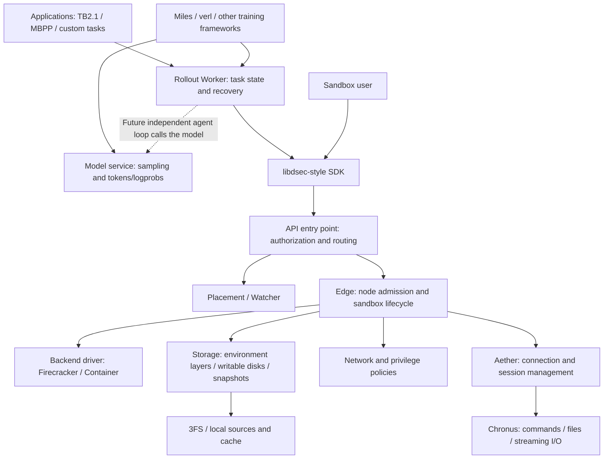

<a id="dsec-模块化重构设计"></a>

# DSec modular refactoring design

**English** · [简体中文](MODULAR_REFACTOR_DESIGN.md)

Status as of 2026-10-08: design approved, R0/R1 implemented. R2 local responsibility consolidation and the planned R3 physical-host upgrade, storage, recovery, shared admission, short application and GRPO checks are complete. Code baseline: `7f70524187e61e13f123c7999098858cf3411bd5`.

<a id="1-目标与范围"></a>

## 1. Goals and scope

Build a general-purpose elastic sandbox system. The lower layers follow the mechanisms and responsibilities described in the DSec paper. The upper layers provide a stable sandbox SDK, recoverable rollout services and optional application integrations. TB2.1 and MBPP are consumers of the system.

The system manages sandbox resources: guest RAM, VMMs, environment-layer and writable-disk caches, shared storage services, and the resources used for creation, pause, snapshots, restore and retirement. External frameworks own model weights, KV cache, optimizer state, training/inference GPU memory and model offload. Node admission may observe pressure from external workloads. It neither unloads models nor tunes inference servers. The worker's policy interface calls an external model service.

First clarify modules, dependencies and ownership while preserving verified behavior. For missing capabilities, identify their implementation location and acceptance criteria. This refactor does not add every production capability, rewrite Rust storage, or incorporate RL algorithms and GPU memory patches. Moving directories alone does not reproduce paper mechanisms.

The paper's execution path includes libdsec, a control plane and edge → aether → chronus, with separate mechanisms for storage, memory, CPU and pause/restore. We take [paper sections 3, 5, 6 and 7](https://arxiv.org/html/2609.22978) as design references. Public descriptions do not establish wire compatibility. We retain libdsec-style call semantics with independently versioned protocols.

<a id="仓库布局与当前重构边界"></a>

### Repository layout and refactor boundary

Canonical source lives in `src/dsec/`, `src/dsec_adapters/` and `src/dsec_image/`. Historical top-level imports are collected in `compat/python/`. Installed import names and CLIs stay stable. The repository root no longer serves as Python's package discovery root. Task and training recipes remain in optional `apps/`. Installation uses package metadata, testing uses unittest discovery and release tools define the source export. These operations no longer depend on a shared manual test-file list.

A worker is a deployment role. Episode execution responsibilities are composed in the same process along the following boundaries, without adding a service or a second recovery state machine.

| Module | Responsibilities and state ownership |
| --- | --- |
| `rollout/episode.py` | In-memory `Episode` record and existing version-1 representation. Does not run recovery loops. |
| `rollout/episodes.py` | `EpisodeService` is the sole state coordinator. Owns the creation lock, episode mutation lock, persistence ordering, recovery evidence and lease release. Creation, pause, stop and other operations have named entry points. |
| `rollout/store.py` | `EpisodeStore` owns directory exclusivity and fsync without interpreting the task lifecycle. `RolloutStore` is its former name. |
| `rollout/actions.py` | `ActionExecutor` validates action identity and submits a command once. It does not write episode state, release leases or automatically retry. |
| `rollout/dialogue.py` | Projects dialogue from committed history without storing another copy of model context. |
| `rollout/evaluation.py` | `EvaluationService` validates registrations, arguments and plug-in results through explicit dependencies. It neither imports TB2.1 nor commits scoring state. |
| `rollout/server.py` | Private RPC framing, error serialization, CLI and process composition. Cannot write episode state. |
| `compat/rollout_worker.py`, `rollout/worker.py` | Historical constructor arguments, counter/TB2.1 configuration bridges and import/launch aliases reuse `EpisodeService`. |

`EpisodeService.dispatch` executes actions, scoring and lifecycle operations under the same per-episode lock. Persist pending state before submitting an action and append history only after confirmation. Recover UNKNOWN solely from evidence for the original request. Action and scoring components cannot override commit order or infer resource release from failures or disconnects. Status and dialogue queries read the original record outside the lock, so a long verifier does not block them.

The service persists environment execution state. The complete sampling loop, token/logprobs and training algorithm remain external. A future separate `AgentRunner` must use these interfaces rather than moving model or training state into the episode service under the worker name. The production SDK uses the API Server. Private RPC is not an application entry point.

Next review IAM/API/Placement/Watcher dependency direction, separate Host CLI configuration, deployment rendering and diagnostics, and remove runtime dependencies on old task compatibility code. This round preserves sandbox mechanisms, wire protocols, durable fields and training functionality. Existing bounded models and controlled implementation regressions must still pass. Real fault, production containment and model training acceptance retain their own requirements. Historical reports retain their version context.

<a id="control-host-decisions"></a>

<a id="控制面与-host-cli-的关键设计决策"></a>

### Control-plane and Host CLI decisions

Approved 2026-10-20 as constraints on the next structural refactor. Approval does not close implementation. Preserve existing API, CLI, wire protocols, persistence formats and HA deployment requirements. Specify and verify behavior changes separately.

| ID | Decision | Rationale and constraints |
| --- | --- | --- |
| CPH-001 | Each kind of state has one authoritative owner | IAM and its admission ledger own identity, authorization, tenant quotas and admission receipts. Placement selects a Node. API manages request identity, routing and queries. Node/Edge own physical resources and sandbox lifecycles. Watcher reconciles through existing owners. Reuse transactions and ledgers without duplicating physical accounting or execution state. |
| CPH-002 | Business logic depends on contracts and explicit interfaces. Composition selects concrete implementations. | Control depends on contracts, storage and Node-call interfaces. Execution owns Docker/VMM, mounts and networking. Host composes them. Business modules may not depend on the CLI, deployment scripts or historical compatibility entry points. Place genuinely shared protocols in contracts. Avoid ownerless common utilities. |
| CPH-003 | Host CLI owns arguments, configuration, composition and operational entry points | Dedicated components own config validation, diagnostics, deployment rendering, startup and acceptance. CLI branches call them without reimplementing authorization, placement or recovery. Additional deployment modes share configuration and service construction. |
| CPH-004 | Distinguish read, plan, render and apply side effects | Help, parsing, basic diagnostics and read-only planning cannot mutate the host. Config reads may access files but cannot create directories or change environment variables. Render produces reviewable files only in the explicit output directory. Apply/start explicitly mutate state. Privileged work uses limited helpers and verifies ownership, protecting existing Docker, networking and services. |
| CPH-005 | Failure semantics and commit order are compatibility requirements | Preserve IDs, digests, idempotence, CAS/fencing, persistence order and release evidence. Node loss, failed health checks and lost replies may yield UNKNOWN and cannot establish stop or release. Watcher must not replay effects, select a new execution owner or release quota on that basis. |
| CPH-006 | Decide module and deployment boundaries separately | Splitting a responsibility does not itself add a process, RPC or setting. Compose modules under existing roles, preserving HA and trust boundaries. Renaming or moving modules is no reason to add microservices or weaken availability. |
| CPH-007 | Verify refactoring through inspectable boundaries and compatibility evidence | Check dependencies, old/new configurations, request results and durable records. Revisit model/code mappings and controlled regressions for authorization, admission, recovery or concurrency changes. Run relevant Linux acceptance when runtime behavior changes. Directory moves, fixtures and model checks alone do not prove production behavior. |
| CPH-008 | Deployment is part of refactor acceptance | Generate a read-only plan from declarative topology and Node configuration, then role-specific deployment files. Execute administrator bootstrap and service startup separately. Reuse the implementation for one or multiple hosts. Specify identities, ports, directories, artifact versions, credential owners and dependency order. Verify join/exit, repeat execution, recovery, upgrade/rollback and continuity of host services. On mixed CPU/GPU clusters DSec owns sandboxes and their budgets. External systems manage GPU/model services. |
| CPH-009 | Dynamic membership and admission share the quorum boundary | On 2026-10-24 the user required new Nodes to join without changing or restarting controllers. etcd stores public routes, versioned membership and an in-flight count updated atomically by IAM, without plaintext Node credentials or duplicated execution state. Only ACTIVE Nodes accept work. Maintenance and retirement check held admissions and evidence from owning Edge/episode services. All management changes use expected versions and request IDs. RETIRED keeps an identity tombstone. Loss or UNKNOWN cannot release quota or move ownership. Administrators issue deployment bundles with the existing CA. Gateways derive Node-specific credentials from the cluster key and independently require mTLS. Trusted infrastructure registration does not become tenant self-registration. |

CPH-012 (2026-10-25): All three execution paths use SDK → API → IAM/Placement → Node → Edge. FnCall and Container place inner Docker inside QEMU/KVM, sharing scheduler, leases and request journal. MicroVM retains Firecracker and its EROFS/DAX/OverlayBD/3FS paths. FnCall is an execution policy with immutable `execution_mode=fncall`. It uses the container route and physical lease category, reports the actual path in status and requires an observed prepared function environment before placement. Warm slots consume quota. An invocation must complete cleanup before finishing or reusing the slot. Never replay UNKNOWN. Failed cleanup retires the outer VM. The policy has no session/snapshot API. Config, images and CID pool are trusted Node-local inputs. Tenants cannot pass host paths or Docker arguments. Admission covers outer RAM/vCPU/private disk. Both stop and failed creation require proof of VMM death and CID return before resource release. Networkless execution is the first gate. LSM/cgroups, host-user vsock authorization, networking and Container memory offload have separate gates. It is not proof of production containment, image sharing or paper performance. New QEMU/FnCall records require Edge contract 2. No automatic upgrade or rollback across 1/2. Compatible request bytes do not allow old Edges to adopt new state. Start with a fresh drained instance and separately review old-state migration.

CPH-013 (2026-10-25): A QEMU guest's host CID check is insufficient for Edge authentication. Container/FnCall require per-instance keys and mutual HMAC proofs bound to fresh challenges, direction and port. Both 5002 control and 5001 sessions/streams authenticate before parsing or connecting to the inner agent. Inject the key only through a private virtio-serial bootstrap into trusted supervisor memory. Keep it out of task devices, argv and cluster state. On adoption, Edge uses the same private key and recorded digest. Restart never resends the secret or repeats work. Reject missing or changed credentials without silently rekeying a live VM. Each new VM gets a new key. Live rotation needs a separate design. This composition requires catalog/descriptor schema 2 and a rebuilt guest. Drain old instances under their old release first. Existing Firecracker and the standalone QEMU development primitive are unaffected. Root and the Edge UID remain trusted. Authentication does not close LSM/cgroup, flooding or networking containment gates.

CPH-014 (2026-10-25): Host containment is part of launch and retirement. Do not move a running VMM into a cgroup after exec. A QEMU environment with `host_isolation` requires its own delegated service subtree. Enforce outer RAM plus explicit VMM overhead, CPU quota, pids and swap. Include overhead in Node/IAM minimum admission. Edge durably records launch intent and waiting child identity. The fixed-privilege AppArmor broker claims the child before Edge permits it to enter the cgroup, set its on-exec profile and exec QEMU. Do not use threaded `preexec_fn` or post-exec migration. Adoption verifies pidfd/exe/argv, kernel cgroup, enforcing profile, NoNewPrivs, zero effective/permitted capabilities and seccomp. At launch check after QMP/KVM readiness and before guest `cont`. Exec completion alone does not prove QEMU has installed seccomp. Lost launch permission never authorizes replay. The broker accepts only 32-hex instance IDs and verified launcher PIDs, without launching processes, changing networks or accepting policy text. Unload AppArmor only after the claimed process is dead. Persist the retirement tombstone first. No delayed claim can reverse it. Failed unload or cgroup cleanup retains the lease. Administrators install only the fixed helper/config/sudoers once. Service and per-VM cgroup operations use an ordinary account. No additional lifecycle owner is introduced. Networking, adversarial tenants and other backends require separate production evidence.

CPH-015 (2026-10-25): QEMU networking reuses the separate netns/TAP boundary without adding a root VMM launcher. Administrators pin instance, uplink, address slots, DNS, optional proxy and eBPF object digest. The limited broker creates only this instance's network and delivers a TAP FD once over its private Unix socket with mutual UID checks. Callers supply neither commands nor host paths. QEMU retains an ordinary host UID and inherits a TAP FD into the isolated netns. Inner Docker host networking refers only to the outer guest. TAP is opened via a private root-owned device node. AppArmor permits inherited access to that instance's node without a wildcard `/dev/net/tun` grant. Control/native traffic continues over authenticated vsock.

Attach TC eBPF on TAP ingress and verify it before link activation. In addition to public IPv4 TCP/UDP egress, allow only the pinned DNS and optional TCP proxy exception. Deny source MAC/IP spoofing, IPv6, VLAN, fragments, metadata and other private destinations by default. Namespace conntrack/NAT and exactly tagged host rules handle returns. Do not flush host chains or reuse Docker bridges. IPv6, ICMP, live policy updates and bandwidth shaping remain outside this release.

The network ledger is an Edge lifecycle resource receipt. Persist FD-delivery intent before sending. Do not claim again after a lost reply. Journal the launch child and claim networking before exec. Prove VM death and persist RETIRING before dismantling resources. A late claim cannot reverse retirement. Fixed root subcommands inherit the broker's FD lock so even killing the broker cannot start cleanup before in-flight commands finish. Preserve leases and evidence on failure. Adoption requires matching namespace inode, interface identity, BPF ID/tag and policy. Do not rebuild a running instance's network. Persist original launch errors before attempting cleanup, recording cleanup failures separately. If an unreturned creation lacks its failure marker, continue retirement only with proof of original request, original instance and VMM death. Failure recovery must not destroy a successful RUNNING create. Retry STOPPING cleanup within the same Edge. Only the original lifecycle and IAM owners release leases after disk, CID and network proofs are complete. No manual ledger edits. The model and controlled mutations check finite boundaries. Installed-wheel Linux acceptance additionally passed seven SDK and 29 bounded physical checks, including real attached kernel program, egress/denials, adoption and full retirement. Scope is one prepared Node with no proxy, excluding adversarial tenants, flooding and scale.

CPH-016 (2026-10-25): Adding a prebuilt environment must preserve retired-instance history. The execution catalog may explicitly reference up to 16 old catalogs by path and content digest. Accept an old instance digest only if its original environment definition, CID pool, host confinement and network policy match field by field. Trust does not propagate through another catalog's history list. Catalog and older snapshots remain immutable during an Edge lifetime. Maintenance requires keeping the old snapshot and restarting explicitly. This supports appending environments, without reinterpreting old instances under new images, resources or privileges. SDK callers cannot set this list. Adding an environment does not require reinstalling the fixed-instance administrator helper.

CPH-017 (2026-10-26): The QEMU private disk's cache mode belongs to the environment. SDK callers cannot override it. Old environments default to buffered. New ones can explicitly select Direct I/O with flush preserved, rejecting unsupported filesystems without silent fallback. Physical failures showed dirty/writeback pages from a large image import competing with guest RAM in the same cgroup. Remove the host copy rather than simply raising the memory allowance. Direct I/O is distinct from DAX and changes neither guest RAM nor immutable shared layers. Adoption still verifies every config field and full argv. Retirement retains death, identity and empty-cgroup gates. Persist raw peak/OOM/CPU/I/O counters to the instance directory before removing kernel counters. Missing fields stay missing. Models, tool parsers and RL algorithms remain optional application code.

CPH-018 (2026-10-26): EROFS plus virtio-pmem/DAX is the execution capability for sharing read-only data across instances. Direct I/O cannot substitute for it. QEMU catalogs pin ordered read-only layers and the task directories to share. Map original host files with share, readonly and ROM semantics, without per-VM copies or preallocation. Guests enforce ro,dax=always and verify STATX_ATTR_DAX on actual files. Reject READY on mismatch in devices, layer order, size, DAX or private upper. No silent fallback to virtio-blk. Writes copy up to OverlayFS on each VM's private ext4 disk. FnCall shared directories are read-only, preventing changes from carrying across calls.

Publish uncompressed EROFS with no inline regular-file data and 128 MiB alignment. The compressed distribution profile is separate. An EROFS filename cannot establish DAX for all files. Bound pmem count and size, including guest struct-page metadata in available RAM checks. Mapped capacity is not RSS. Initial node authorization pins a shared artifact root. Each instance requests read/mmap only on its required files under that root and records exact layer identities in the existing policy state machine. Claim and retirement use that record, preventing live expansion of privileges or layer substitution. Later publication under the root requires no helper reinstall. SDK cannot specify host paths or override the catalog. Runtime full-file SHA-256 still touches artifact data, so this path does not prove cold on-demand read performance. Connect existing fs-verity publication receipts before measuring demand I/O. Unit regressions do not replace two-VM Linux sharing, application migration or performance checks. Bounded installed Container/FnCall acceptance on 2026-10-26 demonstrated shared file pages and private writes (installation report). Application migration and performance remain separate.

CPH-019 (2026-10-26): Shared-directory migration is an offline publication step. From a pinned local image ID, create a stopped export container and split its flattened tar stream. Shared directories' contents go to immutable EROFS, their mount points remain in the lean archive, and the runtime Config, numeric ownership, modes and tar metadata are preserved. Reject inputs whose semantics cannot be preserved, including cross-partition hardlinks, declared volumes and non-directory roots. Never execute host task code, modify the host Docker driver or skip official setup/tests via build tooling. Publish image/template/layers as a new environment, keeping the old one. Build-time task-image and digest-pinned task-archive are mutually exclusive. Validate read-only file sharing and private copy-up separately. A smaller private import alone does not prove improvements in cold startup or whole-VM memory.

CPH-020 (2026-10-26): Operator-prepared guest and catalog jointly fix long-command budgets. Applications may select separate tool/verifier budgets up to that ceiling. Default 30 seconds, maximum 300 seconds, aligned with the remote transport wait boundary. Status/result queries do not take the long execution lock, so a busy Node can remain observable. The existing operation gate serializes effects on one sandbox. Stop cannot overtake an admitted shell. Caller cancellation or disconnect cannot revoke an admitted effect.

After lost replies or restart Edge queries only the original guest's durable result. Request identity, argument digest, DONE and successful response must all match before repairing host UNKNOWN to DONE. Lacking proof, leave it unknown. No replay or refund presented as completion. On timeout or error, clean command descendants. Linux subreapers cover setsid/orphans. Uncertain cleanup cannot report success. Successful Container commands preserve explicitly started background services. Container init reaps exited orphans to prevent zombies after background services stop. Mount the trusted init read-only at the reserved `/dsec-init` root path instead of Docker's implicit `/sbin/docker-init`, which layered `/usr` mounts would hide. FnCall still resets the entire container. Compile-time native-session limits, host channel and guest forwarding waits share the prepared budget without a hidden short ceiling. `QemuCommandRecovery` models AtMostOnce, DoneRequiresExactProof and independent queries. Controlled regressions are in `test_qemu_commands.py`. `check_command_refinement.py` checks the exact-proof guard mutation and records model/source/test digests. This finite model does not prove full implementation refinement or liveness.

CPH-021 (2026-10-27): Agent, sandbox execution and benchmark harness have separate owners. Keep the mature agent's prompt, parser, history and control loop upstream. `integrations/<agent>` only maps its runtime/actions/observations onto the public DSec SDK, without tasks, scorers or training. `apps/<benchmark>` owns the public instruction, environment selection, candidate artifact and independent scoring. The core does not branch on benchmark or agent names. Dependencies point toward SDK/contracts. An integration cannot import concrete runtime/host drivers or add provider-specific branches to API Server or Edge.

Capability matching includes semantics: independently verify persistent cwd/env, PTY stdin, nonblocking poll, interrupt, file line ranges, editor undo and Python state. A successful call does not imply complete compatibility. Publish OpenHands' PTY and ipykernel/ACI as optional guest tool artifacts reached over native HTTP. Native DSec transfer still reads/writes files. Separate tools from task interpreter, immutable layers and config. Prepare tool dependencies offline and reuse them across tasks without episode downloads. Do not leak tool Python's PYTHONHOME/PYTHONPATH to the task shell. The guest companion binds guest loopback, exposes no host port, runs no host task code and needs no new root helper. Promote primitives to versioned native capabilities only when multiple agents need the same semantics. Keep individual agents' tool-service protocols outside the core.

OpenHands event and conversation IDs determine stable mutation IDs. Reject reuse with different arguments. Disconnect and unknown outcomes never authorize replay. If the interactive tool process epoch changes, reject the lost session without silently recreating it. A terminal action has a single completion boundary for its entire script. A PS1 prompt after the first line cannot finish a multiline script. Require the final exit status and prevent later actions from consuming stale frames. Evaluating the full script inside a persistent shell preserves cwd/env/aliases. Input to an existing foreground process remains raw stdin. Use deterministic multiline, heredoc and subsequent-output ownership tests. HTTP success or an exit code alone is insufficient. The agent owns its VM lifecycle. The harness scores in a fresh sandbox. Unknown execution and incomplete grading cannot become negative samples. External trainers own model weights, training tokens/logprobs, policy version and algorithm. Frozen OpenHands message logs alone do not constitute trainable TITO. Record local contracts, actual upstream control loops, real model trajectories and official scores separately. Oracle success is distinct from model success, and an application run does not cover every upstream capability. On close, first reject new work, wait for submitted SDK operations, then request stop. Cancellation of an upstream awaiter does not revoke an accepted effect. Do not close its SDK event loop prematurely. Retry the same stop ID within a bounded wait only on definitive ServiceBusy non-admission. UNKNOWN remains sticky across close/atexit without replay. Record actual recovery lookup/cleanup proof separately, preserving the original unknown record.

CPH-008 was added on 2026-10-21 to include deployment in refactor acceptance. It did not itself implement fleet installation, dynamic membership or upgrade rollback, or extend prior HA evidence.

CPH-009 changes behavior beyond package layout. `control.node_lifecycle` owns membership decisions. IAM updates quota and Node in-flight count in the same CAS. `control.node_admin` composes root-project policy authorization with trusted Node proof. `host.node_directory` constructs only the TLS route. Watcher discovers new Nodes through a bounded probe pool. Fleet CLI calls only the management API. The new state machine, three required counterexamples and controlled CAS tests verify admission/maintenance and delayed recovery boundaries. Existing configs default to compatibility mode. Before enabling managed membership upgrade all control-plane, Node and episode services. Do not mix it with older admission code. No automatic adoption of old UNKNOWN admissions or expansion of project quotas.

CPH-010 (2026-10-24): Upgrades switch only the stateless software. Reuse maintenance state, IAM CAS and original Edge/episode persistence directories without restoring a live ledger backup or recreating the node identity. Bind the target to the verified wheel's content digest, package version and explicit protocol/persistence compatibility contract. The Node must be in maintenance with no in-flight work. Pending upgrade blocks scheduling resumption and retirement. Commit requires proof that gateway, Edge and configured episode service loaded the same target release. Rollback verifies actual restoration of the original software. Both share a version-conditional transaction. Stale processes or delayed operations cannot override a newer commit. Install alongside the previous version. Host tools prepare/start explicitly. They never implicitly execute SSH, sudo, systemd or Docker, or roll back an UNKNOWN operation. Rebuild controllers one replica at a time with a pinned image, retaining config, CA, etcd and data volumes. Verify the first replica before switching the second. Incompatible persistence changes, etcd upgrades, privileged helper/VMM updates and credential rotation need separate review. Old deployments without version proof must install a compatible baseline in a maintenance window. Never mix with controllers unaware of pending upgrades.

CPH-011 (2026-10-24): Rotate authentication credentials, TLS trust and long-lived route signing separately. Preserve route keys and sandbox addresses. Internal Node authentication uses a separate versioned key set. Overlap new and old credentials before explicit retirement. TLS uses private versioned reference files and immutable material. Publication performs a local CAS on expected generation. Running readers reject older generations or same-generation rewrites. SDK and control plane share secure file/TLS components depending only on stdlib/contracts, without Host/runtime imports. Each request chooses current authentication material. Rotation never automatically resends an uncertain write. Recheck trust and certificate pin retirement before accepting a request. A completed TLS handshake alone does not authorize it. Work accepted first may finish. API token rotation uses IAM CAS. Only the new token can complete revocation of the old token, while cancellation requires proof from the original token. Persist credential hashes only. Migrate etcd service accounts with separate scoped identities and overlap, never by resetting identities or ledgers with bootstrap. Root CA rotation can expand to dual trust, switch and contract. Do not implicitly replace etcd peer CA, JWT root signing keys or route root signing keys. They require their own cluster/long-lived identity migration plans. Owner keys, certificates and root administrator material remain in administrator/role-specific files. Rotation does not permit tenants to register Nodes or take over execution.

Implementation order: separate Host CLI configuration/composition, then control-plane decision and transport logic, then remove reverse dependencies. Module size helps locate problems. Split at state ownership and effect boundaries.

Cite the applicable CPH IDs in refactor reviews and document how their constraints were preserved and checked. To replace a decision, record its successor, rationale and migration effect here, updating affected dependency guards, protocols and model mappings. Code movement is not a reason to silently change constraints. Historical evidence keeps its original version context.

<a id="host-cli-的配置与组合边界"></a>

### Host CLI configuration and composition

Split Host configuration and local service composition under CPH-002–004. Preserve schema-1, CLI subcommands and existing imports. This is a local ownership split without changes to control-plane deployment or ownership of physical sandbox resources.

| Module | Responsibility and permitted effects |
| --- | --- |
| `host/configuration.py` | Read config, copy and normalize in-memory data and construct init defaults. No directory creation, permission/environment mutation or service connection. Depends only on stdlib and contracts. |
| `host/composition.py` | Describe commands, `ServicePlan`, environment overrides, private directories, budgets and readiness dependencies. Constructing the plan does not execute it. |
| `host/services.py` | Executes an explicit launch plan using the existing checks for private directories, atomic budget publication, environment setup, dependency waits and exec. Also provides read-only status and readiness queries. |
| `host/deployment.py` | Generates systemd and privilege files in an explicit output directory, or lets init create configuration exclusively. Installing the files and starting services are separate steps. |
| `host/diagnostics.py` | Performs basic read-only checks and explicit live probes. Permission repair is outside its scope. |
| `host/acceptance.py` | Runs tasks, injects failures, collects evidence and cleans up for explicit smoke tests. Configuration loading and launch planning belong to other components. |
| `host/cli.py` | Handles argparse and command routing. Historical function imports remain available and delegate to the components above. |

A launch plan holds an in-memory snapshot of the configuration. Execution preserves the order of directory checks, environment setup, budget publication and dependency waits. `--validate-only` goes directly to the existing artifact-verification subprocess without first creating runtime directories or budget files. `contracts/network.py` owns shared proxy-domain validation. The original runtime and legacy imports still refer to that function, so the configuration layer can reuse pure validation without depending on execution. Business modules must not import the Host CLI.

This structure adds no CLI subcommands, RPCs, service processes or configuration versions. Acceptance separately checks side-effect-free configuration and planning, launch call order, generated-file compatibility, clean installation and behavior on Linux hardware. Local tests cannot establish the outcome of a real service upgrade or verify KVM, networking or privileges.

<a id="部署职责与验收顺序"></a>

### Deployment responsibilities and acceptance sequence

Deployment roles are control-plane replica, etcd member, sandbox Node and optional external training or inference service. Represent CPU, memory and disk differences in configuration and capabilities so that nodes can share deployment code. A GPU service can act solely as an API client. When it shares a machine with Edge, the sandbox budget must explicitly reserve resources for it.

| Stage | Authoritative inputs, outputs and constraints |
| --- | --- |
| Read and plan | Validate the declarative topology, node specifications and pinned artifact identities to produce a reviewable plan. This step must not generate credentials, create directories, call Docker or start processes. |
| Generate deployment files | From the plan, generate private certificates, credentials and role configuration. Write only to the designated new directory, without contacting services, installing dependencies or starting services. |
| Administrator initialization | Explicitly prepare KVM, network helpers, storage and service identities within each node's scope. Check ownership before acting. Installation must preserve existing Docker and routing configuration. |
| Join and accept | Admit a Node to work only after dependencies, credentials and capabilities pass their checks. Keep evidence that enables recovery on failure. Registration alone does not prove that physical resources are ready. |
| Maintain and retire | Stop new placements and handle in-flight work before upgrading, rolling back or retiring. Removing a route or losing contact does not prove resource release. |

`deploy/cluster/planning.py` currently handles read-only topology, node and artifact validation and planning. `configuration.py` derives controller, Node, initialization and client role configurations from the plan without side effects. `prepare.py` explicitly generates deployment files. The legacy `prepare(args)` delegates to these components and the CLI's `--plan` prints only the plan. The plan records an input snapshot and the wheel digest. Generation rejects a changed artifact and writes the same bytes it verified. `export_hosts.py` still exports directories for distribution by role without starting services. Initialization now uses the credential reader directly.

Bulk Node inventories and unified role configuration are implemented. The new `--nodes` takes a schema-1 inventory. Legacy single-Node arguments normalize to the same plan. Conflicting declarations are rejected before file generation. Each Node has its own certificate and token, controllers reference the corresponding token, and a per-host export includes only the local Node's files. The shared route key, etcd identity and trust boundary are preserved. This covers initial deployment file generation. Dynamic join, retirement and upgrades require their own lifecycle operations.

Node preflight and restricted network initialization have local implementations. `host/node_probe.py` checks Linux, KVM/TUN, privileges and network prerequisites read-only and is embedded in the administrator installer as standard-library code. `host/node_setup.py` combines the existing doctor, directory and budget checks to bind a Node declaration to this instance. The Host CLI routes `preflight` and `prepare-node`, with the latter delegating to the existing helper renderer. Restricted containers that lack a required device or capability are rejected before any write, regardless of their provider. Installation rechecks the live platform and pinned runtime identity independently of the preflight file. The microVM Node gateway applies the platform gate before creating state or contacting the control plane. The procedure installs no software, loads no modules, creates no accounts and starts no services. Helper permissions and state ownership retain their original scope. Read-only preflight from a standalone wheel on existing Linux file-backend and OverlayBD Host configurations correctly classified missing network configuration and a missing storage socket after shutdown. If an unprivileged account cannot read the namespace of PID 1, the result explicitly requires administrator verification. On 2026-10-24, a new isolated instance on an existing Linux host passed nine administrator checks covering inspection without installation, rejection under real capability restrictions, NoNewPrivs or a private mount namespace, rejection of tampered artifacts, resumption after partial installation following publication of the first file, repeated installation and refusal to overwrite different content. Thirteen unprivileged checks covered helper argument, directory and slot boundaries, UID and network namespace evidence from a real 512 MiB VM, guest commands and routing, refusal to remove networking from a running VM, SDK stop and resource cleanup. Three final checks confirmed removal of only the temporary privileges and five newly added rules. Host interfaces, routes and firewall, and the PIDs and startup identities of pre-existing containers matched the baseline. The test installed no application and used no GPU. Clean-host automated deployment, adversarial isolation certification and dynamic cluster retirement still require separate acceptance.

Join, maintenance and retirement are available through the management API under CPH-009. Two-machine acceptance covered discovery of a new Node, draining, maintenance, resumption and retirement with real containers and episodes, gateway recovery, and control-plane and etcd member failures. All three etcd members ran on the Mac, so independent-failure-domain HA remains unverified. CPH-010 implements compatible runtime upgrade and rollback using staging in separate directories, versioned maintenance transactions and proof of the loaded software. The control plane switches one replica image at a time. Two-machine container Node acceptance covered successful upgrade, restoration of the source version after startup failure, return to a retained version through a new transaction, historical episode and reward reads, and rolling API replica upgrades and rollbacks. The tests exclude arbitrary earlier versions and state-format migrations. The next work is credential rotation and clean-host deployment. Each step reuses the existing runtime, IAM and helper, without adding an installation state store or execution ledger. Full deployment acceptance must start on a clean Linux node, follow the published guide and test repeated execution, interrupted operations and continuity of existing services. The fixed-instance tests cover a narrower scope.

<a id="控制面决策与传输边界"></a>

### Control-plane decision and transport boundaries

The control plane separates decisions from transport under CPH-001, 002 and 005–007. Module migration preserves deployment roles, authentication order, request formats, timeouts, resource ledgers and persistence versions.

| Module | Responsibility |
| --- | --- |
| `control/cluster_api.py` and `rollout_api.py` | Authorize, admit and route using injected IAM, Placement and Node interfaces, without opening network connections. |
| `control/iam.py` and `cluster_inventory.py` | Validate identities, quotas and acknowledgments in the existing coordination-store transactions, independently of the etcd HTTP/TLS implementation. |
| `control/placement.py` and `watcher.py` | Select candidates from observations and track observation freshness. Physical resources have a single ledger. |
| `control/node_gateway.py` | Owns the Node admission serialization boundary, persists DISPATCHED before sending, translates identities, validates evidence and decides on recovery or release. |
| `control/rollout_gateway.py` | Reconciles episode and physical sandbox evidence through injected worker and inspection interfaces. The worker owns episode runtime state. |
| `host/node_transport.py` | `NodeRPC` interprets existing Node RPC envelopes and `RemoteNode` encodes and sends them. The transport cannot retry, change placement or infer release from a lost connection. |
| `host/cluster_http.py` | Handles TLS, internal controller credentials, HTTP framing, concurrency limits and error responses. The composition entry point injects business functions. |
| `control/coordination.py` and `etcd_auth.py` | Provide the existing etcd transport and credential renewal implementations. Only the composition entry point supplies these to IAM. |
| `host/cluster.py` | Wires the real store, private SDK UDS connection, Node RPC and HTTP service, and owns process startup and shutdown. |
| `contracts/rpc.py` | Defines shared remote error identities. Historical SDK error imports remain available, so decision code can catch errors without importing the SDK. |

`host.cluster_node.NodeGateway` preserves historical construction and `.dispatch()` usage. Its thin subclass inherits the same admission and recovery methods and delegates dispatch to `NodeRPC`. Production wiring uses the control-plane class and independent `NodeRPC` directly. The old `host.rollout_gateway` aliases the canonical module object and the old `RemoteNode` import references the same transport class. The compatibility layer must not add decisions.

Model-to-code mappings target the canonical `control/node_gateway.py` and `control/rollout_gateway.py`. `ClusterAdmission` retains its quota, unique owner and release-evidence boundaries. `RolloutDispatch` retains the health condition for first dispatch, the replay prohibition and the cleanup evidence boundary. Controlled regressions use the production classes and mutation checks directly modify the canonical methods so the checks exercise production wiring. Dependency checks also verify that business logic has no Host, SDK or concrete transport dependencies, transport has no decision-module dependency, and legacy imports and exception objects retain their identities.

<a id="2-逻辑架构"></a>

## 2. Logical architecture



The diagram shows the target logical architecture. Dashed lines indicate that training lifecycle decoupling is incomplete. In this design snapshot FnCall has a future, separate execution path. Full VMs and distributed IAM, placement and watcher are also outside the implemented scope shown here.

**A module need not be a service process.** The initial deployment still uses one machine. API routing and Edge can share a process, placement has one candidate node, and the worker runs independently. Keep request entry points and ownership boundaries intact so services can be split later. Ordinary sandbox operations can bypass the rollout worker. Applications use it when they need episode management.

<a id="3-顶层模块"></a>

## 3. Top-level modules

Use one `dsec` Python package and initially retain the existing distribution name and CLI. The eight core modules are listed below.

| Module | Responsibility | Outside its scope |
| --- | --- | --- |
| `contracts` | Specs, IDs, capabilities, errors, results, protocol versions and recovery states | Starting processes, reading host resources or importing task plugins |
| `sdk` | Thin client, sandbox handles, request correlation, attach/query and libdsec-style arguments | Starting Docker or VMMs, mounting disks or managing sudo |
| `control` | Request ingress, authorization boundaries, node routing, placement and watcher interfaces | Keeping a second copy of sandbox execution state or running guest commands |
| `runtime` | Edge, lifecycle, node admission, backend drivers, sessions, isolation and ready pools | TB2 scoring, model parsing or training algorithms |
| `storage` | Environment manifests, layers, sources, caches, block devices, snapshots and publication | Driving rollouts, allocating CPU or managing training GPU memory |
| `rollout` | Episodes, action and dialogue logs, task plugin calls, scoring evidence and recovery | GRPO/GAE, model-specific parsing or direct VMM calls |
| `observability` | Event and metric definitions, sampling, accounting boundaries and Prometheus export | Making lifecycle decisions or interpreting a sampling failure as a task failure |
| `host` | Deployment configuration, dependency checks, installation plans, privileged helpers and service composition | Changing global host configuration during an ordinary SDK call |

Proposed directory layout

```text
src/dsec/
  contracts/       sandbox.py  environment.py  execution.py  protocol.py
  sdk/             client.py  sandbox.py  rollout.py  transport.py
  control/         api.py  routing.py  placement.py  watcher.py  authorization.py
  runtime/
    edge.py  registry.py  lifecycle.py  admission.py  resources.py  pool.py
    backends/      firecracker.py  container.py
    sessions/      channel.py  dispatcher.py
    isolation/     network.py  policy.py
  storage/
    catalog.py  layers.py  sources.py  cache.py  devices.py
    snapshots.py  publication.py  integrity.py
  rollout/         worker.py  episodes.py  actions.py  dialogue.py  evaluation.py
  observability/   events.py  meters.py  prometheus.py
  host/            configuration.py  doctor.py  install.py  privileged_helper.py
native/            guest_agent/ (existing C implementation, later evolving into aether/chronus)
integrations/      miles/  verl/ (optional dependencies and thin adapters)
apps/              tb21/  mbpp/ (tasks, data preparation, scorers and example configurations)
tests/             unit/  contracts/  integration/  acceptance/  packaging/
```

These directories group responsibilities. Create files as their implementation requires them. The design reserves boundaries for capabilities such as IAM that are still pending, without adding empty services, simulated success responses or unused abstractions. Each implementation has one canonical location.

<a id="4-底层机制的约束"></a>

## 4. Constraints on the underlying mechanisms

The table specifies project implementation constraints. The current status follows the code and the [roadmap](../../ROADMAP.md). Target capabilities have separate acceptance requirements.

| Area | Target implementation and constraints | Gap to address |
| --- | --- | --- |
| Environment composition | Explicitly distinguish base, workspace and toolkit. Instances share immutable read-only layers and write to a private layer. Offline merging preserves deletion semantics. | Remove dependence on `tb2-*` IDs from core storage behavior and move the merge policy into the general publication flow. |
| On-demand storage | Support local or 3FS sources. Declare metadata and data layout capabilities explicitly. Record read granularity, caching and actual remote reads. | Full local staging cannot validate remote reads on demand. Single-host 3FS leaves distributed acceptance open. |
| microVM disks | Model read-only EROFS layers separately from writable ext4 disks backed by OverlayBD and ublk. Supply a separate writable disk for Docker data-root when needed. | Reuse the existing storage components and keep alternatives to the FUSE single-disk composition available. |
| Memory | Use DAX for shareable read-only layers. DAMON/FPR provides a separate reclamation policy. Verify combinations against device and kernel capabilities. | Expose the current local-backing restriction for DAX. Verification with two VMs covers only the tested configurations. |
| CPU | LS/BE scheduling belongs to runtime resource policy. Record logical CPUs, SMT and the actual applied policy. | The current container tests leave VMM QoS unverified. |
| Pause and resume | Record a microVM pause checkpoint separately from VMM termination. Resume with the same identity. Declare container freezing and memory offload separately. | Docker pause establishes freezing only. |
| Environment publication | `pack_diff` publishes disk deltas as a new environment after build-identity isolation, cleanup of residual state and integrity checks. | Existing disk COW provides a foundation. A prepared-state fork still requires a separate publication flow. |
| Session execution | Edge owns resources, aether owns connections and sessions, and chronus owns operations within a session. | The current `guest_agent.c` is a single-connection command prototype. Multi-session and streaming implementations are pending. |
| Security | Edge applies instance policies through a restricted helper. Model file and socket protection separately from egress policy. | Network namespaces cover only part of eBPF/AppArmor isolation. Keep the host-container path for trusted development and comparisons. |

Two components use FUSE. The 3FS client uses it, and a separate project implementation uses it to present or forward multiple EROFS layers. Determining alignment with the paper requires checking each component's role beyond the choice of FUSE.

Ready pools, memory-baseline forks and local proxies are optional engineering extensions. Measure ordinary creates, pool hits and baseline forks separately. Report the time to claim a ready instance under its own metric.

<a id="5-状态所有权与依赖规则"></a>

## 5. State ownership and dependency rules

| State | Sole owner | Access by other modules |
| --- | --- | --- |
| Sandbox lifecycle, TTL, VMM identity, network and disk handles, node resource leases | Runtime Edge | Query or issue commands. Direct registry modification is prohibited. |
| Immutable environment and snapshot objects, content digests, dependencies, storage references | Storage | Edge holds leases and confirms release after stopping. Storage decides when to reclaim objects based on references and leases. |
| Rollout, step/action IDs, dialogue, task budget, scoring and evidence | Rollout Worker | SDK and training framework read and submit through the protocol. |
| Tokens and logprobs, model weights, optimizer, native training samples | Training framework. Future persistent policy records belong behind an explicit trajectory-storage interface. | The worker may retain raw responses and references. Text cannot reconstruct original tokens or logprobs. |
| Node health, load and placement view | Derived Control view | Rebuild from Edge. Edge remains authoritative for sandbox existence. |
| Project permissions and quotas (future) | Control authorization | Edge still checks local admission. Both authorization and available capacity are required. |
| Monitoring samples and aggregate metrics | Observability | Samples can expire or be reconstructed. Action execution requires its own evidence. |

Edge ultimately owns the physical node ledger for CPU, memory, disk and network. The worker retains job concurrency and API quotas. Move existing `WorkScheduler` node reservations into that ledger, keeping a single reservation path throughout the transition so two services cannot charge for the same memory. Define which deployments share an API quota. Workers must not each receive the full global allowance.

Dependency rules

- `contracts` has no dependencies on other project modules. `sdk` depends only on contracts and client transport.
- Control, runtime, storage and rollout communicate using interfaces or messages in contracts and do not import one another's concrete drivers.
- Backends have no episode management responsibilities. Storage does not import runtime. Edge connects them through composition.
- Task and training integrations depend on the core. The core has no dependencies on `apps`, Miles, verl, OpenEnv or benchmark-specific behavior.
- Host injects implementations at the service composition entry point. The SDK and contracts must not import Host. Monitoring receives observations, and policies have explicit interfaces of their own.

<a id="6-关键接口与执行流程"></a>

## 6. Key interfaces and execution flows

<a id="61-接口"></a>

### 6.1 Interfaces

`SandboxSpec` specifies the backend, environment digest, resource limits, TTL, network policy, initial identity and storage, memory and QoS policies. `EnvironmentManifest` specifies layer roles, order, formats, dependency digests and validation requirements. For compatibility, `FrameworkProfile` remains a configuration entry point and gradually converts inputs to these general objects. Experiment names such as `e3_mixed` and task-name prefixes must no longer represent kernel capabilities.

`Capabilities` distinguishes at least command, persistent session, streaming, file I/O, pause, memory offload, disk snapshot, memory restore, prepared fork, pack_diff, DAX and QoS. Results explain unavailable capabilities and validate combinations against the current environment.

Backend Drivers provide runtime primitives such as launch, inspect, freeze, checkpoint, restore and terminate. SessionChannel owns command execution. Storage provides prepare, create_writable, checkpoint_disk, publish_diff and release. Each implementation owns its system calls. The interfaces take no TB2 task paths.

<a id="62-创建和执行"></a>

### 6.2 Create and execute

1. The SDK submits a stable request ID and SandboxSpec. The API routes them to Edge.
2. Edge checks capabilities and available resources, persists the create intent, acquires resource, storage and network handles, and launches the backend.
3. Return READY only after the session channel is ready and identity verified. On failure, unwind acquired resources in reverse order and record outstanding items.
4. Route exec by sandbox, session and action IDs through the entry point. Track acceptance, completion and result persistence as separate states.
5. A caller disconnect leaves the result unknown. Query or reconcile before proceeding. Never automatically replay a command with side effects.

UNKNOWN describes an action outcome. It cannot by itself justify destroying an instance during a health check. Use a separate control connection or reserved capacity for health checks so long-running commands cannot exhaust the pool and trigger a false failure. Configure separate timeouts for commands, RPCs, episodes and verifiers. Also configure output collection limits, model-feedback truncation and raw-evidence retention independently.

<a id="63-暂停分叉与发布"></a>

### 6.3 Pause, fork and publish

- Pause and resume within an episode retain identity, dialogue and completed actions. Acknowledge completion only once the state can be recovered.
- A prepared-state fork creates new sandbox and rollout IDs, private writes and independent history. Children share the read-only baseline and its references.
- `pack_diff` produces disk state for a new environment, excluding previous sessions, task answers, worker logs and model context.
- Stop can be called repeatedly. Retain leases and cleanup progress until resources are actually released, avoiding premature success and permanent reservations.

Cross-process recovery requires a versioned journal and verification of actual process and device identities. A PID or stale directory name alone cannot authorize operations on a host process. General side effects have no exactly-once guarantee under arbitrary failures. Preserve unknown state and evidence.

<a id="64-任务与-rl"></a>

### 6.4 Tasks and RL

TaskAdapter owns instructions, preparation requirements, action interpretation and the verifier. Worker advances episodes durably and records scoring. TrainerAdapter handles model templates, sampling, native tokens and logprobs, and training-sample conversion. The training framework retains GRPO group identity. If a slot fails or its outcome is unknown, compacting the array must not replace it with another task's sample.

The existing reset, step, evaluate and stop entry points and the [feedback protocol](AGENT_ENVIRONMENT_CONTRACT.md) remain valid. Gradually connect MBPP scoring acknowledgments and the TB2 worker scoring path to the same evidence interface while preserving their original reward semantics. Record task failure, budget exhaustion, verifier failure and UNKNOWN actions separately. Infrastructure errors have their own outcome.

In the short term, training frameworks may continue to drive the agent loop. Full decoupling as described in the paper is a separate milestone. The worker and agent sandbox retain runtime state and request inference through a reconnectable policy interface, allowing continuation or safe pause after the training process exits. Durable shell logs alone do not establish that capability. Episodes missing historical TITO are excluded from training updates.

<a id="7-现有代码迁移位置"></a>

## 7. Migration of existing code

| Current file or component | Destination and required split |
| --- | --- |
| `sandbox_client.py` and `libdsec_compat.py` | sdk. Move container startup and journal management from client to Edge. |
| `scheduled_dsec.py` and `rollout_client.py` | SDK rollout client. Remove imports of the server-side scheduler implementation. |
| `sandbox_sdk.py` and `durable_manager.py` | runtime edge/lifecycle/registry/pool. Use composition to remove coupling through manager inheritance. |
| `sandboxd.py` | control entry point and host service composition. Remove the binding to the TB2 verifier. |
| `microvm.py`, `container_backend.py`, container supervisor/broker | runtime backends. Share lifecycle constraints while retaining backend-specific behavior. |
| `network_namespace.py`, privileged helper, `egress_proxy.py` | runtime isolation and host administration. Separate policy from installation. |
| Catalog, OverlayBD/ublk client, shared layers, artifact publisher/integrity | storage. Unify object references and publication. |
| `work_scheduler.py`, `admission_guard.py`, `work_journal.py` | Separate the runtime admission/resource ledger from rollout job and API quotas. |
| `rollout_workerd.py`, `rollout_store.py`, `agent_environment.py` | rollout and contracts. Put shell formatting in its own module and move task-specific branches out of the worker. |
| Resource meter/monitor, shared service monitor | observability. Preserve distinct accounting boundaries for instances, shared services and nodes. |
| `tb2_*` and TB2 manifests and verifiers in adapters | apps/tb21. Register through a plugin so the core need not infer task types from IDs. |
| Miles adapters and OpenEnv compatibility entry points | Optional integrations. Retain generic task contracts in the core and move out framework details. |
| `dsec_host.py`, service admin, installation templates | host. Thin CLI entry points invoke canonical modules without duplicating business logic. |

Preserve legacy top-level imports with thin forwarding and deprecation notes during migration. Keep a single implementation. Check compatibility separately for installation entry points, configuration formats, journal schemas, environment digests and existing instance paths. Re-creating all instances would hide recovery regressions. Upgrade privileged helpers through a separate installation plan. The refactor must leave host Docker, Grafana and global networking intact.

<a id="8-分阶段实施与验收"></a>

## 8. Phased implementation and acceptance

| Phase | Deliverable | Pass criteria |
| --- | --- | --- |
| R0: Freeze contracts | This design, inventory of existing APIs, CLIs and schemas, module dependency baseline, recovery and security invariants | Review confirms the baseline and distinguishes mechanical moves from behavioral changes. |
| R1: Move modules | Move existing implementations, first contracts/storage, then runtime/host, then sdk/control/rollout. Keep compatibility shims. | Current CI, release archives, legacy imports and entry points pass. The core imports no benchmark or training dependencies. |
| R2: Consolidate responsibilities | Thin SDK, unified Edge lifecycle and node ledger, task plugins, explicit session and storage interfaces | The SDK no longer manages the host on the container path. Resource reservations are unique. UNKNOWN and restart recovery satisfy their contracts. |
| R3: Live regression | Linux sandbox lifecycle, storage and concurrency tests, TB2.1/MBPP integration checks and a short GRPO interface test | Independent writes, recovery, action deduplication, scoring evidence and cleanup pass. Compare creation and execution overhead to baseline. |

R1 introduces no new feature development. Split behavioral changes in R2 into small commits and verify each before moving on. Installation or journal migrations include a dry run, backup and rollback procedure. Retain the storage format throughout migration and preserve referenced baselines and historical evidence.

R3 does not require another full 187-update model-effectiveness experiment or a new pass-rate sweep of all TB2.1 tasks to validate directory changes. Use a fixed command workload to check execution and resource behavior, then existing fixed application samples for one create, score and short training cycle. Changes to reward, sample or model-context semantics require a separate experiment with fresh evidence.

The refactor is complete when module boundaries, single state ownership, independent client and plugin installation, compatibility entry points, failure regressions and short live acceptance all pass. The roadmap then adds aether/chronus, full pack_diff, an independent agent loop and production isolation. Full VM, FnCall, a multi-node platform and new GPU tuning fall outside this refactor.

Acceptance reports record implementation and live verification separately. Preserve original evidence. Maintain design decisions and their rationale here and priorities in ROADMAP, avoiding a new temporary Markdown file and execution script for each change.

<a id="9-本提案的默认选择"></a>

## 9. Defaults for this proposal

1. Retain Python for the main implementation, the existing C guest agent and Rust OverlayBD/ublk.
2. Keep single-machine installation and the logical component boundaries from the paper. Report production gaps explicitly.
3. Keep task sets, models and training algorithms out of the core. OpenEnv is an optional compatibility entry point.
4. Reuse verified storage and recovery paths first. Enable DAX, FPR, QoS and ready pools through verifiable combinations of capability and policy.
5. Prioritize state ownership and failure semantics over file counts and names. Each migration phase has an acceptance point where work can safely stop.

<a id="10-实施节点"></a>

## 10. Implementation milestones

Contract acceptance: on 2026-10-08 the user accepted the contract and confirmed that the system owns only sandboxes. This froze module responsibilities, state ownership, the scope of resource management and the R0 compatibility baseline, allowing R2 responsibility consolidation to begin. At that point the R3 Linux/KVM and live training gates were still pending.

<a id="r0r1契约冻结与通用模块迁移"></a>

### R0/R1: Freeze contracts and migrate general modules

The [compatibility baseline](../../tests/contracts/v01_compatibility.json) pins resource fields and defaults, request digests, the set of mutating operations and CLI entry points. The [contract regression](../../tests/contracts/test_module_boundaries.py) checks identity across old and new imports, recovery of old journals, dependency direction and the self-contained source boundaries of guest and root helpers.

Moved 37 general top-level implementations into `src/dsec`, forwarding old paths as module aliases. Storage, client, runtime, worker, host and sampling implementations each have a single copy. Request/resource contracts and file persistence primitives were extracted. Apart from splitting request and resource definitions, the AST of migrated code after removing imports matches the baseline. Privileged helper source is byte-for-byte identical. This work did not connect to the experiment machine, upgrade helpers or change running services.

Release tools support the package-dir mapping for `src/dsec`. The source archive contains the new package and contract fixture. A separate virtual environment installed the wheel and checked 12 compatibility aliases and five CLIs outside the source tree. Verification on another Linux host or a real microVM remains separate. Linux-only checks on Mac still require explicit skips.

This milestone ran 210 checks, with 203 passes, seven skips and no failures or errors. Coverage includes existing core regressions, both application regressions, contract checks and release archive checks. Skips required Linux `/proc` or devices, or a missing historical experiment workspace. The record excludes Linux CI results and live service upgrade acceptance.

At the end of R1, R2 still needed to move container management from the old façade to Edge, turn worker/API TB2 exceptions into plugins, separate node accounting from job and API quotas, split the lifecycle manager and consolidate session/storage interfaces. `compat.libdsec` and existing profile validation rules define compatibility during migration. The thin SDK and generic capability resolver still require implementation. `service_admin.py` temporarily stays at the original path to preserve its legacy script identity check. Task integrations retain their current installation packages. Real Linux/KVM and short training verification under R3 had yet to run.

<a id="r2worker-评分插件节点"></a>

### R2: Worker scoring plugins

Extracted the scoring interface to `contracts.evaluation` and moved official TB2.1 verifier rules into optional `apps/tb21`. Legacy requests and configuration go through `compat`. Importing or constructing the generic worker does not load the TB2.1 application. Missing configuration raises an error before allocation of the state directory. The generic SDK can select a scorer registered by the deployment. The worker owns scoring identity, parameters, result submission and UNKNOWN state. The plugin owns task rules and score execution.

A canceled or invalid scoring result cannot become a zero score. Newly completed records check scorer identity and parameters before returning the cached result. Historical completed TB2 records remain readable without running the verifier again. Actions retain the actual submitted command after transformation so a restart cannot reinterpret an earlier action under new configuration. The [scoring contract](AGENT_ENVIRONMENT_CONTRACT.md#worker-评分插件) defines this boundary. The [failure regressions](../../tests/unit/test_worker_evaluators.py) cover interruption, error evidence, changes to results or parameters and the prohibition on loading code dynamically through RPC.

The local suite ran 221 regressions, with 214 passes, seven skips for Linux requirements and no failures or errors. An independent wheel environment verified core-only installation, preflight with the optional application missing, registration after installation, and task and parameter constraints. Source archive, documentation link and core wheel boundary checks passed.

This milestone had yet to migrate TB2 manifest/API rules and the adapter. The compatibility bridge still provided the PATH fix. At the end of the scoring-plugin milestone, the thin SDK/Edge container lifecycle, node resource ledger and session/storage consolidation remained pending. R3 still required live Linux/KVM, running-service upgrade and short training acceptance.

<a id="r2薄-sdk-与容器-edge-节点"></a>

### R2: Thin SDK and container Edge

Extracted libdsec-style arguments to `contracts.sandbox` and made `sdk.client` the canonical client. The old façade path forwards to the same module. Docker backend, artifact directories and container journals have moved out of the client. The runtime receives container create, status, execute, query and stop requests through the same Unix socket. Both the client and Edge validate runtime arguments. Only Edge resolves artifacts and directories.

Container Edge now owns the existing backend and lifecycle journal. Request records keep the original create/stop digests and schema and do not acquire a second microVM journal. An exclusive lock on the instance directory prevents two Edge processes from managing the same root. Execution and stop become mutually exclusive before any side effects. Status and request reads do not count toward foreground work. After stop, the service releases cached container handles. Closing a client or service owner handle leaves the container running.

Both result-commit failure and backend execution failure report UNKNOWN. An existing record requires state evidence of completion and cannot repeat the side effect. The SDK disables implicit retries with a new ID for stable-ID requests so the worker journal stays aligned with the actual request. The new client requires the service to advertise `container-rpc-v1` and rejects older services without silently falling back to host Docker. [Installation configuration](../guides/DSEC_HOST_CONFIGURATION.md#container-runtime-ownership) describes configuration ownership and upgrade boundaries. [Local RPC failure regressions](../../tests/unit/test_container_edge.py) run without real Docker.

The full local suite ran 236 checks, with 229 passes and seven Linux-specific skips. Outside the source tree an independent core wheel passed 14 RPC/failure checks, six CLI help checks, legacy import identity and missing-optional-application preflight. After installation of the TB2.1 application, scorer registration passed. Container resource sampling now uses the identity returned by the service and has no dependency on an internal client backend object. Source archive, documentation link and wheel boundary checks passed.

Remaining work included separation of the node ledger from job and API quotas, splitting the lifecycle manager, consolidation of session/storage interfaces and migration of remaining TB2 manifest/API and adapter rules. Container inventory/TTL and production VM isolation were still missing. R3 live Linux/KVM, Docker upgrade and short training acceptance were pending.


<a id="r2节点资源作业配额与-api-限额分离节点"></a>

### R2: Separate node resources, job quotas and API limits

`contracts.resources` retains the fields and defaults of the original `ResourceDemand` and `ResourceBudget`, with explicit projections for node demand, node budget and API limits. `runtime.resources.NodeResourceLedger` accepts only physical resource demand and holds reservations by lease ID. It derives totals from the leases and returns copies. Node demand and budget exclude API fields. Linux `/proc` sampling belongs to the node module and keeps its original semantics.

`rollout.scheduler.WorkScheduler` owns queues, dependencies, job statistics and composite admission. `rollout.quotas` manage episode slots and external API inflight/RPM/TPM limits respectively. The old `work_scheduler` and `runtime.scheduler` forward to the same implementation. Resource digests, worker journals, report fields and metric names retain their earlier formats. The new `resource_scopes` provides component-level views. Compatibility `reserved` only aggregates them and makes no second reservation. There is no await between acquiring node and episode resources. If episode acquisition fails, roll back the new node lease. UNKNOWN recovery retains reservations even over the current budget. Neither scoring completion nor the end of an API call releases node resources.

API concurrency and rate capacity are now acquired together before a call. The previous implementation spent RPM/TPM before waiting for a concurrency slot. Canceled queued requests consume no quota. Requests already dispatched retain their rate reservation on cancellation or uncertain response. Processes can explicitly share a node ledger or API limiter internally, with mismatched budgets rejected. Cross-process node admission and global API quotas remain outside this implementation. API windows do not persist across restart. Configure budgets during construction. Replacing the legacy scheduler budget attribute directly now raises an error, preventing divergence between displayed and enforced limits. The existing prepared-fork test now passes a two-sandbox budget at construction and still exercises the real worker's baseline fork flow.

The full local suite ran 245 checks, with 238 passes and seven Linux-specific skips. The new core wheel in an isolated venv outside the source tree passed 24 scheduler and worker recovery checks. With no task application installed, help for both service entry points and module identity checks across all three scheduler import paths passed. The wheel contains 119 runtime Python modules. Source archive and documentation link checks passed. These local checks exclude real kernel resource limits, KVM, storage and short RL training.

This milestone separated module responsibilities. **Migration of ledger ownership to Edge was still pending.** Existing persistent worker rollout records still restored reservations, and server admission still checked worker authorization. A subsequent migration must make Edge the sole persistent node-lease entry point and remove the old reservation path. The two ledgers must never run simultaneously. Splitting the lifecycle manager, consolidating session/storage interfaces and moving remaining task rules were also pending. R3 live host acceptance had yet to run.


<a id="r2edge-持久节点租约节点"></a>

### R2: Persistent node leases at Edge

Node leases moved into `runtime.node_admission`. In production `dsec-host` deployments the worker no longer holds physical reservations. Edge persists a lease and binds it to the physical sandbox identity before host resource side effects. Direct SDK calls, multiple workers on one Edge, baseline forks and the ready pool share one ledger. The worker owns job concurrency and API quotas only. Restarting it does not restore physical reservations a second time.

Ready VM checkout tops up the existing lease to cover active demand. Creation, standby and active reservations are represented separately. Guest virtual memory limits, physical admission reservations and measured PSS represent distinct quantities. By default, standby reduces CPU and network reservations while retaining conservative memory and disk reservations. The defaults need calibration on the experiment machine before they can support pool density or performance claims. Node budgets apply to an Edge instance. They cannot enforce host-wide quotas across instances. Models remain under external framework management.

TTL and direct SDK stop release node leases after actual cleanup, independently of the worker acknowledgment. An instance marked STOPPED with incomplete cleanup retains its reservation and retries cleanup. On restart, Edge conservatively retains leases for UNKNOWN instances, over-budget leases and bound leases with missing registry entries. A failed Docker query cannot prove that a container has disappeared. If resources are insufficient and no sandbox side effects occurred, return `NodeAdmissionBusy`. The worker records the wait reason and duration and retries with the same ID. If creation or lease commit is uncertain, retain UNKNOWN and do not replay side effects.

The original request/journal digests, fields and mutating operations are preserved. Physical resource hints use an additional envelope. The old admission socket and new Edge budget cannot both be enabled. Upgrades retain existing instance directories and journals. The [host configuration guide](../guides/DSEC_HOST_CONFIGURATION.md) documents scope, parameters and migration order.

The full local suite ran 260 checks, with 253 passes, seven environmental skips and no failures or errors. An independent venv outside the source tree installed only the core wheel, without the TB2.1 or MBPP application packages, and passed 53 node, container and scheduler recovery checks. Help for three installed CLIs and the wheel/documentation boundary checks passed.

Resource ownership migration completed at this milestone. Splitting the lifecycle manager, consolidating session/storage interfaces and moving remaining task rules were still pending. R3 still required live Linux/KVM, Docker upgrade and short application training acceptance. Local RPC failure checks use doubles for VMM and Docker side effects, leaving real kernel and performance verification for later.


<a id="r2生命周期状态转换组件节点"></a>

### R2: Lifecycle state transition component

`runtime.transitions.LifecycleController` now owns nine existing methods covering OverlayBD device reconciliation and release, failure handling, TTL checks, snapshot pause, restore and stop cleanup. `Sandbox` remains the sole runtime state and persistence object. The controller stores only file-operation dependencies and composes the existing Driver, Storage, locks and leases. It creates no second registry or execution journal. A Sandbox reconstructed after a `DurableManager` restart uses the same entry point, without adding component fields to historical records.

Old Sandbox methods remain as thin delegates. Exception identities moved into `contracts.errors` and are re-exported by legacy paths. Edge composition injects file operations, preserving existing module-level fault injection. The controller has no reverse import of the lifecycle façade, registry, SDK, worker or task modules. Compared with `ce09444`, all nine methods have identical ASTs after normalization of parameter names and injected calls. The snapshot schema, publication and cleanup order, UNKNOWN handling, wait for baseline fork readers and node-lease release conditions remain the same, without a new state machine or storage format.

The full local suite ran 261 checks, with 254 passes, seven environmental skips and no failures or errors. The core wheel in an independent venv outside the source tree passed 41 snapshot, fork, node lease and create/cleanup checks. TB2.1 and MBPP application packages were absent. Help for three CLIs and wheel/documentation boundary checks passed.

Creation and ready pool scheduling and registry composition still lived in the compatibility manager. The execution channel and unified Storage interface still required consolidation. This milestone split state transition responsibilities. Further work remained on lifecycle decomposition and R2. R3 owns live VMM, kernel and storage upgrade acceptance. These local checks used existing fault doubles.


<a id="r2创建ready-池与持久-registry-组合节点"></a>

### R2: Compose create, ready pool and durable registry

`runtime.provisioning.SandboxProvisioner` owns cold create, the prepared-baseline fork entry point and prewarming. `runtime.pool.ReadyPool` owns FIFO checkout, foreground waits and idle replenishment. These components hold only their injected operation dependencies. One Edge still owns the instance table, state, locks, condition variables and node leases. The original manager entry points remain thin delegates to a single pool and resource ledger.

`runtime.registry_store.RegistryRecords` handles the original v1 records, recovery reconciliation and cleanup of uncommitted snapshots. `RegistryOperations` injects Linux identity verification, pidfd and atomic writes. `SandboxRegistry` takes the exclusive instance-directory lock before creating or recovering Edge. The production service uses `runtime.edge.open_edge` to compose the regular manager and registry. The legacy `DurableManager` constructor follows the same composition path, preserving old import identity and the `registry_lock` attribute. Instance directories, sandbox IDs, record fields and request digests stay the same. UNKNOWN never replays side effects.

Fifteen migration checks against `d51083c` produced identical ASTs after normalizing parameters and injected operations. They cover pool helpers, cold creation and prewarming, record handling, create preconditions and checkout branches. Three explicit safety changes go beyond a mechanical move. After ownership is retired, stale objects cannot operate VMs adopted by a new Edge. If service composition fails, retire only its threads and close its process identity handles, preserving known-live VMs and recovery evidence. An explicit Edge close relinquishes directory ownership only after successful sandbox cleanup, which can be retried on failure.

`detach` retires control threads and ownership, saves records and closes this process's handles while leaving sandboxes running. `close` lets the current owner stop sandboxes and clean up their resources. Keep the operations distinct. New recovery tests use real temporary records and directory locks for running and paused takeover, ownership conflicts, interrupted requests becoming UNKNOWN, process-identity mismatch, startup and cleanup failures and invalidation of stale objects. VMM and process identity operations use doubles. Linux `/proc`, live pidfd, KVM, networking and storage require separate acceptance.

The full local suite ran 272 checks, with 265 passes, seven environmental skips and no failures or errors. Without the TB2.1 or MBPP application packages, the core wheel in an independent venv outside the source tree passed 51 snapshot, create, fork, node and Edge recovery checks. Help for three CLIs, legacy module identity, wheel and source archives, and documentation boundary checks passed. The wheel contains 126 runtime Python modules. The execution/session interface, unified Storage interface and remaining TB2 manifest/API and adapter rule migration were still pending. R2 was incomplete and R3 had yet to run.


<a id="r2执行契约dispatcher-与-channel-节点"></a>

### R2: Execution contracts, dispatcher and channels

`contracts.execution` defines the value-only `ShellRequest`, `ShellResult` retaining the original result fields and the `CommandChannel` interface. Request values hold no connection, sandbox state or journal. Edge continues to validate backend capabilities. `runtime.sessions.dispatcher.ShellDispatcher` takes over the original Sandbox command, proxy and scope checks, automatic restore, command dispatch and failure handling, using the same Sandbox lock and lifecycle entry points. `VsockCommandChannel` handles one command exchange per connection to the original guest. `DockerCommandChannel` owns the existing Docker shell, request-ID command log and result query. MicroVM, container and legacy SDK methods remain thin entry points. Module-level fault injection is still resolved at composition.

Command bytes, guest headers, merged output and return fields retain their formats. Timeout and truncation evidence is returned unchanged. If the legacy container path omits `timed_out`, do not substitute false. UNKNOWN and a completed command with a failing exit status have separate handling. The microVM guest lacks command-level request IDs. The Edge journal retains the original ID, and the channel advertises no guest-side deduplication. Containers use the original request ID, parameters and query evidence. Neither backend retries automatically after timeout or a lost response. `RequestOutcomeUnknown` moved to the shared exception contract. The old SDK path re-exports that class, keeping runtime independent of the client.

Six normalized AST checks against `3763e1a` cover the dispatcher, both communication paths, querying and container preconditions. Twenty-two new regression checks cover real local Unix byte streams, UTF-8 lengths, fragmentation, disconnects, refusals and oversized replies, limits after proxy expansion, agent and verifier budgets, serialization by the original lock, command timeouts and UNKNOWN or conflicting container journal entries. Docker execution and the VMM use doubles. Real kernel and guest acceptance remains separate.

The full local suite ran 295 checks, with 288 passes, seven environmental skips and no failures or errors. The core wheel in an independent venv outside the source tree passed 88 command communication, Edge/container RPC, journal, snapshot, create and node checks. With no task application installed, legacy module and exception identity and help for three CLIs passed. The wheel contains 130 runtime Python modules. Source archive, documentation link and package boundary checks passed. This milestone consolidated execution interface responsibilities. Interactive sessions, background processes, streaming stdout/stderr and full aether/chronus remain later mechanism milestones. The unified Storage interface and remaining task rule migrations are part of R2. Live Linux/KVM, Docker and short RL acceptance belong to R3.


<a id="r2运行时-storage-接口节点"></a>

### R2: Runtime Storage interface

`contracts.storage.DiskStorage` defines interfaces for environment preparation, private writable disks, disk checkpoints, restore, validation and release. `DiskPaths` represents only directory/root/work paths. Sandbox still holds device IDs, daemon identity and cleanup state and persists them in the original registry. `storage.service.RuntimeStorage` composes the existing catalog, file operations and OverlayBD RootStore. It imports no runtime and holds no secondary sandbox state, lease, journal or reference ledger.

The shared environment preparation for create, restore, fork and registry uses one entry point. The existing catalog validates local/3FS sources, EROFS ordering, kernel, DAX device indices and VMM digest. Preparation does not copy remote data. Private ext4 and OverlayBD with ublk retain their respective mechanisms, with checkpoint/restack, sparse copy, integrity checks and cleanup going through one storage service. Sparse-file and snapshot hashing primitives moved into `storage.snapshots`. Old names form a compatibility bridge. Edge composition binds file operations and hash fault hooks late.

The runtime still coordinates guest sync, VMM pause/stop, snapshot publication and registry commit before releasing the node lease. The wait for fork readers, shared CAS references and prepared-snapshot publication retain their semantics. Assign the returned device ID and runtime to Sandbox immediately after device creation, before the daemon identity lookup that can fail. If lookup fails, retain the cleanup handle so the new abstraction cannot lose the created block device. Deletion still verifies daemon identity. If a device disappeared, clean only its private runtime. An ID reused by a new daemon must not be deleted.

Twelve scoped AST comparisons against `18342b8` cover hashing and copying primitives, snapshot manifest, registry persist/load and four device acquisition sequences. The comparisons cover this subset of the lifecycle. Thirteen new storage regressions cover local DAX pinning, remote layers without prereads, private disk isolation, root/work checkpoint integrity, OverlayBD layer sets and content checks, no retry after a lost restack reply, daemon replacement, and cleanup after post-acquisition failure. ublk, the 3FS mount and the VMM use doubles. Tests exercise actual local files and integrity checks.

Storage capabilities describe only the corresponding disk mechanism. Runtime still verifies isolation, quiescence and configuration compatibility. Full `publish_diff` and `pack_diff` remain unsupported. The milestone adds no artificial publication success path and preserves the existing SDK capability table. Container read-only layers still use the existing catalog and guest mount components. Container snapshots and memory offload remain separate capabilities.

The full local suite ran 309 checks, with 302 passes, seven environmental skips and no failures or errors. The core wheel in an independent venv outside the source tree passed 101 storage, snapshot, fork, Edge, command and container RPC checks. With no task application installed, legacy module and file primitive identity and help for three CLIs passed. The wheel contains 133 runtime Python modules. Source archive, documentation link and package boundary checks passed. Moving remaining manifest/API/adapter rules out of the core is part of R2. Live Linux/KVM, Docker, 3FS/ublk and short application acceptance belong to R3.


<a id="r2可选任务应用与兼容入口节点"></a>

### R2: Optional task applications and compatibility entry points

`apps/tb21/src/dsec_tb21_case` now holds TB2.1 instruction and WORKDIR adapters, canonical and offline verifiers, cache manifests, fixed suite manifest validation, verifier tool disk and DAX task pins, worker pin environment configuration and the historical PATH fix. The core wheel no longer ships TB2 JSON manifests. The old `dsec_adapters.tb2_*` and `tb2_verifier_artifact` are module aliases for the optional application. They preserve implementation identity, existing scoring request names and command digest bytes. Explicitly using TB2 functionality without the application returns installation guidance.

`control.environments.MicroVMConfiguration` collects startup configuration, while generic catalog parsing remains in the core. The legacy `tb2_*` CLI delegates manifest content validation to the application on demand. Instance netns, TAP, EROFS, DAX, OverlayBD with ublk, ready scheduling and lifecycle remain general core mechanisms. Profile validation for verifier storage checks generic storage values. The tool disk configured at Edge determines availability, with no requirement for TB2-prefixed environment IDs. Historical registry field names, legacy recovery compatibility checks for stopped records and CLI parameter names are preserved so reorganizing modules requires no disruptive data migration.

The generic Miles policy session wrapper moved into `dsec_adapters.miles_session`. The OpenEnv TB loop and prompt stay in the optional application. The old `openenv_agent_function` aliases the session and forwards explicit TB API access to the application implementation. Normal DSec/Miles runs use their own worker and require no OpenEnv service. Both retained Miles-derived source files carry an Apache-2.0 notice and the full license. The project's own source remains MIT-licensed.

Ten new regressions cover generic host, worker, Counter and Miles sessions without the application, missing-plugin diagnostics, aliases and manifest locations, historical PATH bytes, independent VM/agent/verifier budgets, rejection of manifest drift, in-place layer and ready configuration and DAX pin validation. The OpenAI client, VMM and block devices use doubles. Tests perform actual local file validation. The full portable suite ran 320 checks, with 313 passes, seven platform or runtime skips and no failures or errors. Package boundary checks cover the core and optional applications. CI adds a core-only check outside the source tree. Two isolated venvs tested actual wheels. Core only passed all 104 checks and three CLI help checks. Core plus the TB2.1 application passed 92 of 93 checks with one skip and four CLI help checks. Fourteen scoped AST and content comparisons confirm that migrated task functions, layer/manifest/ready validation blocks and three manifests retain their original implementations. This evidence covers only those parts of the modules. The core omits the OpenAI SDK. Miles session tests use a client double.

Local R2 responsibility consolidation is complete. R3 next verifies on live Linux an upgrade with existing configuration and registry, the shared SDK/worker/ready/fork node ledger, EROFS/OverlayBD/ublk/3FS paths and short application regressions for TB2.1 and MBPP. Local test doubles cannot establish these outcomes, new paper capabilities or performance figures. Models, GPUs, KV cache, training algorithms and the optimizer remain with the external RL framework.

<a id="r32026-10-08-真实宿主验收进展"></a>

### R3: Live host acceptance progress, 2026-10-08

The installed Linux release ran 323 regressions, with 322 passes, one skip because the release omits an experiment directory alias, and no failures or errors. The new SDK, daemon and worker used an independent venv. Core imports came from the installed release. One RUNNING and one PAUSED VM in the old configuration and registry retained identity, private files and action deduplication through the upgrade. The new Edge adopted a real Docker container created by the old client and passed the same checks.

When the direct SDK consumed the node CPU budget, the worker waited with reason `cpu_budget` and obtained one node lease after capacity was released. Ready checkout kept the same VM and lease and changed only active demand. The client measured 45.68 ms wall-clock for this one pool hit. Cold create and p95 under load require separate measurements. Two sequential episodes forked from one prepared baseline, restored their respective process memory and kept private writes isolated. The children remained restorable after deletion of the parent baseline, and the shared objects were eventually reclaimed. The official TB2.1 verifier scored 1 using real EROFS, OverlayBD with ublk and a separate netns. Acceptance passed for 64 fixed MBPP candidates. The node budget limited 32 concurrent requests to a peak of 16 actual leases, distinguishing request from physical VM concurrency.

Native external verl completed four steps with Qwen3.5-2B, Non-Thinking and LoRA/GRPO (n=8), and wrote final model and optimizer checkpoints. Step 2 produced mixed rewards and a nonzero gradient. All 80 generations link to scoring evidence. There were 72 real sandbox executions and eight explicitly labeled zeros for model-format errors. Six generations reached the length limit. This validates the refactored application path. A full MBPP learning-gain evaluation and a complete TB2.1 pass-rate evaluation are separate experiments.

Two defects found on the live host were fixed. Concurrent budget publication by services could fail on rename when they shared a temporary file. Brief operation lock contention could permanently record a fixed-ID verifier request as a busy failure. The fixes use a separate temporary inode and release journal intent only for requests explicitly rejected before admission. UNKNOWN still forbids replay. The recovery tool's upper bound for waiting on service readiness increased from 30 to 120 seconds to allow startup integrity checks on large read-only artifacts.

3FS used a separate copy of the offline backup. Restoring the original dedicated NIC, Soft-RoCE, dynamic library dependencies and private mount propagation scope brought both replicas to readiness. One 48,201,728-byte EROFS layer was stored on real 3FS. Both VMMs had open files pointing to that source. Command execution, pause and resume, independent writes and final lease cleanup passed. Other layers used local sources. Publication hash verification had warmed the object. The experiment does not establish cold-read performance or distributed behavior. The planned functional gates for R3 passed. The roadmap keeps a second clean host, sustained concurrency and failure testing, and paper performance comparisons as separate acceptance items. The [installation acceptance record](../reports/DSEC_V01_INSTALL_ACCEPTANCE.en.md) contains the raw evidence, initial failures and scope of acceptance.
