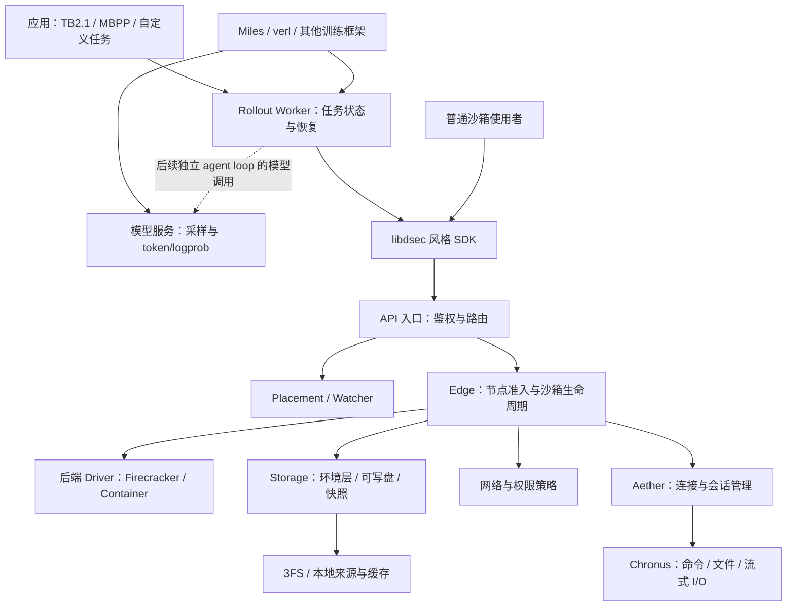

# DSec 模块化重构设计

状态：设计已确认，R0/R1 已实施；R2 本地职责收敛及 R3 计划内实机升级、存储、恢复、共享准入和短应用/GRPO 验收已完成。日期：2026-10-08。
代码基线：`7f70524187e61e13f123c7999098858cf3411bd5`。

## 1. 目标与范围

目标是通用的 DSec 弹性沙箱系统。底层按论文的机制和职责组织，顶层提供稳定的
沙箱 SDK、可恢复的 rollout 服务和可选应用接入。TB2.1、MBPP 是使用者，不决定核心模型。

系统资源管理范围为沙箱：guest RAM、VMM、环境层与可写盘缓存、共享存储服务，
以及创建、暂停、快照、恢复和回收所需资源。模型权重、KV cache、优化器、训练/推理
GPU 显存和模型 offload 归外部框架管理。节点准入可观察外部负载造成的资源压力，
但不卸载模型或调整推理服务配置；worker 的策略请求接口只调用外部模型服务。

本轮先整理模块、依赖与状态所有权，保留已验证行为；明确缺失能力的实现位置和验收条件。
不把重构与增加全部生产能力合并，不改写 Rust 存储组件，不迁入 RL 算法或 GPU 内存补丁。
目录调整通过不代表论文机制已经复现。

论文给出的运行路径包含 libdsec、控制面以及 edge → aether → chronus；存储、内存、CPU
与暂停恢复有各自机制。以[论文 §3、§5、§6、§7](https://arxiv.org/html/2609.22978)为设计依据，
公开描述不足以确认的线协议不宣称兼容。本项目保持 libdsec 风格调用语义，独立定义版本化协议。

### 仓库布局与当前重构边界

正式源码统一放在 `src/dsec/`、`src/dsec_adapters/` 和 `src/dsec_image/`。
历史顶层导入集中于 `compat/python/`，安装后的 import 名称与 CLI 不变；
根目录不再承担 Python 包发现。任务与训练 recipe 保持在可选 `apps/` 中。
安装使用 package metadata，测试使用 unittest discovery，发布工具只决定
源码导出的边界，三者不再通过手写测试文件清单耦合。

Worker 是部署进程的角色，不是所有业务逻辑的归属。episode 执行已按以下边界拆分，
仍在同一进程内组合，不增加服务或第二套恢复状态机：

| 模块 | 职责与状态所有权 |
| --- | --- |
| `rollout/episode.py` | `Episode` 内存记录及原有 version-1 表示，不运行恢复循环 |
| `rollout/episodes.py` | `EpisodeService` 是唯一状态协调者：创建锁、episode 变更锁、持久化顺序、恢复证据和租约释放；创建/暂停/停止等分成命名操作 |
| `rollout/store.py` | `EpisodeStore` 负责独占目录与 fsync，不解释任务生命周期；`RolloutStore` 是同一类的旧名 |
| `rollout/actions.py` | `ActionExecutor` 校验动作身份并提交一次命令，不写 episode、释放租约或自动重试 |
| `rollout/dialogue.py` | 从已提交历史投影对话，不另存一份模型上下文 |
| `rollout/evaluation.py` | `EvaluationService` 校验注册、参数和插件结果，接收显式依赖；不导入 TB2.1，也不提交评分状态 |
| `rollout/server.py` | 私有 RPC 帧、错误序列化、CLI 与进程组合；不写 episode 状态 |
| `compat/rollout_worker.py`、`rollout/worker.py` | 历史构造参数、counter/TB2.1 配置桥接和导入/启动别名；复用 `EpisodeService` 的实现 |

`EpisodeService.dispatch` 在每条 episode 的同一把锁内调用动作、评分和生命周期操作。
动作提交前先持久化 pending，结果确认后再提交历史；UNKNOWN 只按原请求的证据恢复。
动作和评分组件不接管这个提交顺序，也不能从失败或连接中断推断资源已释放。
锁外的状态/对话查询继续读取原记录，避免被长 verifier 阻塞。

当前服务保存的是环境执行状态，不拥有完整的模型采样循环、token/logprob 或训练算法。
未来独立 `AgentRunner` 必须使用这些接口，而不能借 Worker 的名字把模型与训练状态塞回
episode 服务。SDK 的产品入口仍是 API Server，私有 RPC 不成为新的应用入口。

后续继续审查控制面 IAM/API/Placement/Watcher 的依赖方向，分离 Host CLI 的配置、
部署渲染与诊断，并清理 runtime 对历史任务兼容层的反向依赖。
这轮不改变沙盒机制、线协议、持久化字段或训练功能；已有有界模型与受控实现回归仍需
通过。结构重构不替代实机故障、生产隔离或模型训练验收，旧报告保留原始版本语境。

<a id="control-host-decisions"></a>

### 控制面与 Host CLI 的关键设计决策

确认日期：2026-10-20。状态：以下决策已确认，作为下一批重构的约束；不表示
控制面与 Host CLI 的职责拆分已完成。适用范围是既有实现的结构调整，保持现有
API、CLI、线协议、持久化格式与 HA 部署要求；行为变更需要单独说明和验收。

| ID | 决策 | 理由与约束 |
| --- | --- | --- |
| CPH-001 | 每类状态只有一个权威所有者 | IAM/准入账本继续拥有身份、授权、租户配额与准入凭证；Placement 选择节点；API 负责请求身份、路由和查询；Node/Edge 拥有实际节点资源与沙盒生命周期。Watcher 通过已有所有者协调恢复。拆模块继续复用原事务和账本，不复制物理资源账本或执行状态。 |
| CPH-002 | 业务逻辑依赖协议和明确接口，具体装配归组合入口 | 控制面依赖 contracts、存储接口和节点调用接口；执行层负责 Docker/VMM、挂载与网络操作。host 可以装配具体实现，业务模块不反向依赖 CLI、部署脚本或旧兼容入口。真正共享的协议进入 contracts，避免无职责边界的公共工具模块。 |
| CPH-003 | Host CLI 负责参数、配置、组合和运维入口 | 配置校验、诊断、部署渲染、服务启动和验收分别有所属组件。CLI 分支调用组件，不实现第二份授权、放置或恢复逻辑；新增部署方式复用同一套配置与服务构造过程。 |
| CPH-004 | 读取、规划、生成和执行有明确副作用边界 | help、配置解析、基础诊断和只读规划不改变宿主状态；配置读取可读文件但不顺便创建目录或修改环境变量。render 只向显式输出目录生成可审查文件，apply/启动等入口明确执行变更。特权操作继续使用受限 helper 并验证资源归属，保护已有 Docker、网络与服务。 |
| CPH-005 | 故障语义与提交顺序属于兼容约束 | 保留请求 ID、digest、幂等规则、CAS/fencing、持久化顺序和资源释放证据。节点失联、健康检查失败或响应丢失仍可能是 UNKNOWN，不构成停止/释放证明；Watcher 不据此重放副作用、另选执行所有者或释放配额。 |
| CPH-006 | 模块边界与部署边界分别决定 | 拆分职责本身不新增服务进程、RPC 或配置项；按既有部署角色组合模块，保持 HA 与信任边界。模块重命名和迁移不作为增加微服务或降低高可用要求的理由。 |
| CPH-007 | 用可检查的边界和兼容证据验收重构 | 检查依赖方向、新旧配置、请求结果和持久化记录。授权、准入、恢复及并发边界的变化同步审查模型到代码映射并运行对应受控回归；运行行为变化补充相关 Linux 验收。目录调整、fixture 或模型通过都不单独证明生产行为。 |
| CPH-008 | 部署是重构的验收对象 | 从声明式拓扑和节点配置生成只读计划，再生成角色专用部署文件，管理员初始化与服务启动分别执行；单机与多机复用同一实现。明确服务身份、端口、目录、制品版本、凭据归属与依赖顺序。验收覆盖节点加入/退出、重复执行、失败恢复、升级回滚及宿主原服务连续性。CPU/GPU 混合部署中，DSec 只拥有沙盒及其资源预算，模型/GPU 服务由外部系统管理。 |
| CPH-009 | 动态节点成员状态与准入共享 quorum 边界 | 用户于 2026-10-24 要求新节点无需更新/重启控制面加入。etcd 只保存公开路由、版本化成员状态与 IAM 原子更新的在途计数，不保存节点明文凭据或第二份执行状态。ACTIVE 才能接受新准入；维护、退出必须同时检查在途计数和所属 Edge/episode 服务证明。所有管理变更使用预期版本和请求 ID，RETIRED 保留身份墓碑；失联和 UNKNOWN 不释放配额或迁移执行所有者。管理员沿用现有 CA 签发部署包，网关内凭据按节点身份从现有集群密钥派生，并独立要求 mTLS；既有受信基础设施边界不扩大为租户可注册节点。 |

CPH-008 于 2026-10-21 根据“重构要面对部署问题”的要求追加。它扩充验收范围，
不表示批量安装、动态入群或升级回滚已完成，也不扩大现有 HA 验收结论。

CPH-009 是行为扩展，不是包移动。`control.node_lifecycle` 拥有成员决策，IAM 在同一
CAS 中更新配额和节点在途计数；`control.node_admin` 组合 root 项目策略授权与可信节点证明。
`host.node_directory` 只构造 TLS 路由，Watcher 使用有界探测池发现新增节点，Fleet CLI 只访问
管理 API。新状态机、三个必要反例和受控 CAS 回归共同校验准入/维护及延迟恢复边界。
旧配置缺省保持兼容模式；开启管理模式前必须升级所有控制面/Node/episode 服务。
该模式不与仍运行旧准入代码的控制面混用，不自动接管旧 UNKNOWN 准入或扩张项目配额。

CPH-010（2026-10-24）：升级只切换无状态运行程序，复用维护状态、IAM CAS 和原 Edge/episode
持久化目录，不备份恢复运行中账本，也不重建节点身份。目标由经过校验的 wheel 的内容摘要、
包版本和显式协议/持久化兼容契约绑定。Node 必须维护且无在途任务；pending 升级阻止恢复调度和
退役。提交核验目标软件已在网关、Edge、配置的 episode 服务一致加载；回滚核验原软件实际恢复，
二者共用版本条件事务。旧进程/延迟操作不能覆盖新提交。安装在独立目录并保留前版；Host 工具
只显式准备/启动，不自动执行 SSH、sudo、systemd 或 Docker，也不隐式回滚有 UNKNOWN 的操作。
控制面采用固定镜像逐副本重建，沿用原配置、CA、etcd 和数据卷，先核验一个副本再切第二个。
不兼容状态格式、etcd 本身、特权 helper/VMM 更新和凭据轮换另行评审。无版本证明的旧部署必须
先在维护窗口安装支持此契约的基线，不能与不识别 pending 升级的旧控制面混用。

CPH-011（2026-10-24）：认证凭据、TLS 信任与长期路由签名分开轮换。保留现有 route-key
和沙盒地址，Node 内部认证改用独立版本化 key 集；新旧凭据重叠后显式撤销旧材料。TLS 使用
私有、版本化引用文件与不可变材料，文件发布执行预期 generation 的本地 CAS，运行中读者拒绝
旧版本或同版本改写。SDK、控制面共用仅依赖标准库与 contracts 的安全文件/TLS 组件，不导入
Host/runtime。每个请求只选当前认证材料，写请求的未知结果不因轮换而自动重发。信任或证书
pin 撤销在请求接受前重新检查，TLS 握手完成不等于应用请求已获准；接受在先的任务仍可完成。
API token 轮换复用 IAM CAS，只有新 token 可以完成旧 token 撤销，取消则由原 token 证明；
凭据只存摘要，不保存明文 secret。etcd 服务账号通过独立受限身份重叠迁移，不复用 bootstrap
重置身份或账本。根 CA 可按双信任扩展/切换/收缩推进；etcd peer CA、JWT 签名根密钥与路由
签名根密钥不隐式替换，分别需要独立的集群/长期身份迁移方案。所有者密钥、证书和 root
管理员材料仍在管理员/角色专用文件中，轮换不赋予租户注册 Node 或接管执行归属的权限。

实施顺序：先分离 Host CLI 的配置与组合职责，再整理控制面的决策逻辑和传输逻辑，
最后清理反向依赖。模块大小用于发现问题，状态所有权和副作用边界决定拆分位置。

评审重构时引用适用的 CPH 编号，说明保持了哪些约束以及对应证据。若确需改变决策，
在此处记录替代决定、理由和迁移影响，并同步相关依赖门禁、协议或模型映射；不能仅因
移动代码更方便而悄然改变约束。历史验收记录保留其原版本语境。

### Host CLI 的配置与组合边界

Host 配置与本地服务组合按 CPH-002～004 拆分，schema-1、CLI 子命令和已有导入保持兼容。
这是本地职责划分，不改变控制面部署或实际沙盒资源的所有权。

| 模块 | 职责与允许的副作用 |
| --- | --- |
| `host/configuration.py` | 读取配置、复制并规范化内存数据、构造 init 默认值；不创建目录、修改权限/环境或连接服务，只依赖标准库与 contracts |
| `host/composition.py` | 生成参数与 `ServicePlan`：命令、环境覆盖、私有目录、预算和依赖就绪检查的描述；构造计划本身不执行它 |
| `host/services.py` | 显式执行启动计划：原有私有目录检查、预算原子发布、环境配置、依赖等待和 exec；另提供只读状态/就绪查询 |
| `host/deployment.py` | 向显式输出目录生成 systemd/权限文件，或由 init 独占创建配置；不安装生成物或启动服务 |
| `host/diagnostics.py` | 基础只读检查与显式 live 探测，不修复权限 |
| `host/acceptance.py` | 显式 smoke 的任务执行、故障注入、证据和回收；不参与配置加载或启动规划 |
| `host/cli.py` | argparse 与命令路由；保留旧函数导入入口，具体行为委托上述组件 |

启动计划是配置的内存快照；执行时保持原有目录、环境、预算发布和依赖等待顺序。
`--validate-only` 只进入已有的制品校验子进程，不先生成运行目录或预算文件。
共享代理域名校验归 `contracts/network.py`，原 runtime/legacy 导入继续引用同一函数，
避免配置层为复用纯校验而依赖执行层。业务模块不得导入 Host CLI。

该结构不增加 CLI 子命令、RPC、服务进程或配置版本。验收区分配置/规划无副作用、
启动计划执行的调用顺序、生成文件兼容、干净安装和 Linux 实机行为；本地检查不替代
实际服务升级、KVM、网络或权限验收。

### 部署职责与验收顺序

部署按角色组织：控制面副本、etcd 成员、沙盒 Node，以及可选的外部训练/推理服务。
节点 CPU、内存和磁盘不同通过配置与能力表达，不复制部署代码；GPU 服务可以只作为
API 调用方，不要求安装 Edge。若同机运行 Edge，沙盒预算要显式为外部服务保留资源。

| 阶段 | 权威输入/输出与约束 |
| --- | --- |
| 读取与计划 | 声明式拓扑、节点规格和固定制品身份 → 可审查计划；不得生成凭据、创建目录、调用 Docker 或启动进程 |
| 部署文件生成 | 计划 → 私有证书、凭据及角色配置；只写指定新目录，不连服务、不安装依赖、不启动服务 |
| 管理员初始化 | 按节点作用域显式准备 KVM、网络 helper、存储与服务身份；操作必须有归属检查，不能借安装改变已有 Docker/路由 |
| 加入与验收 | 依赖就绪、凭据与能力检查通过后才让 Node 接任务；失败保留可恢复证据，不能将注册等同于物理资源已就绪 |
| 维护与退出 | 先停止新放置并处理在途任务，再升级/回滚/退出；移除路由配置或失联不能代替资源释放证明 |

当前 `deploy/cluster/planning.py` 负责只读拓扑/节点/制品校验与计划，
`configuration.py` 从计划纯生成控制器、Node、初始化和调用方角色配置，
`prepare.py` 负责显式生成部署文件；旧 `prepare(args)` 委托这些组件，CLI 的 `--plan`
只输出计划。计划保存输入快照和 wheel 摘要，生成时若制品改变先拒绝，再从同一份
核验字节写入制品。`export_hosts.py` 继续导出按角色分发的目录，不启动服务。
初始化代码直接使用凭据读取组件，不再通过 Host 的运行服务入口获取它。

批量 Node 清单与统一角色配置已实现：新 `--nodes` 使用 schema-1 清单，旧单 Node
参数归一到同一计划。声明冲突在生成前拒绝；每 Node 独立证书/token，控制器引用
对应 token，按主机导出仅带当地 Node 文件。共享 route key、etcd 身份和信任边界不变。
这覆盖初始部署文件生成；动态入群/退出及升级不能通过重新生成身份替代。

节点预检与受限网络初始化已增加本地实现：`host/node_probe.py` 只读检查 Linux、
KVM/TUN、权限和网络先决条件，作为标准库代码嵌入管理员安装器；
`host/node_setup.py` 结合既有 doctor、目录与预算校验，把 Node 声明绑定到本实例。
Host CLI 只路由 `preflight`/`prepare-node`，后者委托既有 helper 渲染器。
缺少设备或 capability 的受限容器在写入前拒绝，不按供应商名称封禁。
安装时重新检查实时平台和固定运行身份，不采信预检文件；microVM Node 网关在
创建状态与连接控制面前执行平台门禁。此流程不安装软件、加载模块、创建账号或
启动服务，不扩张 helper 权限和状态所有权。已通过独立 wheel 在 Linux 既有文件后端和
OverlayBD Host 配置上做只读预检，验证了缺少网络配置与停机后存储 socket 缺失的分类。
普通账户无法读取 PID 1 命名空间时明确标为待管理员核实，不误报通过或不匹配。
2026-10-24 已在既有 Linux 宿主的新独立实例完成实测：9 项管理员检查覆盖只检查不安装、
真实 capability/NoNewPrivs/私有挂载命名空间拒绝、制品篡改拒绝、首文件发布后的部分安装
状态续跑、重复安装与拒绝覆盖不同内容；13 项普通账户检查覆盖 helper 参数/目录/槽位边界、
真实 512 MiB VM 的 UID 与网络命名空间证明、guest 命令及路由、拒绝删除运行中 VM 网络、
SDK 停止和资源清理。最后 3 项收尾检查确认只撤销本次临时权限和新增的 5 条规则，宿主
网卡、路由、防火墙与原容器 PID/启动身份保持基线一致。测试没有安装应用或使用 GPU。
这仍不是空白宿主自动部署、对抗式隔离认证或集群节点动态退役的验收。

加入/维护/退出已按 CPH-009 接入正式管理 API。两机验收覆盖新 Node 动态发现、
实际容器与 episode 的排空/维护/恢复/退役、网关恢复和控制面/etcd 成员故障；
三个 etcd 成员同在 Mac，不能据此宣称独立故障域 HA。兼容运行程序升级与回滚已按
CPH-010 实现：独立目录暂存、版本化维护事务和已加载软件证明，控制面只切换单个副本镜像。
两机容器 Node 验收覆盖正常升级、启动失败后恢复源版本、通过新事务返回保留版本、历史
episode/reward 读取，以及 API 逐副本升级/回滚；不包含任意旧版本或状态格式迁移。
接下来收敛凭据轮换与干净宿主部署。
每一步沿用既有 runtime、IAM 与 helper，
不另造安装状态库或执行账本。验收须从干净 Linux 节点按发布指南完成，测试重复执行、
中断恢复和已有服务连续性；本轮固定实例验收不能替代这些后续流程的完整部署验收。

### 控制面决策与传输边界

控制面按 CPH-001、002、005～007 分离决策和传输；模块迁移不改变部署角色、
认证顺序、请求格式、超时、资源账本或持久化版本。

| 模块 | 职责 |
| --- | --- |
| `control/cluster_api.py`、`rollout_api.py` | 通过注入的 IAM、Placement、Node 接口鉴权、准入和路由；不创建网络连接 |
| `control/iam.py`、`cluster_inventory.py` | 在原协调存储事务上校验身份、配额和回执；不依赖 etcd 的 HTTP/TLS 实现 |
| `control/placement.py`、`watcher.py` | 从观察结果选择候选、管理观察的新鲜度；不持有第二份物理资源账本 |
| `control/node_gateway.py` | Node 的准入串行边界、DISPATCHED 先写后发、身份转换、证明校验和恢复/释放判断 |
| `control/rollout_gateway.py` | 通过注入的 worker/inspection 接口核对 episode 与物理沙盒证明；worker 仍是 episode 运行状态的所有者 |
| `host/node_transport.py` | `NodeRPC` 解读已有 Node RPC 信封，`RemoteNode` 编码发送；不重试、不重新放置、不自行解释失联为释放 |
| `host/cluster_http.py` | TLS、内部控制器凭据、HTTP 帧、并发界限和错误响应；业务函数由组合入口注入 |
| `control/coordination.py`、`etcd_auth.py` | 既有 etcd 传输与凭据续期实现；仅由组合入口提供给 IAM |
| `host/cluster.py` | 组合真实 store、SDK 私有 UDS 连接、Node RPC 和 HTTP 服务，负责进程启动/停止 |
| `contracts/rpc.py` | 共享远端错误身份；SDK 保留旧错误导入，决策代码不再为捕获错误而导入 SDK |

`host.cluster_node.NodeGateway` 保留历史构造与 `.dispatch()` 用法：薄子类继承同一组
准入/恢复方法，仅将 dispatch 委托 `NodeRPC`。正式组合直接使用控制面类和独立
`NodeRPC`，不经过兼容子类。旧 `host.rollout_gateway` 是规范模块的同一对象别名，
旧 `RemoteNode` 导入引用同一传输类。兼容层不得新增决策。

模型到代码映射指向规范的 `control/node_gateway.py`、`control/rollout_gateway.py`：
`ClusterAdmission` 的配额、唯一 owner、释放证明与 `RolloutDispatch` 的首次发送健康条件、
禁止重放、清理证明保持原边界。受控回归使用正式类，mutation 门禁直接修改规范方法，
不能只验证未用于生产组合的兼容副本。依赖门禁同时检查业务无 Host/SDK/具体传输依赖、
传输无决策模块依赖，以及旧导入和异常对象身份。

## 2. 逻辑架构



图是目标逻辑架构。虚线表示尚未完整实现的训练生命周期解耦，不是已上线功能。
FnCall 将来走单独执行路径；当前不提供。完整 VM、分布式 IAM/placement/watcher 也不冒充已实现。

**模块不等于服务进程。** 首个部署仍是单机：API 路由与 Edge 可以同进程，placement
只有一个候选节点，worker 独立运行。保持请求入口和职责边界，以后再拆服务。
普通沙箱操作无需经过 rollout worker；需要 episode 管理的应用才使用它。

## 3. 顶层模块

采用一个 `dsec` Python 包，先保留现有发行包名称和 CLI。八个核心模块如下。

| 模块 | 职责 | 禁止承担的职责 |
| --- | --- | --- |
| `contracts` | Spec、ID、能力、错误、结果、协议版本和恢复状态 | 启动进程、读宿主资源、导入任务插件 |
| `sdk` | 薄客户端、沙箱句柄、请求关联、attach/query、libdsec 风格参数 | 启动 Docker/VMM、挂载磁盘、管理 sudo |
| `control` | 请求入口、授权边界、节点路由、placement 与 watcher 接口 | 保存第二份沙箱执行状态、执行 guest 命令 |
| `runtime` | Edge、生命周期、节点准入、后端驱动、会话、隔离、ready 池 | TB2 评分、模型解析、训练算法 |
| `storage` | 环境清单、分层、来源、缓存、块设备、快照与发布 | 驱动 rollout、分配 CPU、操作训练显存 |
| `rollout` | episode、动作与对话日志、任务插件调用、评分证据、恢复 | GRPO/GAE、模型特有解析、直接调用 VMM |
| `observability` | 事件与指标定义、采样、统计口径、Prometheus 导出 | 决定生命周期、把采样异常解释为任务失败 |
| `host` | 部署配置、依赖检查、安装计划、权限 helper、服务组合 | 在普通 SDK 调用中修改宿主全局配置 |

建议目录：

```text
src/dsec/
  contracts/       sandbox.py  environment.py  execution.py  protocol.py
  sdk/             client.py  sandbox.py  rollout.py  transport.py
  control/         api.py  routing.py  placement.py  watcher.py  authorization.py
  runtime/
    edge.py  registry.py  lifecycle.py  admission.py  resources.py  pool.py
    backends/      firecracker.py  container.py
    sessions/      channel.py  dispatcher.py
    isolation/     network.py  policy.py
  storage/
    catalog.py  layers.py  sources.py  cache.py  devices.py
    snapshots.py  publication.py  integrity.py
  rollout/         worker.py  episodes.py  actions.py  dialogue.py  evaluation.py
  observability/   events.py  meters.py  prometheus.py
  host/            configuration.py  doctor.py  install.py  privileged_helper.py
native/            guest_agent/（现有 C 实现，随后演进 aether/chronus）
integrations/      miles/  verl/（可选依赖与薄适配器）
apps/              tb21/  mbpp/（任务、数据准备、评分器、示例配置）
tests/             unit/  contracts/  integration/  acceptance/  packaging/
```

这是职责分组，不要求一次创建所有文件。暂未实现的 IAM 等能力在设计中保留边界，
不增加空服务、假的成功响应或无用抽象。每个实现只保留一个正式位置。

## 4. 底层机制的约束

以下是本项目的实现约束；当前状态依据代码和[路线图](../../ROADMAP.md)，不是目标能力清单的完成声明。

| 领域 | 目标实现与约束 | 当前需要处理的差距 |
| --- | --- | --- |
| 环境组合 | 显式区分 base、workspace、toolkit；不可变只读层共享，实例写入私有层；离线合并保留删除语义 | 不再让 `tb2-*` ID 决定核心存储行为；合并策略进入通用发布流程 |
| 按需存储 | 可选 local/3FS 来源；元数据与数据的布局能力显式声明；读取粒度、缓存与实际远端读取可追踪 | 不把本地全量预置描述为远端按需验证；3FS 本机部署不等于分布式验收 |
| microVM 磁盘 | 只读 EROFS 层与 OverlayBD＋ublk 可写 ext4 盘分别建模；需要 Docker data-root 时提供独立可写盘 | 现有存储组件继续复用；不把 FUSE 单盘组合设为唯一正式路径 |
| 内存 | DAX 用于适合共享的只读层；DAMON/FPR 是另一种回收策略；按设备和内核能力验证组合 | 当前 DAX 本地 backing 限制明确暴露；不能把两个 VM 的验证扩展为所有配置 |
| CPU | LS/BE 调度策略属于 runtime resource policy，记录逻辑 CPU/SMT 和实际应用状态 | 现有容器验证不能代表 VMM QoS 已完成 |
| 暂停恢复 | microVM 的暂停检查点与终止 VMM 分开记录；恢复继续原身份。容器冻结与内存卸载分别声明能力 | 不把 Docker pause 当作内存卸载已完成 |
| 环境发布 | `pack_diff` 发布磁盘增量；经过构建身份隔离、残留清理、完整性检查后成为新环境 | 现有磁盘 COW 是基础；prepared-state fork 不替代完整发布流程 |
| 会话执行 | Edge 管资源；aether 管连接与 session；chronus 管 session 内操作 | 当前 `guest_agent.c` 是单连接命令原型，尚非完整多会话、流式实现 |
| 安全 | Edge 通过受限 helper 应用实例策略；文件/socket 保护与出网策略分别建模 | netns 不等于完整 eBPF/AppArmor；宿主容器路径只保留可信开发/对照定位 |

特别区分两类 FUSE：3FS 客户端使用 FUSE，与自建的 EROFS 多层呈现/转发实现不是同一组件。
不能仅因使用或移除 FUSE，就判断是否与论文对齐。

ready 池、内存基线分叉和本地代理属于工程扩展，保留为显式选项。普通创建、池命中与
基线分叉分别统计；不把池中就绪实例的领取时间作为冷启动时间。

## 5. 状态所有权与依赖规则

| 状态 | 唯一负责模块 | 其他模块的权限 |
| --- | --- | --- |
| 沙箱生命周期、TTL、VMM 身份、网络/磁盘句柄、节点资源租约 | Runtime Edge | 查询或提交命令，不直接修改 registry |
| 不可变环境与快照对象、内容摘要、依赖、存储引用 | Storage | Edge 持有租约；停止后确认释放；回收由 Storage 根据引用和租约决定 |
| rollout、step/action ID、对话、任务预算、评分及证据 | Rollout Worker | SDK/训练框架通过协议读取与提交 |
| token/logprob、模型权重、优化器、原生训练样本 | 训练框架；将来的持久策略记录由明确的轨迹存储接口承接 | Worker 可保留原始响应及引用，不用文本伪造 token/logprob |
| 节点健康、负载和 placement 视图 | Control 的派生视图 | 从 Edge 重建，不作为沙箱是否存在的事实源 |
| 项目权限及配额（后续） | Control authorization | Edge 仍须做本地准入；权限与余量不能互相替代 |
| 监控样本与聚合指标 | Observability | 可失效或重建，不作为动作是否执行的证据 |

节点 CPU/内存/磁盘/网络的物理资源账本最终由 Edge 管；worker 保留作业并发/API 限额。
现有 `WorkScheduler` 的节点预留迁入该账本，过渡期间只保留一个预留路径，避免两个服务
分别扣除同一份内存。API 额度的部署共享范围必须明确，不能每个 worker 各算一份全局额度。

依赖规则：

- `contracts` 不依赖其他项目模块；`sdk` 只依赖 contracts 和客户端传输。
- control、runtime、storage、rollout 通过 contracts 中的接口或消息交互，不导入彼此的具体驱动。
- 后端不管理 episode，storage 不导入 runtime；Edge 用组合方式连接两者。
- 任务与训练集成依赖核心；核心不依赖 `apps`、Miles、verl、OpenEnv 或 benchmark 特例。
- host 作为服务组合入口注入实现，不被 SDK 或 contracts 导入；监控接收事实，策略另有明确接口。

## 6. 关键接口与执行流程

### 6.1 接口

`SandboxSpec` 表达 backend、environment digest、资源限制、TTL、网络策略、初始身份和
storage/memory/QoS policy。`EnvironmentManifest` 表达层角色、顺序、格式、依赖摘要和
验证要求。`FrameworkProfile` 暂作兼容配置入口，逐步转换为这些通用对象；不再用实验名
`e3_mixed` 或任务名前缀表达内核能力。

`Capabilities` 至少区分 command、persistent session、streaming、file I/O、pause、
memory offload、disk snapshot、memory restore、prepared fork、pack_diff、DAX 和 QoS。
能力结果包含不支持的原因，并校验组合；不能只列一组与当前环境无关的布尔值。

后端 Driver 提供 launch、inspect、freeze、checkpoint、restore、terminate 等运行原语；
命令执行属于 SessionChannel。Storage 提供 prepare、create_writable、checkpoint_disk、
publish_diff、release 等接口。具体系统调用留在各实现内，不传入 TB2 任务路径。

### 6.2 创建和执行

1. SDK 提交稳定 request ID 和 SandboxSpec，由 API 路由至 Edge。
2. Edge 校验能力与当前资源，持久记录创建意图，取得资源/存储/网络句柄，启动后端。
3. 会话通道就绪并核对身份后才返回 READY；失败按已取得资源逆序补偿并记录未决项。
4. exec 带 sandbox/session/action ID 经入口路由。接收、完成和结果落盘有独立状态。
5. 调用方断线只说明结果未知；查询或对账后处理，不自动重放有副作用的命令。

UNKNOWN 是动作结果状态，不是健康检查立即销毁实例的理由。健康检查使用独立控制连接
或保留容量，避免长命令占满连接池后误判。命令、RPC、episode、verifier 的超时分别配置。
输出采集上限、模型反馈截断和原始证据保留也分别配置。

### 6.3 暂停、分叉与发布

- 同一 episode 暂停/恢复保留身份、对话和已完成动作；状态可恢复后再确认完成。
- 准备态分叉产生新 sandbox/rollout ID、私有写入和独立历史；共享只读基线及引用。
- `pack_diff` 输出新环境的磁盘状态，不带旧会话、任务答案、worker 日志或模型上下文。
- stop 可重复调用；资源实际释放前保留租约和清理进度，不先宣告成功或永久漏占资源。

跨进程恢复必须依赖版本化 journal 和实际进程/设备身份核对；不能根据一个 PID 或旧
目录名就操作宿主进程。一般副作用不承诺任意故障下 exactly-once，保持未知状态和证据。

### 6.4 任务与 RL

TaskAdapter 负责 instruction、准备要求、动作解释和 verifier；Worker 负责持久推进及评分
记录；TrainerAdapter 负责模型模板、采样、原生 token/logprob 与训练样本转换。GRPO 分组身份
由训练框架保留，未知或失败 slot 不通过压缩数组替换成其他任务的样本。

现有 reset/step/evaluate/stop 入口和[反馈协议](AGENT_ENVIRONMENT_CONTRACT.md)继续有效。
MBPP 的评分回执与 TB2 的 worker 评分路径逐步接到同一证据接口，但保留原奖励语义。
任务未通过、预算耗尽、评分器故障、动作 UNKNOWN 分开记录；infra error 不伪装成模型零分。

短期仍允许训练框架驱动 agent loop。完整论文式解耦作为独立里程碑：worker 与 agent sandbox
承接运行状态，通过可重连的策略接口请求推理，训练进程退出后可继续或安全暂停。
仅持久保存 shell 日志不能宣称已完成该能力；缺失旧 TITO 的 episode 不进入训练更新。

## 7. 现有代码迁移位置

| 当前文件或组件 | 目标位置与必要拆分 |
| --- | --- |
| `sandbox_client.py`、`libdsec_compat.py` | sdk；容器启动和 journal 管理从客户端移至 Edge |
| `scheduled_dsec.py`、`rollout_client.py` | sdk 的 rollout 客户端；不导入服务端 scheduler 实现 |
| `sandbox_sdk.py`、`durable_manager.py` | runtime edge/lifecycle/registry/pool；组合替代管理器继承耦合 |
| `sandboxd.py` | control 入口及 host 服务组合；不再绑定 TB2 verifier |
| `microvm.py`、`container_backend.py`、容器 supervisor/broker | runtime backends；共享生命周期约束、保留后端差异 |
| `network_namespace.py`、权限 helper、`egress_proxy.py` | runtime isolation 与 host 管理端；策略与安装分开 |
| catalog、OverlayBD/ublk client、共享层、artifact publisher/integrity | storage；统一对象引用与发布流程 |
| `work_scheduler.py`、`admission_guard.py`、`work_journal.py` | runtime admission/resource 账本与 rollout 作业/API 限额拆分 |
| `rollout_workerd.py`、`rollout_store.py`、`agent_environment.py` | rollout 与 contracts；shell 格式化单独模块；任务分支移出 worker |
| resource meter/monitor、shared service monitor | observability；保留实例/共享服务/节点的不同统计边界 |
| `tb2_*` 与 adapters 内 TB2 清单和 verifier | apps/tb21；通过插件注册，不由核心按 ID 猜测任务类型 |
| Miles adapters、OpenEnv 兼容入口 | 可选 integrations；通用任务契约留核心，框架细节移出 |
| `dsec_host.py`、service admin、安装模板 | host；CLI 薄入口调用正式模块，不复制业务逻辑 |

旧顶层 import 在过渡期保留薄转发与弃用说明，禁止新旧两套实现并存。对安装入口、配置格式、
journal schema、环境摘要、已有实例路径分别做兼容检查；不能靠重新创建所有实例掩盖恢复回归。
权限 helper 的升级单独出安装计划，不借重构修改宿主 Docker、Grafana 或全局网络。

## 8. 分阶段实施与验收

| 阶段 | 交付 | 通过条件 |
| --- | --- | --- |
| R0：契约冻结 | 本设计、现有 API/CLI/schema 清单、模块依赖基线、恢复和安全不变量 | 审阅确认；可区分机械迁移与行为变化 |
| R1：模块搬迁 | 先 contracts/storage，再 runtime/host，随后 sdk/control/rollout；移动已有实现，保留兼容 shim | 当前 CI、发行归档、旧 import 和入口通过；核心不导入 benchmark/训练依赖 |
| R2：职责收敛 | 薄 SDK、统一 Edge 生命周期/节点账本、任务插件、明确 session/storage 接口 | 容器路径不再由 SDK 管宿主；无双重资源预留；UNKNOWN 和重启恢复契约通过 |
| R3：真实回归 | Linux 沙箱生命周期、存储与并发回归；TB2.1/MBPP 接入检查；短 GRPO 接口验收 | 独立写入、恢复、不重复动作、评分证据与清理通过；与基线比较创建/执行开销 |

R1 不启动新功能开发。R2 涉及行为的改变拆成独立小提交，分别验收后再推进；安装或 journal
迁移有 dry-run、备份和回滚步骤。不中途替换存储格式，不清理仍被引用的基线或历史证据。

R3 不重复整轮 187 update 的模型效果实验，也不重跑全部 TB2.1 成功率来证明目录重构。
用固定命令工作负载检查执行与资源行为，再用已有固定应用样本完成一次创建、评分和短训练
闭环。若更改奖励、样本或模型上下文语义，则另立实验，不以旧训练成绩为验证。

重构结束标准：模块边界、单一状态所有权、客户端/插件独立安装、兼容入口、故障回归及
真实短验收通过。之后按路线图补齐 aether/chronus、完整 pack_diff、独立 agent loop 和生产隔离，
不在本轮夹带完整 VM、FnCall、多节点平台或新的 GPU 调优。

验收报告分开记录“代码已实现”和“真实执行已验证”。原始证据不覆盖；设计决定和变更原因
维护在本文，优先级维护在 ROADMAP，避免每次改动新增临时 Markdown 和执行脚本。

## 9. 本提案的默认选择

1. 保持 Python 主体、现有 C guest agent 与 Rust OverlayBD/ublk；不进行语言重写。
2. 保持单机可安装，同时采用论文的逻辑组件边界；生产缺口明确报出。
3. 核心不含任务集、模型和训练算法；OpenEnv 为可选兼容入口。
4. 已验证存储和恢复路径优先复用；DAX、FPR、QoS、ready 池通过可验证的能力/策略组合启用。
5. 状态所有权与故障语义优先于文件数量和命名；每一轮迁移都有可停止的验收边界。

## 10. 实施节点

契约验收确认：用户于 2026-10-08 确认契约通过验收，并明确系统只负责沙箱。
据此冻结模块职责、状态所有权、资源管理范围以及 R0 兼容基线，进入 R2 职责收敛。
该确认是契约关卡的通过记录；R3 Linux/KVM 和真实训练运行关卡保持待验收状态。

### R0/R1：契约冻结与通用模块迁移

资源字段及默认值、请求摘要、变更操作集合和 CLI 入口固定在
[兼容基线](../../tests/contracts/v01_compatibility.json)。
[契约回归](../../tests/contracts/test_module_boundaries.py)检查旧/新导入身份、旧 journal 恢复、
依赖方向，以及 guest/root helper 的独立源码边界。

37 个通用顶层实现迁入 `src/dsec`，旧路径作为模块别名转发。存储、客户端、runtime、
worker、host 和采样实现只有一份；请求/资源契约与文件持久化原语已提取。
除请求/资源定义拆分外，迁移代码移除 import 后的 AST 与基线一致；权限 helper 源码
与基线逐字节相同。未连接实验机、升级 helper 或改变运行服务。

发行工具支持 `src/dsec` 的 package-dir 映射，源码归档包含新包和契约 fixture。
独立虚拟环境从 wheel 安装、脱离源码目录检查了 12 个兼容别名与 5 个 CLI；这不是第二台
Linux 主机或真实 microVM 验收。Mac 上 Linux 专用检查仍须明确跳过。

本节点运行 210 项检查：203 通过、7 跳过，无失败或错误。包含既有核心回归、两个应用
回归、契约检查与发行归档检查；跳过项涉及 Linux `/proc`/设备要求或缺失的历史实验
工作区。当前记录不包含 Linux CI 结果或运行中服务升级验收。

R1 节点结束时的 R2 剩余工作：旧 façade 的容器管理移入 Edge、worker/API 内 TB2 特例插件化、节点账本
与作业/API 限额分离、生命周期管理器拆分，以及 session/storage 接口收敛。
`compat.libdsec` 和现有 profile 验证规则是迁移期间的兼容边界，不是最终薄 SDK 或通用
能力解析器。`service_admin.py` 暂保留原路径，保护其旧脚本身份检查；任务集成仍按现有
包安装。R3 的真实 Linux/KVM 和短训练验证尚未执行。

### R2：worker 评分插件节点

评分接口提取至 `contracts.evaluation`，TB2.1 官方 verifier 规则移至可选
`apps/tb21`；旧请求和配置通过 `compat` 转接。通用 worker 的导入与构造不加载
TB2.1 应用，配置缺失在分配状态目录前报错。通用 SDK 可以选择部署方已注册的评分器。
worker 持有评分身份、参数、结果提交与 UNKNOWN 状态；插件只负责任务规则和执行评分。

评分取消或结果无效不会成为零分；新完成记录核对评分器身份和参数后返回缓存结果，
旧 TB2 完成记录仍能读取且不重跑 verifier。命令转换后的实际提交值随动作保存，
防止重启后按新配置重新解释旧动作。[评分契约](AGENT_ENVIRONMENT_CONTRACT.md#worker-评分插件)
描述边界，[故障回归](../../tests/unit/test_worker_evaluators.py)覆盖中断、错误证据、
结果与参数变更，以及禁止 RPC 动态加载代码。

本地共运行 221 项回归，214 通过、7 项因 Linux 条件跳过，无失败或错误。
独立 wheel 环境验证了核心单独安装、可选应用缺失时的预检查、安装应用后的注册和
任务/参数约束。源码归档、文档链接及核心 wheel 边界检查通过。

本节点尚未迁移 TB2 manifest/API 规则和 adapter；PATH 修复仍由兼容桥保留。
本评分插件节点结束时，薄 SDK/Edge 容器生命周期、节点资源账本和 session/storage 收敛尚未完成。
本地插件与发行回归不替代 R3 的真实 Linux/KVM、运行服务升级和短训练验收。

### R2：薄 SDK 与容器 Edge 节点

libdsec 风格参数提取至 `contracts.sandbox`；正式客户端成为 `sdk.client`。
旧 façade 路径只转发同一模块。客户端不再持有 Docker 后端、制品目录或容器 journal，
运行时通过同一 Unix socket 接收容器创建、状态、执行、查询和停止请求。
运行参数的校验在客户端及 Edge 执行，制品/目录的解析只在 Edge 执行。

容器 Edge 接管既有后端与生命周期 journal；请求记录仍用原 create/stop 摘要和 schema，
没有套入第二份 microVM journal。实例目录独占锁阻止两个 Edge 同时管理同一根目录；
执行/停止的互斥在副作用前生效，读取状态与请求不占用前台工作计数。
容器停止后释放服务内的句柄缓存。关闭客户端或服务的 owner handle 不停止容器。

结果提交失败和后端执行失败统一报告 UNKNOWN；原记录只能凭状态证明完成，不能重做副作用。
SDK 对稳定 ID 请求取消隐式换号重试，以免 worker journal 与实际请求脱节。
新客户端要求服务公布 `container-rpc-v1`，不向旧服务静默退回宿主 Docker。
配置归属与升级边界见[安装配置](../guides/DSEC_HOST_CONFIGURATION.md#container-runtime-ownership)，
[本地 RPC 故障回归](../../tests/unit/test_container_edge.py)不启动真实 Docker。

本节点完整本地回归 236 项：229 通过、7 项因 Linux 条件跳过。
独立核心 wheel 脱离源码目录通过 14 项 RPC/故障检查、6 个 CLI help、旧导入身份及
可选应用缺失预检查；安装 TB2.1 应用后评分器注册通过。容器资源采样使用服务返回的
身份，不再依赖客户端内部后端对象。源码归档、文档链接和 wheel 边界检查通过。

尚需完成节点账本与作业/API 限额分离、生命周期管理器拆分、session/storage 接口收敛，
以及剩余 TB2 manifest/API 和 adapter 规则迁移。容器 inventory/TTL、生产 VM 隔离仍是
缺失能力；本节点不声称已提供这些机制。R3 真实 Linux/KVM、Docker 升级与短训练待验收。


### R2：节点资源、作业配额与 API 限额分离节点

`contracts.resources` 保留原 `ResourceDemand` / `ResourceBudget` 的字段和默认值，
另提供节点需求、节点预算和 API 限额的显式投影。
`runtime.resources.NodeResourceLedger` 只接收物理资源需求，持有按租约 ID 组织的
预留；汇总由租约派生，返回副本。节点需求与节点预算均不含 API 字段。
Linux `/proc` 采样归节点模块；采样语义不变。

`rollout.scheduler.WorkScheduler` 负责队列、依赖、作业统计与组合准入，
`rollout.quotas` 分别管理 episode 槽及外部 API 的 inflight/RPM/TPM。
原 `work_scheduler` 和 `runtime.scheduler` 转发同一实现，旧资源摘要、worker journal、
报表字段与指标名称保留。新 `resource_scopes` 给出分项视图，兼容 `reserved` 只汇总，
不再执行第二次预留。节点和 episode 取得资源之间不 await；后者失败回滚本次节点租约。
UNKNOWN 恢复即使超过当前预算也保留预留；评分完成和 API 结束均不释放节点资源。

API 并发与速率额度改为调用前同时取得，解决旧实现先扣 RPM/TPM 后等待并发槽的问题。
取消排队请求不占额度；已发起但取消或响应不确定的请求保留速率预留。
一个进程内可显式共享节点账本或 API 限流器；预算不匹配直接拒绝。
这不是跨进程的节点准入或全局 API 额度实现，重启后 API 窗口也不持久化。
预算在构造时配置；直接替换旧调度器 budget 属性会报错，防止只改报表而账本仍按旧限额执行。
原 prepared-fork 测试改为构造时传入两份沙盒的预算，测试内容仍覆盖真实 worker 的基线分叉流程。

本节点完整本地回归 245 项：238 通过、7 项因 Linux 条件跳过。
新核心 wheel 在独立 venv、源码目录之外通过 24 项调度/worker 恢复检查；
未安装任务应用，两个服务入口 help 与三条调度器导入路径的模块身份检查通过。
wheel 包含 119 个运行时 Python 模块，源码归档与文档链接检查通过。
真实内核资源限制、KVM、存储及短 RL 不属于这些本地检查。

本节点完成模块职责分离，**尚未完成 Edge 账本所有权迁移**：
worker 的既有持久 rollout 记录仍负责恢复预留，服务端准入检查仍确认 worker 授权。
后续迁移必须让 Edge 成为唯一持久节点租约入口，并删除旧节点预留路径，不能同时启用两份账本。
生命周期管理器拆分、session/storage 接口及剩余任务规则迁移仍待完成；R3 真实宿主验收未执行。


### R2：Edge 持久节点租约节点

节点租约已迁入 `runtime.node_admission`，正式 `dsec-host` 部署不再由 worker
保管物理预留。Edge 在宿主资源副作用前持久化租约，绑定物理沙箱身份；直接 SDK、
多个连接同一 Edge 的 worker、基线分叉与 ready 池使用同一账本。
worker 只持有作业并发和 API 限额，重启不再次恢复物理预留。

ready VM checkout 在原租约上补足活跃需求，创建、待机与活跃预留分别表达。
guest 虚拟内存上限、物理准入预留与实测 PSS 不互相替代。待机默认降低 CPU/网络
预留，内存/磁盘仍保守保留；默认估计需实验机校准，不能据此宣称池密度或性能收益。
节点预算作用域是一个 Edge 实例，不是整机跨实例全局配额；模型仍归外部框架管理。

TTL 与直接 SDK stop 在实际清理完成后释放节点租约，不依赖 worker 回执。
STOPPED 但清理未完成的实例保留预留，重试继续清理；重启后 UNKNOWN、超预算及缺失
registry 的已绑定租约也保守保留。Docker 查询失败不等于容器消失。
资源不足且确定没有沙箱副作用时返回 `NodeAdmissionBusy`，worker 记录等待原因和时间，
使用原 ID 重试；创建或租约提交不确定时维持 UNKNOWN，不重放副作用。

既有 request/journal 摘要、字段与变更操作集合保留，物理资源 hint 使用额外 envelope；
旧准入 socket 与新 Edge 预算禁止同时启用。升级保留原实例目录及 journal。
[主机配置指南](../guides/DSEC_HOST_CONFIGURATION.md)说明作用域、参数与迁移顺序。

本节点完整本地回归 260 项：253 通过、7 项因环境条件跳过，无失败或错误。
核心 wheel 在源码目录外的独立 venv 通过 53 项节点/容器/调度恢复检查，
未安装 TB2.1/MBPP 应用包；3 个安装后的 CLI 帮助及 wheel/文档边界检查通过。

本节点完成资源所有权迁移，尚需生命周期管理器拆分、session/storage 接口收敛与剩余
任务规则迁出；R3 的真实 Linux/KVM、Docker 升级及应用短训练仍待验收。
本地 RPC 故障检查中的 VMM/Docker 副作用有替身，不能替代真实内核及性能验证。


### R2：生命周期状态转换组件节点

`runtime.transitions.LifecycleController` 已接管既有 OverlayBD 设备核对/释放、
故障处理、TTL 检查、快照暂停、恢复与停止回收，共 9 个方法。
`Sandbox` 仍是唯一运行状态及持久化对象，controller 只保存文件操作依赖，
通过组合使用原有 Driver、Storage、锁和租约；不创建第二份 registry 或执行 journal。
`DurableManager` 重启构造出的 Sandbox 沿用同一入口，不要求给旧记录补新组件字段。

旧 Sandbox 方法保留薄委托，异常身份移入 `contracts.errors` 并由旧路径重导出。
文件操作在 Edge 组合处注入，兼容既有模块级故障注入；controller 不反向导入
lifecycle façade、registry、SDK、worker 或任务模块。9 个方法相对于 `ce09444`
经参数名称与注入调用归一化后 AST 一致：快照 schema、发布/清理顺序、UNKNOWN、
基线分叉读者等待、节点租约释放条件均沿用现有实现，没有新增状态机或存储格式。

本节点完整本地回归 261 项：254 通过、7 项因环境条件跳过，无失败或错误。
核心 wheel 在源码目录外的独立 venv 通过 41 项快照、分叉、节点租约与创建回收检查，
未安装 TB2.1/MBPP 应用包；3 个 CLI 帮助及 wheel/文档边界检查通过。

创建/ready 池调度及 registry 组装仍在兼容管理器中；执行通道和统一 Storage 接口
尚待收敛。本节点只是状态转换职责拆分，不声称生命周期拆分或 R2 已全部完成。
真实 VMM、内核和存储的升级验收仍归 R3；本地检查使用既有故障替身。


### R2：创建、ready 池与持久 registry 组合节点

`runtime.provisioning.SandboxProvisioner` 接管冷创建、准备基线的分叉入口与预热；
`runtime.pool.ReadyPool` 接管 FIFO checkout、前台等待和空闲补位。
组件只持有注入的操作依赖，实例表、状态、锁、条件变量及节点租约仍由同一个 Edge 管理。
既有管理器入口保留薄委托，不增加第二份池或资源账本。

`runtime.registry_store.RegistryRecords` 处理原 v1 记录、恢复核对和未提交快照清理；
Linux 身份核对、pidfd 及原子写入通过 `RegistryOperations` 注入。
`SandboxRegistry` 在创建和恢复 Edge 前取得实例目录独占锁。
正式服务使用 `runtime.edge.open_edge` 组合普通管理器与 registry；旧 `DurableManager`
构造器继续转入同一组合路径，旧导入身份和 `registry_lock` 属性保留。
实例目录、sandbox ID、记录字段和请求摘要未更换；UNKNOWN 不重放副作用。

15 项迁移检查相对于 `d51083c` 的 AST 经参数/注入操作归一化后相同，覆盖池辅助方法、
冷创建/预热、记录处理、创建前置校验与 checkout 分支。
另有三项显式安全改进，不属于机械迁移：退役所有权后旧对象不能再操作由新 Edge 接管的 VM；
服务组装失败只退役线程并关闭进程身份句柄，保留已知存活 VM 及恢复证据；
显式关闭 Edge 仅在沙箱回收成功后释放目录所有权，回收失败可重试。

`detach` 退役控制线程和所有权，保存记录并关闭本进程句柄，保留沙箱；
`close` 由当前所有者停止沙箱并清理资源。两者不混用。
新恢复回归使用真实临时记录及目录锁，覆盖运行态/暂停态接管、所有权冲突、
中断请求 UNKNOWN、进程身份不符、启动/清理失败和旧对象失效；VMM 与进程身份操作有替身。
这不替代 Linux `/proc`、真实 pidfd、KVM、网络及存储验收。

本节点完整本地回归 272 项：265 通过、7 项因环境条件跳过，无失败或错误。
核心 wheel 在源码目录外的独立 venv 通过 51 项快照、创建、分叉、节点及 Edge 恢复检查，
未安装 TB2.1/MBPP 应用包；3 个 CLI help、旧模块身份、wheel/源码归档及文档边界检查通过。
wheel 包含 126 个运行时 Python 模块。执行/session 接口、统一 Storage 接口以及剩余
TB2 manifest/API 和 adapter 规则迁移仍待完成；R2 未全部完成，R3 尚未执行。


### R2：执行契约、dispatcher 与 channel 节点

`contracts.execution` 给出只含值的 `ShellRequest`、原结果字段的 `ShellResult` 和
`CommandChannel` 接口。请求值不持有连接、沙箱状态或 journal；Edge 仍按后端能力校验。
`runtime.sessions.dispatcher.ShellDispatcher` 接管原 Sandbox 的命令/代理/范围校验、自动恢复、
命令派发与失败处理，继续使用原 Sandbox 锁和生命周期入口。
`VsockCommandChannel` 负责原 guest 的一次连接一次命令交换；
`DockerCommandChannel` 负责既有 Docker shell、带请求 ID 的命令日志及结果查询。
MicroVM、容器和旧 SDK 方法保留薄入口；模块级故障注入仍在组装处解析。

命令 bytes、guest 头部、合并输出和返回字段未改动；超时与截断证据原样返回。
容器旧路径缺少 `timed_out` 时不补成 false；UNKNOWN 与命令已完成但退出失败分别处理。
microVM guest 不支持命令级 request ID，仍由 Edge journal 持有原 ID，channel 不假装具备
guest 去重。容器使用原请求 ID/参数及查询证明。两者都不因丢回复或超时自动重试。
`RequestOutcomeUnknown` 移入共享异常契约，SDK 旧路径重导出同一类，runtime 不反向依赖客户端。

相对于 `3763e1a` 的 6 项 AST 归一化检查覆盖 dispatcher、两类通信、查询和容器前置校验。
新增 22 项回归覆盖真实本地 Unix 字节流、UTF-8 长度、分片/断线/拒绝/过大回复、
代理展开后的边界、agent/verifier 预算、原锁串行、命令超时与容器日志 UNKNOWN/冲突。
Docker 执行与 VMM 使用替身，不能替代真实内核和 guest 验收。

本节点完整本地回归 295 项：288 通过、7 项因环境条件跳过，无失败或错误。
核心 wheel 在源码目录外的独立 venv 通过 88 项命令通信、Edge/容器 RPC、日志、快照、
创建及节点回归；未安装任务应用，旧模块/异常身份与 3 个 CLI help 通过。wheel 包含
130 个运行时 Python 模块，源码归档、文档链接及包边界通过。
此处完成执行接口职责收敛，不实现交互式 session、
后台进程、流式 stdout/stderr 或完整 aether/chronus；这些按既有后续机制里程碑推进。
统一 Storage 接口与剩余任务规则迁移仍属 R2；真实 Linux/KVM、Docker 与短 RL 验收仍属 R3。


### R2：运行时 Storage 接口节点

`contracts.storage.DiskStorage` 明确环境准备、私有写盘、磁盘检查点、恢复、验证与释放接口；
`DiskPaths` 只表达目录/root/work 路径，既有设备 ID、daemon 身份和清理状态继续由 Sandbox
持有并写入原 registry。`storage.service.RuntimeStorage` 组合现有 catalog、文件操作和
OverlayBD RootStore，不持有第二份沙箱状态、租约、journal 或引用账本，也不导入 runtime。

创建、恢复、分叉和 registry 的通用环境准备经过同一入口，仍由现有 catalog 校验
local/3FS 来源、EROFS 顺序、内核、DAX 设备索引与 VMM 摘要。准备不复制远端数据。
私有 ext4 和 OverlayBD＋ublk 保留各自机制，checkpoint/restack、稀疏复制、校验及回收
通过同一存储服务。稀疏文件和快照哈希原语已移入 `storage.snapshots`；旧名称为兼容桥，
文件操作与 hash fault hook 在 Edge 组装处晚绑定。

运行时仍协调 guest sync/VMM pause/stop、快照发布与 registry commit，之后才释放节点租约。
分叉读者等待、共享 CAS 引用和 prepared snapshot 发布语义未更换。
设备创建返回的 ID/runtime 先赋给 Sandbox，再进行可能失败的 daemon 身份查询；
身份查询失败保留清理句柄，避免新抽象把已经创建的块设备遗失。
设备删除仍核对 daemon 身份，消失的设备仅清理私有 runtime，不能删除新 daemon 复用的 ID。

12 项限定的 AST 对照相对于 `18342b8` 覆盖哈希/复制原语、snapshot manifest、registry
persist/load 及四处设备获取顺序；不宣称整个生命周期 AST 不变。
13 项新增存储回归覆盖本地 DAX pin、远端层不预读、私有盘隔离、root/work checkpoint
完整性、OverlayBD 层集/内容校验、丢失 restack 回复不重试、daemon 换代与获取后失败清理。
实际 ublk、3FS mount 和 VMM 有替身；本地文件与完整性检查实际执行。

存储能力仅表达对应磁盘机制，runtime 仍核对隔离、quiescence 和配置兼容性。
完整 `publish_diff`/`pack_diff` 仍未支持；本节点不添加虚假的发布成功路径或改变既有 SDK 能力表。
容器只读层继续使用现有 catalog/guest 挂载组件，不由此宣称容器快照或内存卸载已完成。

本节点完整本地回归 309 项：302 通过、7 项因环境条件跳过，无失败或错误。
核心 wheel 在源码目录外的独立 venv 通过 101 项存储、快照、分叉、Edge、命令及容器 RPC
回归；未安装任务应用，旧模块/文件原语身份与 3 个 CLI help 通过。wheel 包含 133 个
运行时 Python 模块，源码归档、文档链接及包边界检查通过。
剩余任务 manifest/API/adapter 规则迁出仍属 R2，
真实 Linux/KVM、Docker、3FS/ublk 与应用短验收仍属 R3。


### R2：可选任务应用与兼容入口节点

TB2.1 的任务 instruction/WORKDIR 适配器、canonical/offline verifier、缓存清单、
固定 suite manifest 校验、verifier 工具盘及 DAX task pin、worker pin 环境配置和历史 PATH
修复统一位于 `apps/tb21/src/dsec_tb21_case`。核心 wheel 不再包含 TB2 JSON 清单。
旧 `dsec_adapters.tb2_*` 和 `tb2_verifier_artifact` 是可选应用的模块别名，保留实现身份、
既有评分请求名与 command digest 字节；明确使用 TB2 功能却未安装应用时给出安装提示。

`control.environments.MicroVMConfiguration` 收集启动配置，通用 catalog 解析留在核心；
旧 `tb2_*` CLI 的 manifest 内容校验按需委托应用。实例 netns、TAP、EROFS、DAX、
OverlayBD＋ublk、ready 调度和生命周期属于通用核心，不因应用迁移而更换机制。
profile 的 verifier storage 校验只核对通用存储值，实际可用性由 Edge 配置的工具盘决定，
不再要求环境 ID 使用 TB2 前缀。旧 registry 字段名、停止记录的历史恢复兼容判断及 CLI
参数名保留，以免把模块整理变成破坏既有部署的数据迁移。

Miles 的通用 policy session 包装移入 `dsec_adapters.miles_session`；OpenEnv TB 循环与
prompt 留在可选应用。旧 `openenv_agent_function` 是 session 别名，显式访问 TB API 时
转发应用实现。普通 DSec/Miles 使用自己的 worker，仍无需 OpenEnv 服务。
两份保留的 Miles 派生源码都带 Apache-2.0 声明及完整许可证；自有源码仍为 MIT。

10 项新回归检查无应用的通用 host/worker/Counter/Miles session、缺失插件诊断、别名与
清单位置、历史 PATH 字节、独立 VM/agent/verifier 预算、manifest 漂移拒绝、原位层/ready
配置和 DAX pin 校验。OpenAI client、VMM 和块设备使用替身；本地文件校验实际执行。
完整 portable 回归 320 项：313 通过、7 项因平台/运行环境限制跳过，无失败或错误。
包边界检查同时覆盖核心与可选应用，CI 增加只安装核心的源码目录外检查。
实际 wheel 在两份独立 venv 验收：只安装核心 104 项全部通过；核心加 TB2.1 应用
93 项中 92 通过、1 项跳过，分别通过 3/4 个 CLI help。14 项限定的 AST/内容对照
确认迁移的任务函数、层/manifest/ready 校验块和三份清单保持原实现；不声称所有
模块 AST 不变。核心不附带 OpenAI SDK，Miles session 测试使用 client 替身。

R2 的本地职责整理至此完成。下一节点是 R3：在真实 Linux 实例验证既有配置/registry
升级、SDK/worker/ready/fork 共用节点账本、EROFS/OverlayBD/ublk/3FS 路径及现有 TB2.1、
MBPP 的短应用回归。本地替身回归不能替代这些验收，也不证明新的论文能力或性能数字。
模型、GPU、KV cache、训练算法与 optimizer 继续属于外部 RL 框架。

### R3：2026-10-08 真实宿主验收进展

安装版 Linux 回归 323 项：322 通过、1 项因发行包不含实验目录别名跳过，
无失败/错误。新 SDK、daemon 和 worker 使用独立 venv，源码路径不参与核心导入。
旧配置/registry 中一台 RUNNING、一台 PAUSED 的 VM 经升级保留身份、私有文件
与动作去重；旧客户端创建的真实 Docker 容器由新版 Edge 接管，也通过相同检查。

直接 SDK 占满节点 CPU 预算时，worker 按 `cpu_budget` 等待；释放后得到一个节点
租约。ready checkout 保持同一 VM 与租约，仅改变活跃需求；本次客户端墙钟
45.68 ms，属于单次池命中，不代表冷创建或规模下的 p95。准备态基线分出两个
顺序 episode，恢复各自进程内存、隔离私有写入；父基线删除后子分支仍可恢复，
最终共享对象回收。TB2.1 官方 verifier 评分 1 使用真实 EROFS、OverlayBD＋ublk
和独立 netns。MBPP 的 64 个固定候选验收通过，32 并发请求受节点预算约束，
实际最高 16 个租约，没有把请求并发描述成物理 VM 并发。

外部原生 verl 的 Qwen3.5-2B、Non-Thinking、LoRA/GRPO（n=8）完成四步和
最终模型/优化器检查点，第 2 步出现混合奖励与非零梯度。80 条生成全部链接评分
证据：72 次真实沙盒执行、8 次明确标注的模型格式零分；6 条到达长度上限。
这验证重构后的应用链路，不是完整 MBPP 学习收益或全部 TB2.1 成功率测试。

两项实机缺陷已修复：服务并发发布预算时共享临时文件会导致 rename 失败；短暂
操作锁竞争会把带固定 ID 的 verifier 请求永久保存成忙碌失败。修复使用独立
临时 inode，并仅对明确未接纳的请求释放 journal intent；UNKNOWN 继续禁止重放。
恢复工具等服务就绪的上限从 30 秒调整为 120 秒，覆盖大只读制品的启动完整性检查。

3FS 使用离线备份的独立副本，恢复原专用 NIC、Soft-RoCE、动态库依赖和私有
挂载传播范围后达到双副本就绪。一个 48,201,728 字节 EROFS 层存入真实 3FS，
两台 VMM 的打开文件均指向该来源，命令执行、暂停恢复、独立写入和最终租约
回收通过。其他层为本地来源，发布哈希校验已预热对象；这不证明冷读取性能或
分布式行为。R3 计划内功能关卡至此通过，第二台全新主机、长时并发/故障与论文
性能对照仍按 roadmap 单独验收。原始证据、首次失败与验收边界见
[安装验收记录](../reports/DSEC_V01_INSTALL_ACCEPTANCE.md)。
